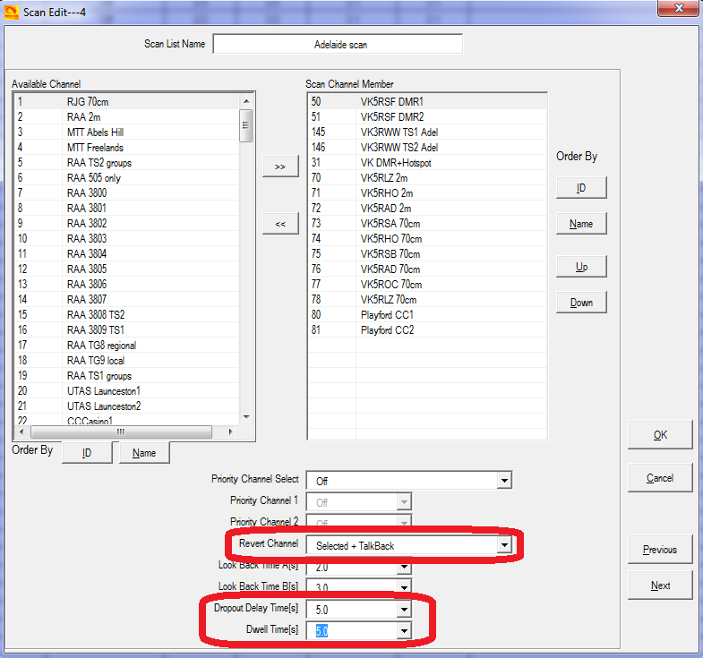
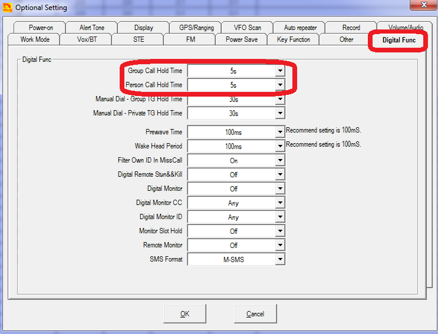

[← All 578 mods](index.md)

!!! note "Author: Jason Reilly VK7ZJA (silent key, January 2023)"
    © Jason Reilly 2018–2022. Jason's pages were preserved by Norman Williams on hamradiosouthernrepeaters.co.uk and are reproduced here, unchanged, so that his work stays available. They will be removed on request from his family. [Original page](https://hamradiosouthernrepeaters.co.uk/images/578Mods/578techmods.html#TalkbackHint)

**How to reply on an active channel found while scanning**
When scan finds an active channel, it is possible to hit the PTT button to reply on that active channel found while scanning. Without these settings, the radio will transmit on your default channel, not the channel found during scan, which can cause some embarrassment. You will have to press the PTT within 5 seconds of the signal dropping, at which time scanning will resume again (5 seconds is the maximum scan hold time allowable).
For each and every scan list you have set up, change these settings as shown:

Also make sure your digital call hold times are set to 5 seconds or more:

------------------------------------------------------------------------
