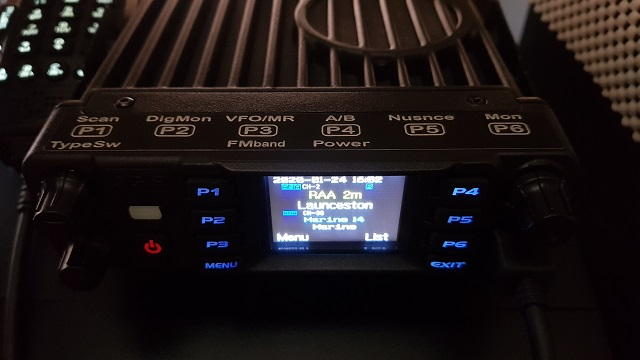

[← All 578 mods](index.md)

!!! note "Author: Jason Reilly VK7ZJA (silent key, January 2023)"
    © Jason Reilly 2018–2022. Jason's pages were preserved by Norman Williams on hamradiosouthernrepeaters.co.uk and are reproduced here, unchanged, so that his work stays available. They will be removed on request from his family. [Original page](https://hamradiosouthernrepeaters.co.uk/images/578Mods/578techmods.html#CustomLabels)

**Custom engraved call sign labels for your radio**
Thanks to Greg KC8GL, you can order a custom laser engraved self adhesive label for your radio that perfectly fits the AnyTone 578 microphone, at a very attractive price. Greg recommends using a black magic permanent ink marker pen to run a line of ink around the white edge of the labels to help hide the white substrate, touching off that professional look once the label is installed. Also check out the lovely cherry wood callsign display plaques that Greg does. I highly recommend them! Greg is a fantastic guy, quick to respond and happy to answer any questions you may have. See his website at: <https://sites.google.com/view/kc8gl/d578uviii-pro-microphone-call-sign-sticker>

Another product that Greg has will be of particular interest to 578 owners. If you have trouble remembering what all the programmed functions go with what button, this is going to be perfect for you. Now you can banish the hand scribbled sticky note you keep by the 578 to remind you of what button does what! Greg has a special web page set up for this very professional sticker at: <https://sites.google.com/view/kc8gl/anytone-578-p-button-cheat-sheet>

------------------------------------------------------------------------
