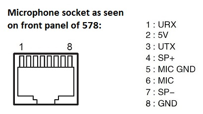
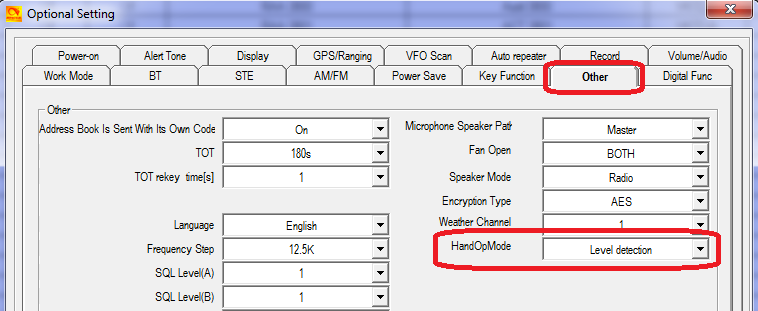
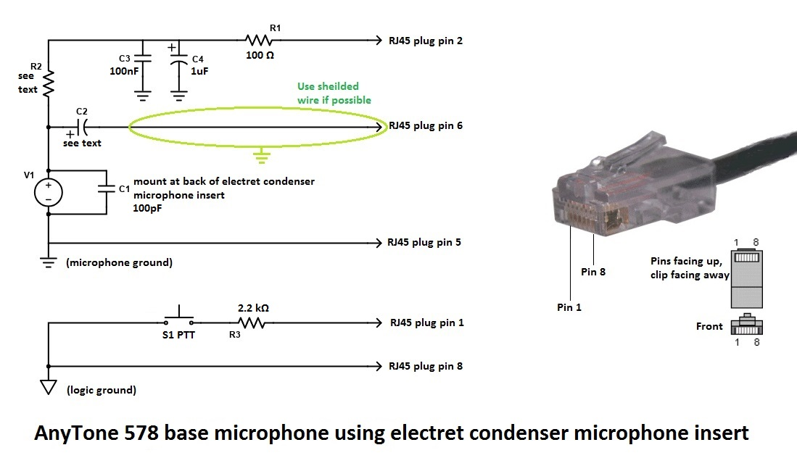

[← All 578 mods](index.md)

!!! note "Author: Jason Reilly VK7ZJA (silent key, January 2023)"
    © Jason Reilly 2018–2022. Jason's pages were preserved by Norman Williams on hamradiosouthernrepeaters.co.uk and are reproduced here, unchanged, so that his work stays available. They will be removed on request from his family. [Original page](https://hamradiosouthernrepeaters.co.uk/images/578Mods/578techmods.html#Microphone)

**Microphone socket pinouts & information AT-D578UV and DR-MD520**

It is now possible to wire up a base microphone to the AnyTone 578 and Alinco DR-MD520. PTT is enabled by connecting pin 1 & 8 on the microphone socket by a 2.2K ohm or 1.0K ohm resistor via your PTT button. You also need to make the following setting in the CPS: HandOpMode set to Level Detection, as seen below here: (this setting is not available in the Alinco DR-MD500, it will only work on the MD520)

Do not use a PTT resistor less than 1.0K ohm, as this could damage the radio.

Here is a general schematic for building or adapting a base microphone to the AnyTone 578 and Alinco DR-MD520. You could use a surplus computer gooseneck microphone and modify that for this use.

R1 is 100 ohms.
R2 can vary from 22k ohms down to 1k ohms, depending on the individual electret microphone insert used. Start with 22k ohms and reduce the value until you reach the microphone gain level desired. Too much gain will cause gross distortion and make your transmissions difficult and unpleasant to listen to.
R3 is 2.2k or 1.5k ohms.
C1 is 100pF and should be mounted directly on the back of the electret condenser microphone insert.
C2 can vary according to your personal preference. Use 10uF electrolytic for a stronger bass response, or 1uF electrolytic for normal use.
C3 is a 100nF (0.1uF) polyester or other similar bypass type capacitor.
C4 is a 1uF electrolytic capacitor.
V1 is an electret condenser microphone insert.
S1 is your PTT button.
*Important:* do not confuse microphone ground and logic ground in the diagram above. The two should be kept separate.

The above schematic could be adapted to using a dynamic microphone, but you will probably need to use a small amplifier in place of C2 to boost the very weak output of the dynamic microphone element. Power it using the same decoupling circuit shown using R1, C3 & C4. R2 is not necessary for dynamic microphone element operation.

*It is not possible to have both original hand microphone and base microphone connected*, or have some sort of switchable tee piece to be able to switch between the two. You can’t even manually swap between the two types of microphone unless you change the CPS setting first - if you leave the setting in Level Detection with the normal microphone connected, not only will the microphone or any of it’s buttons not work, but it will also randomly send the radio into transmit.
The lack of setting HandOpMode in Alinco DR-MD500 means that this model will be unable to have a base microphone used with it.

*Frequently asked question: is the AnyTone QDM-01 base desk microphone compatible with the 578?* Answer: No. At the very least it will require extensive rewiring to suit the 578. I do not have this microphone, so can not tell you exactly how to rewire it, sorry.

------------------------------------------------------------------------
