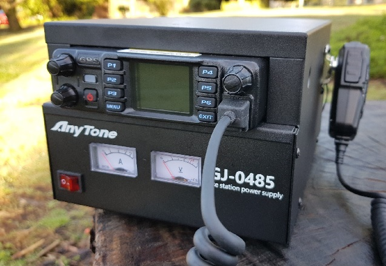

# An integrated power supply & console is available for the 578

[← All 578 mods](index.md)

!!! note "Author: Jason Reilly VK7ZJA (silent key, January 2023)"
    © Jason Reilly 2018–2022. Jason's pages were preserved by Norman Williams on hamradiosouthernrepeaters.co.uk and are reproduced here, with light formatting and spelling edits for readability, so that his work stays available. They will be removed on request from his family. [Original page](https://hamradiosouthernrepeaters.co.uk/images/578Mods/578techmods.html#Console)

Pictured here is AnyTone’s console unit for the 578. It has an in-built 20 amp switch mode power supply with cooling fan, with a carry handle on top and microphone bracket. It is a very neat solution for desk mounting your 578.

