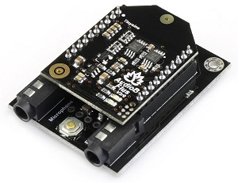

# Using a Bluetooth module for external audio input and output for digital modes etc. Easy

[← All 578 mods](index.md)

!!! note "Author: Jason Reilly VK7ZJA (silent key, January 2023)"
    © Jason Reilly 2018–2022. Jason's pages were preserved by Norman Williams on hamradiosouthernrepeaters.co.uk and are reproduced here, with light formatting and spelling edits for readability, so that his work stays available. They will be removed on request from his family. [Original page](https://hamradiosouthernrepeaters.co.uk/images/578Mods/578techmods.html#BTaudioconnect)

*With thanks to a ham who wished to remain anonymous.*

As an alternative to the above modification of the microphone for connection to a SignaLink, you can use some Bluetooth modules to get audio in and out of the 578, so you can then use digital modes etc. But apparently, many cheap USB Bluetooth adapters are not very good for this purpose. After much experimentation, one ham hit upon a nice little \$12 Bluetooth module that works a treat.

The TinySine Bluetooth adapter converts the Bluetooth connection to a standard pair of 3.5mm audio sockets, one for microphone in, the other for line out. Those are then connected to your PC with standard 3.5mm audio patch cables. It’s powered by a micro USB socket, but this doesn’t form the link to your PC, it is only used to power the TinySine. Easy!

## Radio settings

There are a couple of settings on the radio which you may want to change as well. Under the Bluetooth menu of the radio:

| Setting | Effect |
| --- | --- |
| BT + int mic | If turned on, you are able to use both the hand mic to talk, and the computer to send audio to the 578. |
| BT + int spk | You can decide if you would like to have audio come out of both the radio speaker, and out via Bluetooth going to the computer. |

## Transmitting

To send the radio into transmit, you must use AnyTone’s little Bluetooth PTT button. Another option is to set the HandOpMode to Level Detection (see above information on [microphones](20-microphone.md)) and use whatever digital mode you are using to control PTT, but you will then lose the ability to use the microphone as it must be unplugged for this option to work.

See more information about the TinySine here: <https://www.tinyosshop.com/index.php?route=product/product&path=158_168&product_id=973>

