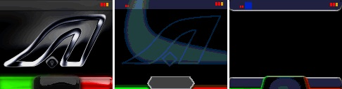

# Custom background display files for your AT-D578UV

[← All 578 mods](index.md)

!!! note "Author: Jason Reilly VK7ZJA (silent key, January 2023)"
    © Jason Reilly 2018–2022. Jason's pages were preserved by Norman Williams on hamradiosouthernrepeaters.co.uk and are reproduced here, with light formatting and spelling edits for readability, so that his work stays available. They will be removed on request from his family. [Original page](https://hamradiosouthernrepeaters.co.uk/images/578Mods/578techmods.html#Backgrounds)

Tim DL2DMC has made available some very nice looking background display files. While these are intended for the 878, they will also work on the 578 too. If you have made your own background display image and would like to share it with others, please get in touch with me by email and I will place it here for everyone.

Download from: <http://www.geoo.de/AnytoneDL/D878UVscreens.zip>

Chris 2E0UKH has made a video preview of these backgrounds and shows you how to upload them to the 878 – the process is practically identical for the 578 too. Take a peek at his YouTube video here: <https://youtu.be/tPMhNEPVgjw>
