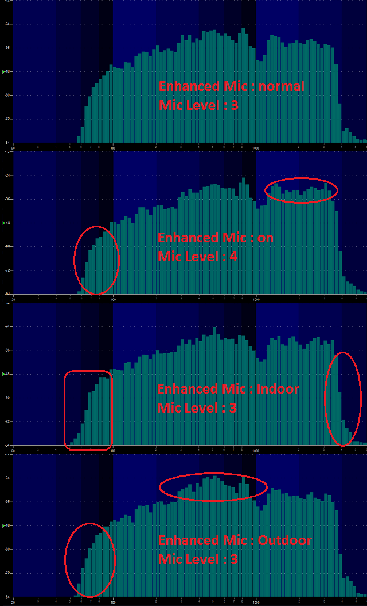

[← All 578 mods](index.md)

!!! note "Author: Jason Reilly VK7ZJA (silent key, January 2023)"
    © Jason Reilly 2018–2022. Jason's pages were preserved by Norman Williams on hamradiosouthernrepeaters.co.uk and are reproduced here, unchanged, so that his work stays available. They will be removed on request from his family. [Original page](https://hamradiosouthernrepeaters.co.uk/images/578Mods/578techmods.html#EnhancedMic)

**Using ’enhanced microphone audio’**
So just what does Mic Enhance (Settings \> Radio Set \> Enhance Sound \> various options) do exactly? Firstly, lets talk about what it does **not** do. Enhance Sound does not have any effect on received audio at all, and it does not have any effect on transmitted analogue FM audio.

What these settings do is to subtly change your voice characteristics when transmitting on DMR.

- *Normal* - this is the standard transmit audio response
- *Mic Enhance* - this rolls off the low end response of the microphone, so if you have a deep and booming voice, this might make your voice a little more pleasant to listen to on DMR. Enabling Mic Enhance causes DMR transmitted audio to be overall a bit quieter, so to compensate for that, bump up your Mic Level up one notch. You could also use Mic Enhance to quieten down your DMR transmitted audio but leave FM transmitted audio level unaffected, if you find that people are telling you that you are too loud on DMR but fine on FM
- *Indoor* - this adds a little bit of extra emphasis at the very top and bottom end of your transmitted audio for a more relaxed, fuller sound
- *Outdoor* - this setting rolls off the low end response of the microphone similar to Mic Enhance, but also adds some mid range emphasis; this might be useful when using the radio in an area with increased background noise, such as in a vehicle

*Experiment with these settings to find the best setting for your situation. At the moment, the Indoor and Outdoor settings are only available from the radio menus, not within the CPS software.*

Shown here is the transmitted audio response plots using a test audio clip transmitted using DMR:

------------------------------------------------------------------------
