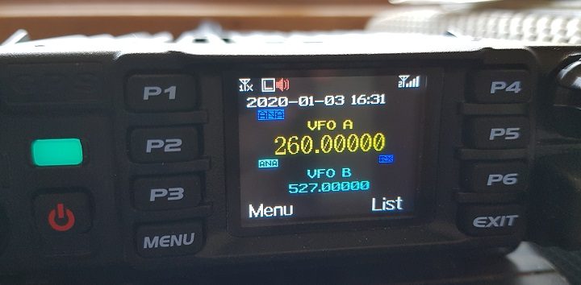

# Expanding RX frequencies Easy

[← All 578 mods](index.md)

!!! note "Author: Jason Reilly VK7ZJA (silent key, January 2023)"
    © Jason Reilly 2018–2022. Jason's pages were preserved by Norman Williams on hamradiosouthernrepeaters.co.uk and are reproduced here, with light formatting and spelling edits for readability, so that his work stays available. They will be removed on request from his family. [Original page](https://hamradiosouthernrepeaters.co.uk/images/578Mods/578techmods.html#ExpandRX)

Difficulty: Easy.

As delivered by the factory, the radio receiver covers 136-174 MHz, 400-480 MHz and 220-225 MHz. There are countries around the world that make use of the radio spectrum above 480 MHz for two way radio, and this modification will allow you to hear those transmissions. TX is intentionally inhibited in these expanded areas.

!!! note
    The modification only opens up the radio hardware; some tricks are still necessary to program out of band frequencies with the CPS software.

!!! tip
    Please go to this page for more up to date info and files - [https://hamradiosouthernrepeaters.co.uk/20-expanding-rx-frequencies.html](../expanding-rx-frequencies.md)

To carry out this modification do the following:

1. Download the firmware package for your radio:
    - Frequency expanded / modified 578 **(non-PLUS model)** firmware package (1.2 Mb), based on v1.16n firmware:
        - [Download via Mega](https://mega.nz/file/Gss2ASCJ#O1BZfDA8SGeluYdrgLQZbVAXeBxv162Z1qb6iCKhHqA)
        - [Download via Google Drive](https://drive.google.com/file/d/1AWclJteohBylg1gUwj2iR3yqC0S3iUQ2/view?usp=sharing)
        - [Download via Sabercat host](https://sabercathost.com/ef8d/D578UV_V1.16n_mod_FW.zip)
    - Frequency expanded / modified 578-II **(PLUS model with airband)** firmware package (2.5 Mb), based on v2.03n firmware:
        - [Download via Mega](https://mega.nz/file/b91R2Rwb#STws9YqoPdjf5yHzHCtqU7vNIhhxQwumDOpFcFGOeVI)
        - [Download via Google Drive](https://drive.google.com/file/d/1k9OuyAKKwtTWT8agvGmVLQ6Xs0IW8UTu/view?usp=sharing)
        - [Download via Sabercat host](https://sabercathost.com/ef8e/D578UVII_V2.03n_mod_FW.zip)
    - Frequency expanded / modified DR-MD520 firmware package (1.2 Mb), based on v1.15 firmware:
        - [Download via Mega](https://mega.nz/file/j9VwCLSJ#udVAe8qQzjWFb4698_LsZj1C1V4nHc24IiBDrM7cNOE)
        - [Download via Google Drive](https://drive.google.com/file/d/1Mh7pqolN7CpXxLE6Hsd2zOn2GBRZAWfO/view?usp=sharing)
        - [Download via Sabercat host](https://sabercathost.com/edqQ/MD520_V1.15mod.zip)

    (Unfortunately there is no frequency expanded firmware for the DR-MD500 model at this point.)

2. Make sure you have downloaded the correct package for your model of radio, and unzip the contents.
3. Make sure you have saved your codeplug (rdt) configuration file.
4. Using the regular firmware updating software & process, send this frequency expanded firmware to the radio.
5. If necessary, update your codeplug / rdt configuration file to be compatible with the version of firmware you have downloaded. If you want to reuse your saved codeplug rdt configuration file, you may need to modify one byte with a hex editor as detailed below.
6. Enjoy ***actual*** extra receive frequency coverage of around 110-281 MHz, and 339-527 MHz (varies from individual radio to radio). On the 578 Plus model only, you will also be able to use the AM Air band up to 144 MHz to cater for those countries that have special air band frequencies above 136 MHz (with thanks to Francesco IK8JHL).

Your mileage may vary of course, due to individual radio & component manufacturing tolerances. You can use the VFO and add memory channels to use these new expanded receive frequency ranges.

!!! note
    With the expanded frequencies, you can’t enter frequencies via keypad direct entry that start with a 3 or 5 (e.g. any frequency in the 300 or 500 MHz range); the only way to get to them is via lots of knob twisting in VFO mode.

## Entering out of band frequencies in the CPS

To enter out of band frequencies in the CPS programming software, you will need to use the export-edit-import method:

1. Program some dummy channels with valid but easy to recognise frequencies, for example 456 MHz.
2. Use the export feature (**Tool → Export → Channel** → give it a name → **Export**) and save your exported channels.
3. Open the exported channels file with a text editor, look for the dummy channels you had previously entered, edit the frequencies as you require, and save the file.
4. Back in the CPS software, use the import feature (**Tool → Import → Channel** → find your edited csv file → **Import**) to bring the channels with out of band edited frequencies into the radio.

*Transmit remains standard according to each MODE.* Note that out of band receive frequencies can be very low in sensitivity due to the excellent front end filtering of these radios.

Refer to the sensitivity plots below:
