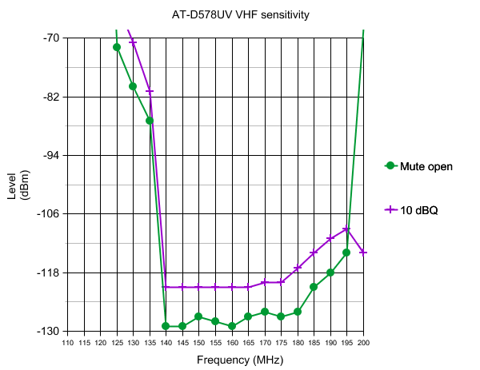
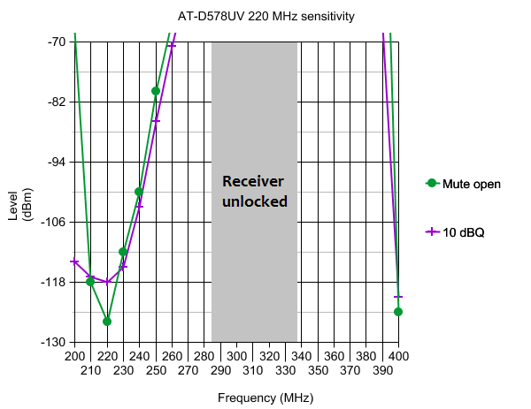
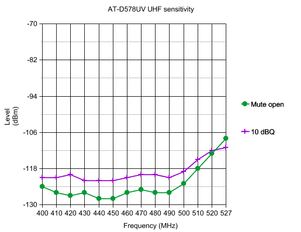
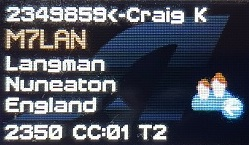

[← All 578 mods](index.md)

!!! note "Author: Jason Reilly VK7ZJA (silent key, January 2023)"
    © Jason Reilly 2018–2022. Jason's pages were preserved by Norman Williams on hamradiosouthernrepeaters.co.uk and are reproduced here, unchanged, so that his work stays available. They will be removed on request from his family. [Original page](https://hamradiosouthernrepeaters.co.uk/images/578Mods/578techmods.html#Measurements)

**578 receiver sensitivity**

**These measurements were all made in Narrowband FM mode. Wideband FM results are 4dB higher. DMR sensitivity is listed as being -117.4dBm for BER 5% and -110dBm for BER 1%**

Summary: 0.18uV VHF // 0.28uV 220 MHz // 0.20uV UHF for 10dBQ (approximates 12dB SINAD) Narrowband FM.

If you are wondering about the sensitivity measurements that are off scale of the above graphs, here are those results for 10dBQ:
110MHz= -34dBm; 115MHz= -22dBm; 120MHz= -49dBm
270MHz= -58dBm; 280MHz= -44dBm; 340MHz= -46dBm; 350MHz= -49dBm; 360MHz= -52dBm; 370MHz= -56dBm; 380MHz= -59dBm; 390MHz= -67dBm

**Transmit RF power output**

*with thanks to Sergei for these measurements*

|                |     |     |      |       |
|----------------|-----|-----|------|-------|
| Test frequency | Low | Mid | High | Turbo |
| 145.5 MHz      | 1.2 | 10  | 25   | 58    |
| 225.0 MHz      | 1.5 | 6.0 | 6.0  | 6.0   |
| 435.0 MHz      | 1.1 | 11  | 26   | 43    |

While these power measurements were taken in analogue FM mode, they will be accurate for DMR as well. Note carefully that unless you have special power measuring test equipment, able to read peak pulse power with a duty cycle correction factor of 0.4615, then your simple power meter will not be able to correctly measure power output in DMR transmit, it will read much lower than the actual figure.

Also included with the frequency expanded firmware package is an alternate font which can be a bit easier to see than the original. Here is an example of what the new alternate font looks like if you are interested.

------------------------------------------------------------------------
