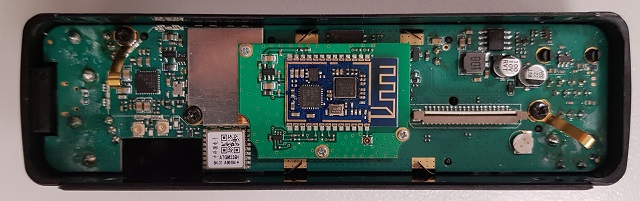
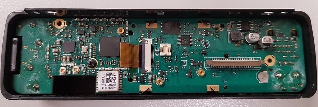
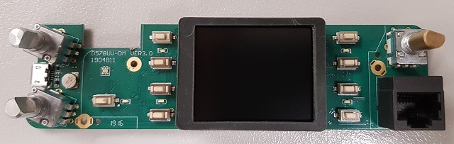
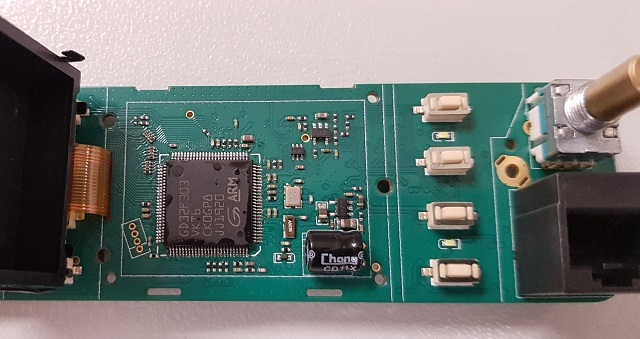
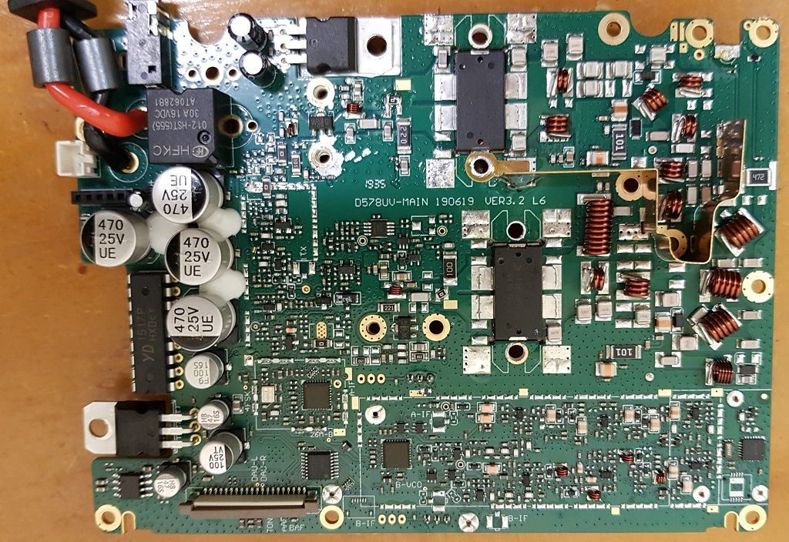
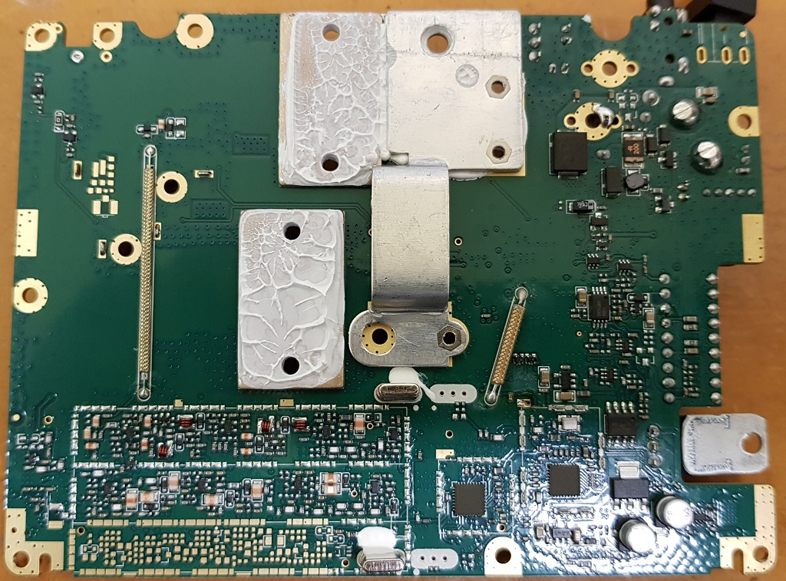
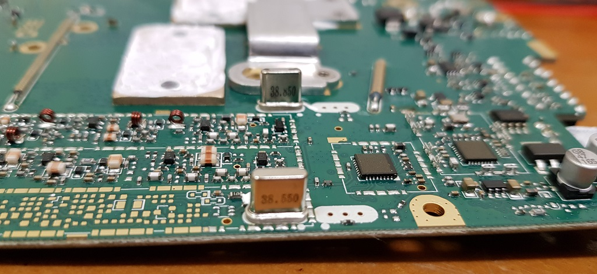

# A look inside the 578

[← All 578 mods](index.md)

!!! note "Author: Jason Reilly VK7ZJA (silent key, January 2023)"
    © Jason Reilly 2018–2022. Jason's pages were preserved by Norman Williams on hamradiosouthernrepeaters.co.uk and are reproduced here, with light formatting and spelling edits for readability, so that his work stays available. They will be removed on request from his family. [Original page](https://hamradiosouthernrepeaters.co.uk/images/578Mods/578techmods.html#Inside)

## Display board

The back side of the display board. The GPS module ATGM336H is capable of tracking GPS & BDS (BeiDou) positioning systems. Also visible is the Bluetooth module.

Note the little cut out area and two mini coax connectors on the left bottom of the picture. One of the mini connectors is for the coax tail that goes to the GPS external antenna SMA connector on the back of the radio. The other connector is unused. Obviously this is a provision to have a tiny built in GPS antenna to the display unit itself, but AnyTone have decided against doing this in the end. A tiny 15x15x6mm or 18x18x7mm active GPS antenna with a short coax tail terminating in a U.FL / IPX connector looks to be ideal if you want to try adding your own, see [adding your own internal GPS antenna](48-add-gps.md).

The back side of the display board, Bluetooth removed:

The front side of the display board:

The 578 MCU hides under the LCD display:

## Main board

The 578 main board top side:

The 578 main board under side:

Close up of the twin 38 MHz IF crystal filters. Note the unpopulated PCB lands for a future version of the 578 that will have air band RX.

Notice how there is an unused position for a second crystal filter to be cascaded with the first... if you wanted even better selectivity, you could source a second pair of 38.550 and 38.850 MHz IF crystal filters, and install them after removing the little SMD 0 ohm resistor. But the 578 already has very good selectivity as it is, so this is not really necessary.
