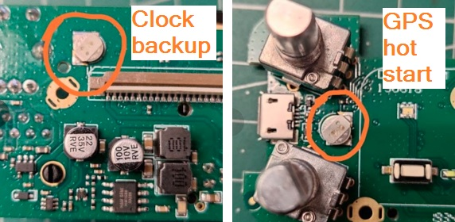

# What are the tiny backup batteries for?

[← All 578 mods](index.md)

!!! note "Author: Jason Reilly VK7ZJA (silent key, January 2023)"
    © Jason Reilly 2018–2022. Jason's pages were preserved by Norman Williams on hamradiosouthernrepeaters.co.uk and are reproduced here, with light formatting and spelling edits for readability, so that his work stays available. They will be removed on request from his family. [Original page](https://hamradiosouthernrepeaters.co.uk/images/578Mods/578techmods.html#BackupBatteries)

With thanks to Francesco IK8JHL, we now know what each backup battery does.

Located on the display / MCU printed circuit board are two tiny backup batteries:

- The one on the back side, near the ribbon connector, is used to backup the real time clock.
- The other battery on the front side in between the two volume control potentiometers is used to help the GPS with ’hot starting’ to obtain a quicker initial first position fix.

Each of these batteries are XH414HG IV01E rechargeable lithium batteries, which receive a trickle charge whenever the radio is connected to power – the radio doesn’t have to be turned on for this to happen.

If your radio has been sitting around dormant and not connected to power for a while, these batteries could become flat. Very flat! A very flat battery can become short circuit and cause mis-operation of the radio MCU processor. If you have not had the 578 connected to power for a while, connect power for 48 hours to allow time for the batteries to recharge some before attempting to use.

If you find that the time & date is being lost, or you can’t confirm entry of time & date after a reset, even after allowing some time for the backup battery to recharge, it could be that the battery is damaged and needs replacing.

Likewise, if the GPS always seems to take a long time to get a lock, a dead GPS backup battery might be the reason.

## Testing the batteries

The best way to determine if a backup battery is dead and requires replacement is:

1. Allow the batteries time to recharge first by leaving the radio connected to power for 48 hours.
2. Disconnect the radio from all power.
3. Open up the radio and measure the backup battery voltages with a multimeter. The positive (+) of the battery is the top side of the battery, and you can put your negative (-) probe of the multimeter on any ground point of the radio.

Any battery that measures less than 2.7 volts should be replaced.
