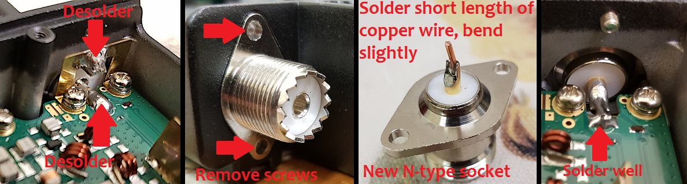
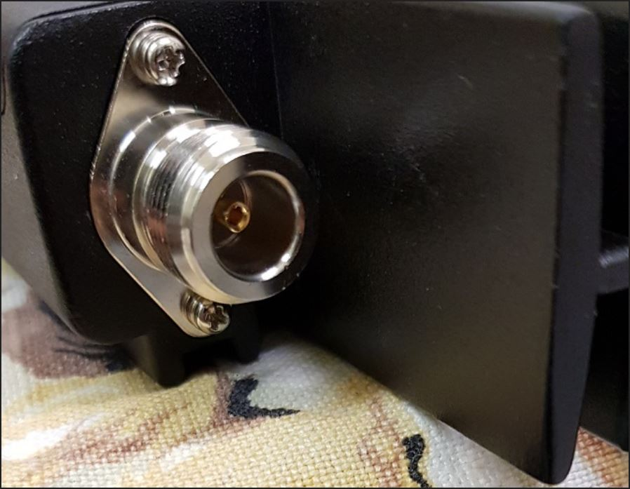

[← All 578 mods](index.md)

!!! note "Author: Jason Reilly VK7ZJA (silent key, January 2023)"
    © Jason Reilly 2018–2022. Jason's pages were preserved by Norman Williams on hamradiosouthernrepeaters.co.uk and are reproduced here, unchanged, so that his work stays available. They will be removed on request from his family. [Original page](https://hamradiosouthernrepeaters.co.uk/images/578Mods/578techmods.html#Ntype)

**Replacing the SO-239 socket with an N-type socket** Moderate
I get why a SO-239 socket has been fitted to the 578. Many hams use them, mainly because that is what a lot of other radios use too. There is a lot to be said for maintaining the status quo. But the SO-239 is a 90 year old design, they don’t maintain a constant 50 ohm impedance, and are usually only good to use up to 100 MHz. It’s about time that we ditch the SO-239 / PL-259 combination and upgrade to something a bit better. The N-type connector is a much better choice: good to at least 1 GHz and high quality types are usable up to 18 GHz, they also maintain a constant 50 ohm impedance across the connection, and not that it matters in this application, they also have a degree of weatherproofing over and above the SO-239 / PL-259 series.

Key benefits:

- Higher quality, better design connector, less ’junk’ connectors around in the N-type
- Slightly lower loss, especially at UHF
- Better VSWR / return loss; SO-239 connectors have an impedance ’bump’
- Better weatherproofing than SO-239 / PL-259 types

Suitable diamond flange, two hole, N-type sockets can be purchased from: Mouser part number 523-172323 / RFparts part number 0-RFN1020-1 / many other suppliers if you look
To replace the SO-239 socket with an N-type on the 578, first desolder the centre and earth pins of the socket as shown below. Then undo the screws holding in the socket, and it should fall right out. Also remove the brass square U shape ground bracket, but replace the screws that held it in. Test fit your replacement N-type socket to make sure it fits nicely. If all is good, solder a short bit of 1mm thick solid copper wire to the N-type socket centre pin, and bend it slightly upwards. Fit the new socket in the radio chassis and refit the screws that hold the socket flange. Make sure the screws are done up quite snugly, but not so over-tight that you strip the threads. Lastly solder the centre pin on to the PCB, clean up any flux that might be left behind and the job is done.

------------------------------------------------------------------------
