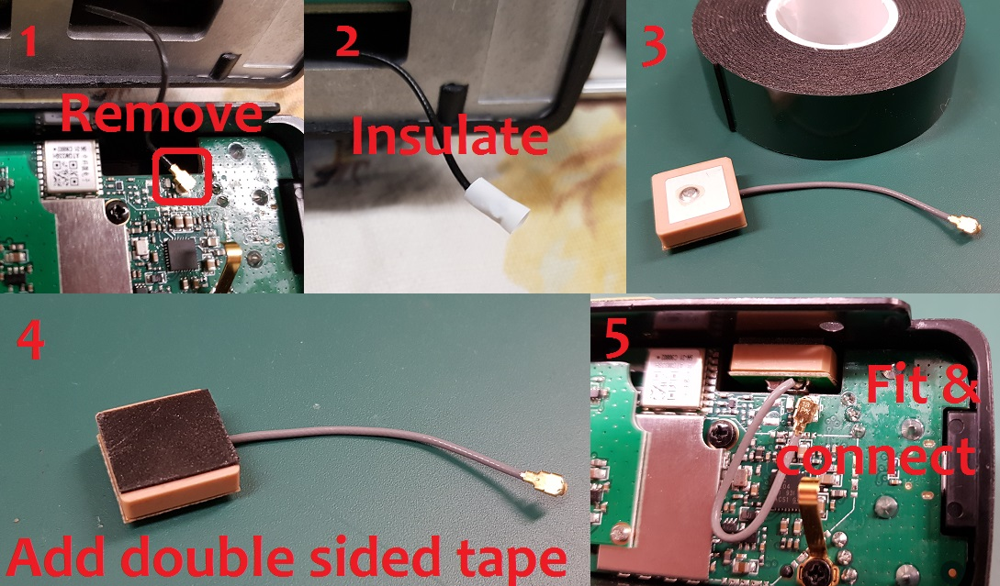
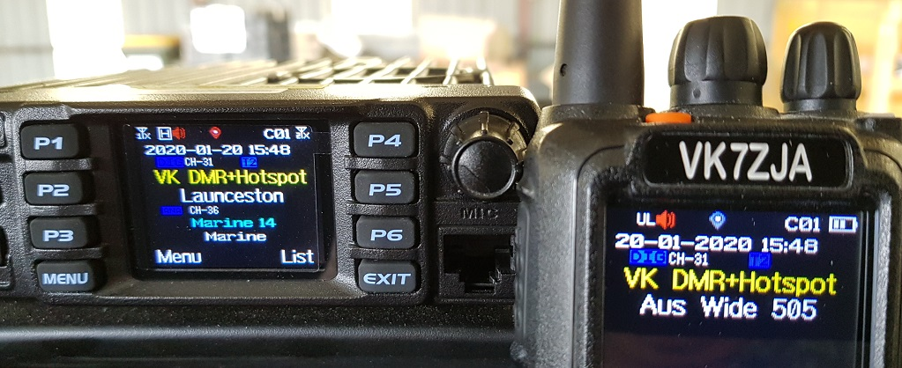

# Adding an internal GPS antenna to the 578

[← All 578 mods](index.md)

!!! note "Author: Jason Reilly VK7ZJA (silent key, January 2023)"
    © Jason Reilly 2018–2022. Jason's pages were preserved by Norman Williams on hamradiosouthernrepeaters.co.uk and are reproduced here, with light formatting and spelling edits for readability, so that his work stays available. They will be removed on request from his family. [Original page](https://hamradiosouthernrepeaters.co.uk/images/578Mods/578techmods.html#addGPS)

*Difficulty: Moderate*

If you have a GPS equipped 578, you will have received an external GPS ’mouse’ style antenna that connects to the rear panel SMA socket. This is all very good, but what happens if you don’t want to use an external GPS antenna? The 578 was originally designed to have an internal GPS antenna too, but in the end the factory decided to rely solely on an external GPS antenna. It isn’t hard to understand why, either. With many 578s destined to be installed in vehicles, an external GPS antenna offers the very best performance in picking up the incredibly weak signals from orbiting GPS satellites as you drive under trees, into deep valleys or just in and around the city with lots of obstructing buildings.

However, if you are happy to sacrifice the performance of an external GPS antenna, you could add in your own GPS antenna to the display unit of the 578 and make use of that instead. There is space within the display unit, just behind the "GPS" inscription above the front panel LED in fact, where you could install your own mini GPS antenna. This space measures 19mm wide by 7mm high, and has an available depth of 20mm maximum. You will need an ’active’ (built in amplifier) type of antenna that is this size or smaller, and works for 1575.42 MHz - this is suitable for GPS and BeiDou GNSS, which the ATGM336H receiver works with.

The 15x15mm types, which came with a short tail of mini coax and ending in a u.FL / IPX connector, cost a fraction over USD \$3 each from eBay. Search for ’GPS active IPX antenna’ and look for the 15x15x6mm model (or 18x18x7mm types but those are a bit more expensive). It may be worthwhile buying a pack of four of these antennae for USD \$8, and then you can cherry pick the most sensitive antenna. I found one of the four antennae I purchased was consistently taking about twice as long as the other three to get a position fix. Installation is simplicity itself:

Begin by removing the four Torx T8 size screws of the underside cover of the 578, and remove the two top side Torx T8 screws on the back lip of the display unit and carefully separate the display unit from the main body of the radio. Don’t pull it out too far or you will damage the connecting ribbon cable. Then:

1. Unclip the existing u.FL connector that goes to the rear mounted SMA socket.
2. Insulate the original u.FL connector and tuck it away somewhere; a little bit of 2mm or 3mm heatshrink is a professional way to do this, but some electrical tape is OK too.
3. Find some double sided tape (maximum of 1mm thick). The double sided foam tape pictured here is used in the automotive industry to affix exterior trim to vehicle bodies etc. and works well.
4. Add a small square of double sided tape to the top of the GPS antenna.
5. Clip in the new antenna connector - due to it’s tiny size, this can be a bit tricky to get mated correctly, be patient and don’t force it. Mount the new antenna in the cut out as shown below.

Reassemble the 578 and test to make sure everything is working OK. Remember you need to turn on GPS in the menu first!

## So how well does it work?

The below photograph illustrates just how well the new internal GPS antenna works. With a vehicle parked deep inside a large metal shed, completely obstructing a view to the sky, the 578 and 868 were set side by side on the dashboard.

After 5 minutes, only the 578 with the added GPS antenna has a position fix. The larger size (roughly double) of the GPS antenna added in the 578 versus the smaller GPS antenna as fitted to the 868 accounts for this better sensitivity. All the same, don’t expect miracles from this antenna, if you mount the 578 low in a vehicle dashboard or console, your GPS fixes will only be intermittent. In situations where the GPS signal is weak, the external ’mouse’ antenna, mounted on the exterior of your vehicle will always be best.

## Two GPS antenna connectors

In some 578s, you may find there are two u.FL / IPX GPS antenna connectors. If this applies to you, test your GPS antenna in both sockets; I found that connecting the new internal GPS antenna to the socket closest the volume control resulted in a consistently faster lock. You can also still keep the existing fly lead for the external SMA GPS socket connected to the other u.FL / IPX socket, and even have both GPS antennae connected and working at the same time, it doesn’t seem to upset the performance getting a position fix.
