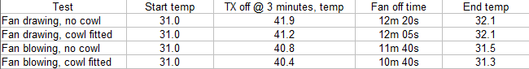

[← All 578 mods](index.md)

!!! note "Author: Jason Reilly VK7ZJA (silent key, January 2023)"
    © Jason Reilly 2018–2022. Jason's pages were preserved by Norman Williams on hamradiosouthernrepeaters.co.uk and are reproduced here, unchanged, so that his work stays available. They will be removed on request from his family. [Original page](https://hamradiosouthernrepeaters.co.uk/images/578Mods/578techmods.html#cool)

**Improved cooling for the 578** Moderate
The 578 isn’t meant for high duty cycle transmit, such as that which many ham operators tend to do. Generating 60 watts of output in such a compact body means the radio will heat up quickly, there is no getting around that. This alone is a very good reason to operate using the lowest power possible for your requirements. However, if you simply must use high power for anything other than a very brief call, then there are things that you can do to improve the cooling of the 578 in these circumstances.
The first change to make is to reverse the direction of the airflow over the heatsink fins of the radio body, which is done simply by turning the fan around. Undo the four screws holding the fan to the back of the 578 chassis, and turn it around so it faces the other way. The fan will now blow air over the heatsink, rather than drawing or sucking air past the heatsink fins. This seems to be more efficient at cooling the radio. ["NF-A6x25 FLX"](https://www.noctua.at/en/products/nf-a6x25-flx)
If you are handy with a bit of sheet metal or a 3D printer, you can also make a small cowl to place over the back of the heatsink fins, which will help direct airflow over them, further improving cooling efficiency. The difference isn’t huge, but worthwhile.

A good example of a small cowl added can be found here: [https://hamradiosouthernrepeaters.co.uk/images/Anytone/578a.jpg](../../originals/images/Anytone/578a.jpg)

However, if you are often going to be using high power, it would be a much better idea to fashion a bracket to hold a 120mm computer fan to the top of the heatsink. Noctua make some excellent quality, very acoustically quiet fans that would be excellent for this job.

------------------------------------------------------------------------
