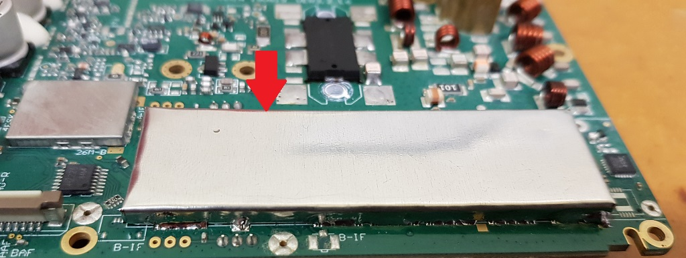
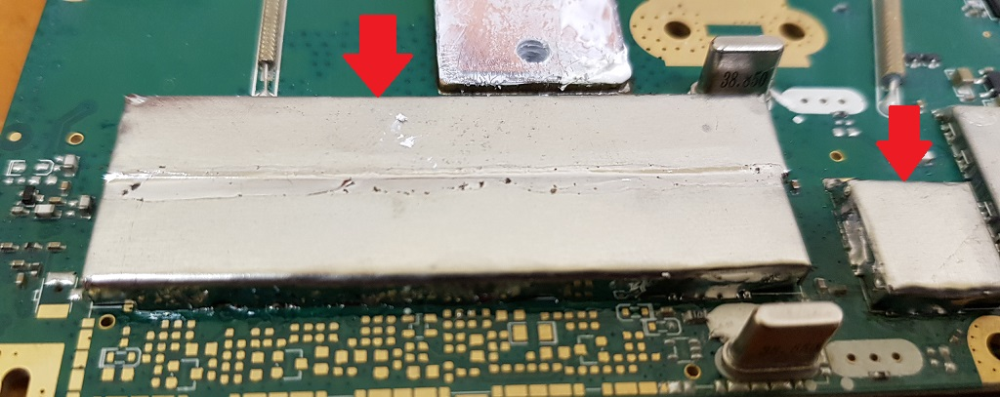

# Improved receiver shielding for the 578 Advanced

[← All 578 mods](index.md)

!!! note "Author: Jason Reilly VK7ZJA (silent key, January 2023)"
    © Jason Reilly 2018–2022. Jason's pages were preserved by Norman Williams on hamradiosouthernrepeaters.co.uk and are reproduced here, with light formatting and spelling edits for readability, so that his work stays available. They will be removed on request from his family. [Original page](https://hamradiosouthernrepeaters.co.uk/images/578Mods/578techmods.html#Shields)

While the radio case is metal and provides a good degree of shielding for the 578 receiver, AnyTone provided the PCB lands to add extra shields over the receiver section.

## Making and fitting the shields

1. You can manufacture your own shields out of 0.8mm tin plate or brass plate and solder them over the receiver PCB.
2. Make each shield just slightly smaller than required, so the sides fit just on the inside edge of the PCB lands provided.
3. Each shield should be at least 2.5mm high to allow a reasonable clearance from the receiver components underneath.
4. Use a 60+ watt soldering iron to run a fillet of solder around the shields. You might not be able to solder all PCB lands due to the close proximity of other components, that is OK, just leave those alone rather than risk burning a nearby component.

The end result should look like this (added shields indicated by red arrows):

## Realignment

After this is done, you will need to realign the following receiver tracking gain settings:

BPFLUA, BPFMUA, BPFHUA, BPFLUB, BPFMUB, BPFHUB, BPFLVA, BPFMVA, BPFHVA, BPFLVB, BPFMVB, BPFHVB.

Feed in a weak test signal at the test frequency indicated, and adjust the value for maximum spot frequency sensitivity. This is to compensate for the added stray capacitance the shields add to the varactor based front end tuning.

If done properly, this will result in a 2dB noise reduction on VHF, raising sensitivity by the same amount. No improvement on UHF was noticed.
