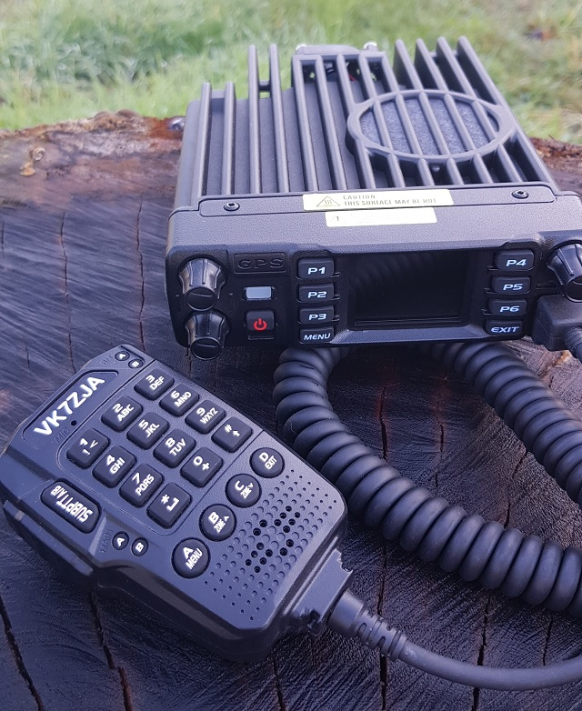

# AnyTone 578 mods, hints & tips

!!! note "Author: Jason Reilly VK7ZJA (silent key, January 2023)"
    © Jason Reilly 2018–2022. Jason's pages were preserved by Norman Williams on hamradiosouthernrepeaters.co.uk and are reproduced here, unchanged, so that his work stays available. They will be removed on request from his family. [Original page](https://hamradiosouthernrepeaters.co.uk/images/578Mods/578techmods.html)

This is a back up of Jason's work (VK7ZJA), who passed away in January 2023.
The page will not be updated and some links might not work.

**Modifications, hints, tips and technical information for the
AnyTone AT-D578UV\**

**dual / tri band DMR digital mobile radio**

(Some relevance to Alinco DR-MD500 & DR-MD520 too)

------------------------------------------------------------------------

 

**Version 7.4 --- 20 October 2022**

**Updates made since the previous version are shown in this purple colour**

------------------------------------------------------------------------

**This information is primarily intended for amateur ’ham’ radio operators who wish to maintain and adjust their AT-D578UV. Any regulatory authority approval (e.g. FCC certification) may become invalid by the use of this information. Users should always ensure that they and their radios are operating in accordance with their licence conditions. Many of these mods may also invalidate any manufacturer warranty you may have. In any case, the user alone accepts all responsibility and risk from the use of this information and tools provided here.**

------------------------------------------------------------------------

**General warnings to all users:\**

**Codeplug version, CPS programming software version and firmware version present in the radio must all match in version number. If not, very strange things happen. You must [REBUILD](57-prevent.md) your codeplug every time a new CPS or firmware version is installed. This keeps the underlying data sent to the radio consistent in version.**

**For the same reason above, I would caution anyone from sharing and using other people’s codeplugs. While it might be convenient, you can’t be guaranteed what version the shared codeplug was built under, and therefore whether it would work properly under the firmware version installed in your radio. You just can’t tell, the CPS won’t tell you unless it is a very early version codeplug. Save yourself a lot of headaches and [REBUILD](57-prevent.md) the codeplug before writing it to your radio.**

Use caution if writing non standard data to the radio in some of the advanced modifications listed below. It is possible to cause the radio to cease functioning correctly if instructions are not carried out with care.

------------------------------------------------------------------------

**Page index:**

- [Introduction
  ](01-introduction.md)
  
- [**Band Error and five ways you can fix it**
  ](02-band-error.md)
  
- [What is the difference between the AnyTone AT-D578UV and AT-D878UV?
  ](03-differences.md)
  
- [What is the difference between the AnyTone AT-D578UV and Alinco DR-MD500 / DR-MD520?
  ](04-578vs-md500.md)
  
- [Hint when using the programming software / CPS
  ](05-cpshint.md)
  
- [Virus detected! Is the CPS software really safe to use?
  ](06-cpsvirus.md)
  
- [Hint when using the microphone
  ](07-mic-hint.md)
  
- [Hints & tips for upgrading firmware
  ](08-fwupgrade.md)
  
- [Trouble getting the drivers to install or work properly on Win 7 or 10
  ](09-driver-trouble.md)
  
- [Strange error messages ---](10-error-messages.md) [Band Error has it’s own section, click here](02-band-error.md)
- [A website with lots of great hints & tips for the AnyTone DMR radio family
  ](11-webhints.md)
  
- [Looking for a guide on how to setup APRS? This website shows you how
  ](12-aprssetup.md)
  
- [How to reply on an active channel found while scanning
  ](13-talkback-hint.md)
  
- [How do I reset the radio?
  ](14-reset.md)
  
- [Compatibility of encryption
  ](15-encryption.md)
  
- [A remote mount head / display for the 578?
  ](16-remote-head.md)
  
- [Bluetooth microphones and the 578
  ](17-btmic.md)
  
- [Custom engraved call sign labels for your radio
  ](18-custom-labels.md)
  
- [Differences between the two external speaker sockets
  ](19-sockets.md)
  
- [Microphone socket pinouts & information, including use of a base microphone for your 578 or MD520, with schematic
  ](20-microphone.md)
  
- [An integrated power supply & console is available for the 578
  ](21-console.md)
  
- [Modify the 578 microphone for external audio input and output for SignaLink etc.
  ](22-signalink.md)
  
- [Using a Bluetooth module for external audio input and output for digital modes etc.
  ](23-btaudioconnect.md)
  
- [Hint when using a Bluetooth earpiece
  ](24-earpiece.md)
  
- [Custom background display files
  ](25-backgrounds.md)
  
- [Using ’enhanced microphone audio’
  ](26-enhanced-mic.md)
  
- [Make your radio sound like a Motorola, or play with some other fun tone sequences
  ](27-tptchirp.md)
  
- [Using the address book to dial EchoLink nodes
  ](28-echolink.md)
  
- [Known button held during power up sequences
  ](29-power-up-sequences.md)
  
- [Selecting operational bands
  ](30-selecting-bands.md)
  
- [Expanding RX frequencies: modified firmware for 578 based on v1.16n & v2.03n & Alinco DR-MD520 v1.15 (all with an optional alternate display font) available for download
  ](31-expand-rx.md)
  
- [Receiver sensitivity & transmit output power measurements
  ](32-measurements.md)
  
- [What about fortuitous air band (118-136 MHz) reception for non PLUS models?
  ](33-air-band.md)
  
- [Can the 578 be used as a scanner?
  ](34-scanner.md)
  
- [My receive keeps cutting in and out on FM, can that be fixed? (updated)
  ](35-popping.md)
  
- [Expanding FM band frequencies 76 to 121 MHz
  ](36-fmband.md)
  
- [Changing the display font / modifying some of the icons
  ](37-fonts.md)
  
- [Alternate GPS icons to download (578 only)
  ](38-gpsicons.md)
  
- [Enabling full test / self adjustment mode
  ](39-full-test-mode.md)
  
- [AnyTone Options software download
  ](40-atoptions.md)
  
- [Resetting your power on password
  ](41-lost-password.md)
  
- [Programming password lock
  ](42-password.md)
  
- [FCC Part 90 approval information
  ](43-fcc.md)
  
- [A look inside the 578
  ](44-inside.md)
  
- [What are the tiny backup batteries for?
  ](45-backup-batteries.md)
  
- [A mod to improve the output volume of the 578 internal speaker
  ](46-speaker-mod.md)
  
- [Replacing the SO-239 socket with an N-type socket
  ](47-ntype.md)
  
- [Add an internal GPS antenna to the 578
  ](48-add-gps.md)
  
- [Improved cooling for the 578
  ](49-cool.md)
  
- [Improved receiver shielding for the 578
  ](50-shields.md)
  
- [General technical information New: updated information
  ](51-gen-tech.md)
  
- [Flash memory structure in the 578
  ](52-flash-mem.md)
  
- [Flash Utility software
  ](53-flash-utility.md)
  
- [Backing up or restoring vital alignment & configuration data of your radio
  ](54-backup.md)
  
- [Fix a frozen during boot up AnyTone 578 or Alinco DR-MD500 & DR-MD520
  ](55-frozen.md)
  
- [Preventing your radio from freezing / locking up and how to cure many problems
  ](57-prevent.md)
  
- [Writing your own .CDD files
  ](58-cdd.md)
  
- [French text help file (updated)
  ](59-other-help-languages.md)
  
- [Updating the SCT3258 baseband / DMR codec firmware Updated: includes latest version V2.01.07BF
  ](60-baseband.md)
  
- [Future developments & ideas
  ](61-future.md)
  

------------------------------------------------------------------------

## Sections

- [Introduction](01-introduction.md)
- [Band Error and five ways you can fix it](02-band-error.md)
- [What are the differences between the AnyTone AT-D578UV mobile and AT-D878UV handheld?](03-differences.md)
- [What is the difference between the AnyTone AT-D578UV and Alinco DR-MD500 / DR-MD520?](04-578vs-md500.md)
- [Hint when using the programming software / CPS](05-cpshint.md)
- [Virus detected! Is the CPS programming software really safe to use?](06-cpsvirus.md)
- [Hint when using the 578 microphone](07-mic-hint.md)
- [Hints & tips for upgrading firmware](08-fwupgrade.md)
- [Trouble getting the drivers to install or work properly on Win 7 or 10](09-driver-trouble.md)
- [Strange error messages](10-error-messages.md)
- [A website with lots of great hints & tips for the AnyTone DMR radio family](11-webhints.md)
- [Looking for a guide on how to setup APRS? This website shows you how](12-aprssetup.md)
- [How to reply on an active channel found while scanning](13-talkback-hint.md)
- [How do I reset the radio?](14-reset.md)
- [Compatibility of encryption](15-encryption.md)
- [What about a remote head / display for the 578?](16-remote-head.md)
- [Bluetooth microphones and the 578](17-btmic.md)
- [Custom engraved call sign labels for your radio](18-custom-labels.md)
- [External speaker socket differences on the AT-D578UV](19-sockets.md)
- [Microphone socket pinouts & information AT-D578UV and DR-MD520](20-microphone.md)
- [An integrated power supply & console is available for the 578](21-console.md)
- [Modify the 578 microphone for external audio input and output for SignaLink etc. Moderate](22-signalink.md)
- [Using a Bluetooth module for external audio input and output for digital modes etc. Easy](23-btaudioconnect.md)
- [Hint when using a Bluetooth earpiece](24-earpiece.md)
- [Custom background display files for your AT-D578UV](25-backgrounds.md)
- [Using ’enhanced microphone audio’](26-enhanced-mic.md)
- [Make your radio sound like a Motorola](27-tptchirp.md)
- [Using the address book to dial EchoLink nodes](28-echolink.md)
- [Known button held during power up sequences](29-power-up-sequences.md)
- [Selecting operational bands](30-selecting-bands.md)
- [Expanding RX frequencies Easy](31-expand-rx.md)
- [578 receiver sensitivity](32-measurements.md)
- [What about fortuitous air band (118-136 MHz) reception for non PLUS models?](33-air-band.md)
- [Can the 578 be used as a scanner?](34-scanner.md)
- [My receive keeps cutting in and out on FM, can that be fixed?](35-popping.md)
- [Expanding FM band frequencies 76 to 120 MHz Easy](36-fmband.md)
- [Changing the display font / modifying some of the icons Advanced](37-fonts.md)
- [Alternate GPS icons to download (578 only)](38-gpsicons.md)
- [Enabling full test / self adjustment mode Advanced](39-full-test-mode.md)
- [Colin G4EML has created an application called AT Options, which will allow you to enable t](40-atoptions.md)
- [Resetting your power on password Easy](41-lost-password.md)
- [Programming password lock Easy](42-password.md)
- [FCC Part 90 approval information](43-fcc.md)
- [A look inside the 578](44-inside.md)
- [What are the tiny backup batteries for?](45-backup-batteries.md)
- [Modifying the internal speaker for extra volume Advanced (extensive disassembly)](46-speaker-mod.md)
- [Replacing the SO-239 socket with an N-type socket Moderate](47-ntype.md)
- [Adding an internal GPS antenna to the 578 Moderate](48-add-gps.md)
- [Improved cooling for the 578 Moderate](49-cool.md)
- [Improved receiver shielding for the 578 Advanced](50-shields.md)
- [General technical information](51-gen-tech.md)
- [Flash memory structure in the 578](52-flash-mem.md)
- [Flash Utility software: Courtesy of Colin G4EML comes this small utility program that can ](53-flash-utility.md)
- [Backing up or restoring vital alignment & configuration data of your 578](54-backup.md)
- [Fix a frozen during boot up AnyTone 578 or Alinco DR-MD500 / DR-MD520 Easy](55-frozen.md)
- [Full defroster](56-full-defrost.md)
- [Preventing your 578 or MD500 / MD520 from freezing or locking up and how to cure many prob](57-prevent.md)
- [Writing your own .CDD files Advanced](58-cdd.md)
- [French text help file](59-other-help-languages.md)
- [Updating the SCT3258 baseband / DMR codec firmware](60-baseband.md)
- [Future developments & ideas](61-future.md)
