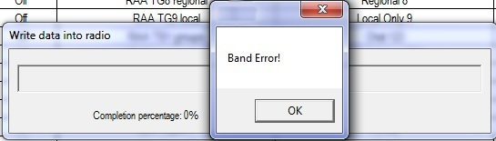
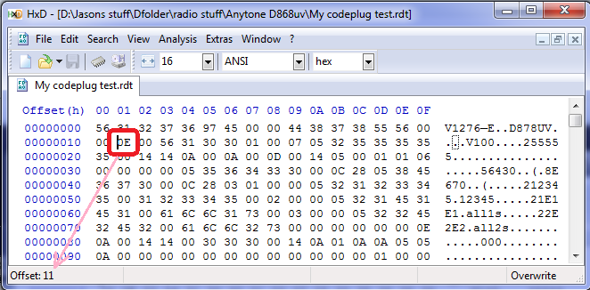

# Band Error and five ways you can fix it

[← All 868-878 mods](index.md)

!!! note "Author: Jason Reilly VK7ZJA (silent key, January 2023)"
    © Jason Reilly 2018–2022. Jason's pages were preserved by Norman Williams on hamradiosouthernrepeaters.co.uk and are reproduced here, with light formatting and spelling edits for readability, so that his work stays available. They will be removed on request from his family. [Original page](https://hamradiosouthernrepeaters.co.uk/images/878Mods/878techmods.html#BandError)

Arrgh, the dreaded ‘Band Error’. This happens when the codeplug you try to write to the radio doesn't match the operational band the radio is set to. The radio has certain band limits that can be changed to suit local requirements, and this can be set to one of several options by the user. If the codeplug that you are trying to write to the radio doesn't match that setting, this is the error you will see.

There are five ways you can correct this issue. Choose the one that best suits you.

## Method 1: change the band of the radio to match the codeplug file you are trying to write (easiest method)

Ensure that you do not have any power on password active. If you do, you must use the CPS software to remove it first.

1. Download Colin G4EML **AT Options version 9 (18.1kb) software** *(edited by Markus)* from:
    - [868, 878 and 578 Download this version](https://mega.nz/folder/SZlhCTKK#l8MPa7CYcU8tsHZvsPHIrA)
    - [890 AT Options v3 Download this version](../../originals/images/Anytone_D890UV_Option_v3.zip)
2. Determine what band the codeplug is. Without the radio connected to the computer, open the codeplug .rdt file in the CPS software, and use menu **Model → Model Information** to display information about the codeplug. In the middle of the window will be 'Frequencys' and next to that will be Mode with a number. This is your band number; write it down. Click on **Cancel** for now.
3. Connect your radio to the computer with the programming cable now, and open the AT Options software. Select your usual Com port and click **Read**.
4. Next to Frequency, use the pull-down list to select the band that matches the Mode number you wrote down earlier in step 2.
5. Click **Write** to change the radio band.
6. Back in the CPS programming software, you should now be able to write the codeplug .rdt file to the radio without a Band Error.

!!! note
    There is a bug in the CPS programming software: Local Information will not show the correct frequency band the radio is set to, but **Model → Model Information** does show the correct frequency band.

## Method 2: change the band of your codeplug file to match the current band setting in your radio (also very easy)

1. Download & unzip Francesco IK8JHL automated script tool (18kb) from:
    - [Download from this webpage here](../../originals/anytonetechzone/RDT_Band_Conversion.zip)
    - [Download via Mega](https://mega.nz/file/LxthBLhQ#s3BIGen1F7i_tmJBSTEnKZZ3V_Fzas1JbE4GXsPRqhg)
    - [Download via Google Drive](https://drive.google.com/file/d/1AJGPx1gxhpcK7Khn6MmYFK1oOzhFx_MR/view?usp=sharing)
    - [Download via Sabercat host](https://sabercathost.com/a20m/RDT_Band_Conversion.zip)
2. Make a backup copy of your codeplug .rdt file and keep it somewhere safe. This script tool will alter your codeplug file 'live' without making any backup.
3. Determine what band your radio is set to: open the CPS programming software, and use menu **Set → Set Initialization** to clear memory contents first, then select **Program → Read From Radio**. You can select just 'Other Data' to read. Let the CPS programming software read the radio contents, and once done select menu **Model → Model Information**. In the middle of the window will be 'Frequencys' and next to that will be Mode with a number. This is your band number; write it down. Click on **Cancel** for now.
4. Copy your codeplug .rdt file into the working directory for the RDT Band Conversion script tool.
5. Start up the script tool by executing the Convert.bat file.
6. Tell the script tool the name of your .rdt codeplug file, and the band number (given in HEX – the on-screen menu will guide you) that you wish to convert your codeplug over to.
7. The tool will automatically edit your codeplug .rdt file to your desired band, and rename it to confirm the changes were made. Copy your converted codeplug .rdt file back into your regular folder where the CPS software looks for & loads its codeplug files.
8. Back in the CPS programming software, load the converted .rdt codeplug file and you should now be able to write the codeplug .rdt file to the radio without a Band Error.

!!! note
    There is a bug in the CPS programming software: Local Information will not show the correct frequency band the radio is set to, but **Model → Model Information** does show the correct frequency band.

!!! note "Note 2"
    Because of the batch file / script nature of this tool, expect your anti-virus software to complain about it, but it is 100% safe to use.

## Method 3: change the band of the codeplug to match the radio (requires hex editing skills)

1. Determine what band the radio is set to. Connect the radio to the computer with the programming cable and, with the CPS programming software, read from the radio.
2. In the CPS programming software use menu **Model → Model Information** to display information about what was read from the radio. In the middle of the window will be 'Frequencys' and next to that will be Mode with a number. This is your band number; write it down. Click on **Cancel** for now and close down the CPS programming software.
3. Convert the band number you wrote down into hexadecimal. As an example, if it is Mode 00015, 15 = 0F in hexadecimal. Write that down too.
4. Now open your codeplug .rdt file in a hex editor, and look at the byte at address (hex) 0x0011. This is the byte that tells the CPS software what 'band' the codeplug is. Change the value of the byte at address 0x0011 to the hex number you just calculated in step 3. Save the edited .rdt file under a new name.
5. Start up the CPS programming software, load the edited .rdt file that you saved with a new name and send it to the radio.

    

    *The red circle indicates byte 0x0011, which determines what band the codeplug is; change that data to 0E for band 14, or change it to 12 for band 18. Also note how the offset (address) shown in HxD indicates where your cursor is placed.*

    Frank, KB2MXV, has made a nice YouTube video on the process of hex-editing your band byte. He's using a different hex editor, so it will look a little different to the above picture, but the general process is the same. Take a look at: <https://youtu.be/atMWu00_33U>

## Method 4: when all else fails, use this export all / import all method (most reliable method, but needs the most work)

1. In the CPS programming software, open your codeplug.
2. Use the menu **Tool → Export** and look at the top of the window that opens – there is an **Export All** button. Click it.
3. Give your export a name, and click **Save**. This will export all your frequencies, contacts, zones etc etc to .csv files. This could take a few minutes with no apparent progress or activity, especially if your digital contact list is large; wait until an Export Complete! message is shown.
4. There are some settings that are not exported, such as Optional Setting information, APRS and Encryption (if you happen to be using them). Go through and write down, take screenshots or take photos of these.
5. Now connect the radio to the computer with the programming cable and, with the CPS programming software, read from the radio.
6. Use the menu **Tool → Import** and look at the top of the window that opens – there is an **Import From File List** button. Click it.
7. Find the file you saved / exported in step 3 above, and click **Open**. This will import all your frequencies, contacts, zones etc etc to .csv files. This step can also take a few minutes to finish; wait until the Import Complete! message is shown.
8. Go through the Optional Setting / APRS / Encryption settings and restore all your settings as they were before, referring to your notes, screenshots or photos from step 4 above.
9. Save your newly rebuilt codeplug with a new name, perhaps including the mode number in the file name for easy reference.
10. Now write the fully rebuilt codeplug to the radio.

## Method 5: change radio bands to match codeplug via radio Test Mode menus (if enabled)

1. Turn off the radio, then while holding down the **P4** key & pushing in the dial knob, power up the radio. Keep holding them until you see 'TEST MODE' on the screen, and release the keys. If this is not displayed, then this method will not work for you.
2. After the radio has fully powered up, you should see MODE:000xx on the screen. If you don't, use the up/down buttons until you do.
3. Then rotate the dial knob to set a new MODE value to match the codeplug you are trying to send to the radio, and simply turn off the radio to set that value.
4. After turning the radio back on normally, you should now be able to write your codeplug to the radio.
