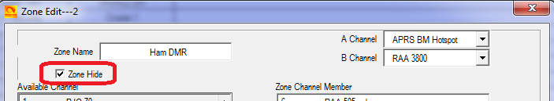

# Help! I can not change zones any more!

[← All 868-878 mods](index.md)

!!! note "Author: Jason Reilly VK7ZJA (silent key, January 2023)"
    © Jason Reilly 2018–2022. Jason's pages were preserved by Norman Williams on hamradiosouthernrepeaters.co.uk and are reproduced here, with light formatting and spelling edits for readability, so that his work stays available. They will be removed on request from his family. [Original page](https://hamradiosouthernrepeaters.co.uk/images/878Mods/878techmods.html#ZoneHide)

So you've just updated your firmware version, and the up/down zone change button doesn't seem to work any more. Must be a bug in the firmware, right? *Wrong!!*

If you read the firmware change log notes, you will find a new feature has been introduced: **Zone Hide**. Some people find it useful to hide an infrequently used zone until they need it, for example when travelling to another city.

By default, when you re-use your old codeplug file, CPS will hide all except your very first zone. You need to go through and unhide all your zones. Untick the following selection for all zones you want to be available:

Of course, this wouldn't have happened if you had followed the recommended best practice to *not* re-use your previous version's saved codeplug.

Yes, it will work - sort of - but sooner or later you will run into a problem, and the reason is a subtle inconsistency in the data formatting used between different versions. This zone hide issue is one such 'issue' - by default all the zones from your previous version codeplug are hidden. By rebuilding your codeplug, you avoid that. So, this 'problem' isn't a bug, it is failure to read notes and failure to follow recommendations / best practices.

!!! tip
    Every time you upgrade firmware and use a new CPS version, you should [rebuild](81-prevent.md) your codeplug to keep all the underlying data consistent with the new version of firmware & CPS being used.
