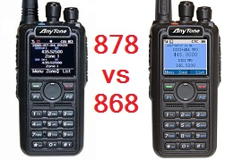

# What are the differences between the AnyTone AT-D868UV, AT-D878UV & AT-D878UV-II?

[← All 868-878 mods](index.md)

!!! note "Author: Jason Reilly VK7ZJA (silent key, January 2023)"
    © Jason Reilly 2018–2022. Jason's pages were preserved by Norman Williams on hamradiosouthernrepeaters.co.uk and are reproduced here, with light formatting and spelling edits for readability, so that his work stays available. They will be removed on request from his family. [Original page](https://hamradiosouthernrepeaters.co.uk/images/878Mods/878techmods.html#Differences)

*(Credit to Sergei Shilov, Carlos Cabezas and others)*

## Features

From a features viewpoint, the D878 has some extra features over and above the D868, such as APRS transmit for FM, roaming (automatic switching to a repeater with the strongest signal, intended for large linked networks) and at extra cost can have either Bluetooth or extra audio recording capacity added as an add-in module. The D878 also has a new screen colour scheme, and talker alias has been implemented.

The 878-II adds APRS receive for FM so you can see where other APRS stations are in relation to you, and has extra internal memory to hold up to 500000 digital ID contacts (up from 200000).

An easy way to identify each model is the colour of the top mounted push button:

| Model | Top button colour |
|---|---|
| 868 | Orange |
| 878 | Light blue |
| 878-II | Light green |

## Hardware

Internally, looking at the hardware differences between the 868 and 878 there are actually three different hardware versions:

1. **Early version 868:** uses GD32F303V**E** MCU which has 512k of internal flash memory and 64k of SRAM. This uses the 'V1' 868 firmware. You can see an example of this at Carlos' Twitter: <https://twitter.com/eb4fbz/status/880697136819691520?lang=en>
2. **First 'V2' revision 868:** uses a GD32F303V**E** MCU with 512k of internal flash memory and 64k of SRAM. There were also some other hardware changes to the PCB making minor improvements all round. This uses the 'V2' 868 firmware. You can see an example of this variant on the FCC Part 90 approval web portal at <https://fccid.io/T4KD868UV/Internal-Photos/int-photos-3496060>
3. **Second 'V2' revision 868, and 878:** identical to the first 'V2' hardware except is now fitted with a GD32F303V**G** MCU with 1024k of internal flash memory and 96k of SRAM. This revision uses the 'V2' 868 firmware, or of course 878 firmware in an AT-D878UV. You can see examples of this PCB right here at this page below.

Despite these variations, you could likely apply many of these hints, tips & modifications across all three hardware revisions and 868 or 878 models.

The 878-II has further differences again: the flash memory chip has been upgraded from 1Gb to 2Gb, and has an all-new daughter board that handles Bluetooth and the FSK receiving function for analog FM APRS receive.
