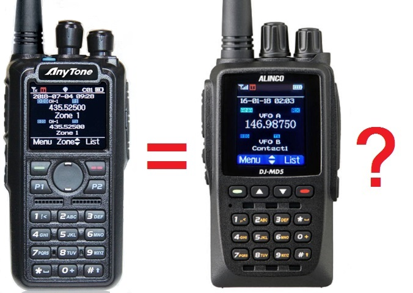
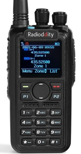

# Similarities between Alinco DJ-MD5, Radioddity GD-AT10G and AnyTone 878?

[← All 868-878 mods](index.md)

!!! note "Author: Jason Reilly VK7ZJA (silent key, January 2023)"
    © Jason Reilly 2018–2022. Jason's pages were preserved by Norman Williams on hamradiosouthernrepeaters.co.uk and are reproduced here, with light formatting and spelling edits for readability, so that his work stays available. They will be removed on request from his family. [Original page](https://hamradiosouthernrepeaters.co.uk/images/878Mods/878techmods.html#MD5similarities)

A quick glance at Alinco's new dual band DMR handheld DJ-MD5 shows many similarities to the AnyTone 878 radio: similar size, similar general layout, near identical display icons, display layout and menus, and the Alinco CPS programming software looks & feels the same as the AnyTone CPS. There are some differences, too: change in case and branding labels of course, more narrow and taller LCD display, no P1 or P2 function buttons, no top mounted PF3 button, and more.

Closer examination of the internals of the Alinco DJ-MD5 from the FCC approval portal reveals that the DJ-MD5 and 868/878 are different internally, but that both use the very same major components e.g. MCU, AT1846, RF PAs, DMR DSP, bulk flash memory chip and so on. It appears as if the DJ-MD5 is a redesigned AnyTone 878. To take it one step further, I even downloaded the CPS programming software for the Alinco, and it was able to talk to the AnyTone - it recognised that the model didn't match, but that in itself proves that the Alinco & AnyTone share the same USB driver, same MCU and same USB communication protocols.

<https://fccid.io/PH3DJ-MD5>

You can get more information about the Alinco DJ-MD5 from:

- <http://hvdnnotebook.blogspot.com/2018/11/review-alinco-md-5-series-dmr-radio.html>
- <http://hvdnnotebook.blogspot.com/2018/11/teardown-alinco-dj-md5tgp.html>
- <http://hvdnnotebook.blogspot.com/2019/03/frequency-expansion-alinco-dj-md5tgp.html>

The Radioddity GD-AT10G is a UHF only version of the AnyTone 868 (despite the blue top button) with 200000 digital ID contacts available, 10 watts claimed RF output power on UHF, and a frequency range of 400-480 MHz. Modification to restore the VHF band is most definitely not possible, as all the VHF components - numbering in the hundreds - have been removed. However, apart from that, it is suspected that many of the modifications listed here will be applicable or at least adaptable to the Radioddity GD-AT10G. The FCC ID for the GD-AT10G is 2AN62-AT10G, but because it is the same hardware as the AnyTone 868 UHF only version, it once was listed under FCC ID T4KD868SUHF. You can see various technical information on the FCC website relating to Part 90 approvals by searching using these two model IDs.

