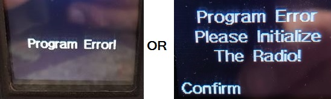

[← All 868-878 mods](index.md)

!!! note "Author: Jason Reilly VK7ZJA (silent key, January 2023)"
    © Jason Reilly 2018–2022. Jason's pages were preserved by Norman Williams on hamradiosouthernrepeaters.co.uk and are reproduced here, unchanged, so that his work stays available. They will be removed on request from his family. [Original page](https://hamradiosouthernrepeaters.co.uk/images/878Mods/878techmods.html#ErrorMessages)

**Strange error messages**

|  |  |
|----|----|
|  | [Band Error has it's own section, click here](02-band-error.md) to see five different methods on how to fix this problem. |

[TABLE]

[TABLE]

[TABLE]

|  |  |
|----|----|
|  | If you see this error, or something similar to it, this means your codeplug is corrupt. The solution is to reset the radio, [REBUILD](81-prevent.md) your codeplug, and write the rebuilt codeplug to your radio (thanks to Lane KD2TVW for this one) |

|  |  |
|----|----|
|  | This error means your codeplug has become corrupt in memory. All you need do is perform a reset on the radio and reload the codeplug. I also strongly recommend doing a codeplug [REBUILD](81-prevent.md) before reloading it to the radio. |

[TABLE]

|  |  |
|----|----|
|  | This message is asking you to "Please enter power on password:" in Chinese. If you know what the password is, enter it, and then you should reprogram the radio codeplug to reset the radio back in to English language. If you don't know what the password is, you can reset it using the instructions [here](66-lost-password.md) |

|  |  |
|----|----|
|  | This error, or 'RTC ERROR!' or 'RTC not run!' means that, for what ever reason, the radio can not read the Real Time Clock. There is a tiny internal battery that backs up the Real Time Clock and keeps time when the radio is turned off. If that battery becomes too old, or goes faulty, you may see this error. If you continue to ignore this error message and the battery becomes so bad that it short circuits itself, then that could start to induce other new random errors such as the radio freezing up, not accepting any codeplug or firmware updates, and finally becoming completely unresponsive. A short circuit battery will drag down the microprocessor voltage supply, causing these random failures. The RTC backup battery can be replaced by getting access to the bottom side of the PCB and desoldering the old battery and replacing it with a new MS412FE 3volt lithium battery - just make sure you get a MS412FE already fitted with solder tabs. After fitting, a reset of the radio, setting the time & date and reprogramming the codeplug should set everything right. |

[TABLE]

------------------------------------------------------------------------
