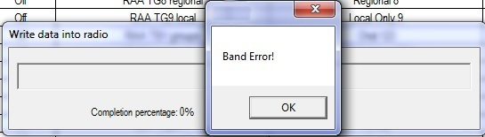
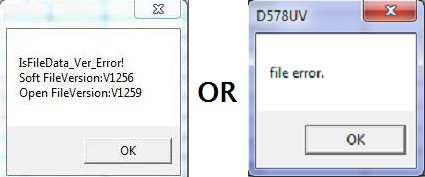
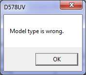
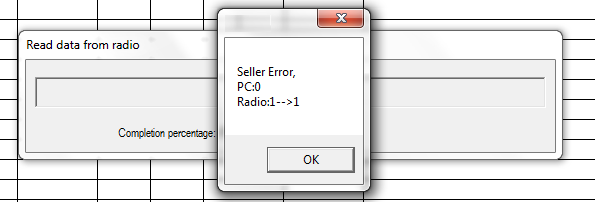
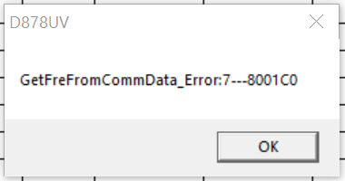
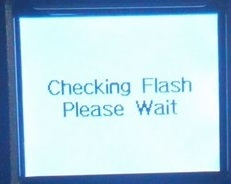
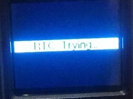
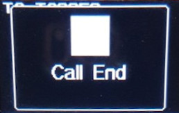

# Strange error messages

[← All 868-878 mods](index.md)

!!! note "Author: Jason Reilly VK7ZJA (silent key, January 2023)"
    © Jason Reilly 2018–2022. Jason's pages were preserved by Norman Williams on hamradiosouthernrepeaters.co.uk and are reproduced here, with light formatting and spelling edits for readability, so that his work stays available. They will be removed on request from his family. [Original page](https://hamradiosouthernrepeaters.co.uk/images/878Mods/878techmods.html#ErrorMessages)

## Band Error

[Band Error has its own section, click here](02-band-error.md) to see five different methods on how to fix this problem.

## IsFileData_Ver_Error / file error

If you see something similar to this error message, it means you are trying to load a newer codeplug file than what your CPS software version can handle. You must make sure your CPS software version matches your codeplug file version and matches your firmware version installed in the radio and that you are using it with the correct matching model radio.

## Model type is wrong

This error means you are trying to use the wrong CPS / wrong codeplug / wrong firmware for the model of radio you have. For example, you might be trying to use the 878 CPS with an 878-II radio. You must make sure your CPS software version matches your codeplug file version and matches your firmware version installed in the radio and that you are using it with the correct matching model radio.

## Seller Error

If you are getting this cryptic error message when trying to read or write to your radio, it means that your PC programming (CPS) software isn't the same version firmware as what is on your radio. For example, in the screen grab here, this shows v1.09 software trying to interact with a radio with v1.10 firmware. You must make sure your CPS software version matches your codeplug file version and matches your firmware version installed in the radio and that you are using it with the correct matching model radio.

## GetFreFromCommData_Error

If you see this error, or something similar to it, this means your codeplug is corrupt. The solution is to reset the radio, [REBUILD](81-prevent.md) your codeplug, and write the rebuilt codeplug to your radio (thanks to Lane KD2TVW for this one).

## Program Error

This error means your codeplug has become corrupt in memory. All you need do is perform a reset on the radio and reload the codeplug. I also strongly recommend doing a codeplug [REBUILD](81-prevent.md) before reloading it to the radio.

## Checking Flash Please Wait

This error is a little more serious. A similar error message is 'Bad Block.' Try the following, in order:

1. First confirm you have loaded the correct firmware, this error can appear if you've accidentally loaded a V1 firmware file on to a V2 hardware 868 or vice versa.
2. Reset the radio and then reload the codeplug.
3. If that did not work, reset the radio, reload a fresh copy of firmware and icons, perform another reset, and then reload your codeplug.
4. If you happen to have a backup image of your flash memory, especially of the critical area at addresses 02F00000 and 02FDFFFF, then use the instructions below on writing your own CDD file to restore this image to your radio flash memory. Alternatively, you can use the defroster packs toward the bottom of this page to refresh your flash memory, though you will still need to have a backup of your critical area data first.
5. In the very worst case, this could indicate hardware failure of the flash memory, a fatal problem that can not be recovered from.

## Power on password in Chinese

This message is asking you to "Please enter power on password:" in Chinese. If you know what the password is, enter it, and then you should reprogram the radio codeplug to reset the radio back in to English language. If you don't know what the password is, you can reset it using the instructions [here](66-lost-password.md).

## RTC errors

This error, or 'RTC ERROR!' or 'RTC not run!' means that, for what ever reason, the radio can not read the Real Time Clock. There is a tiny internal battery that backs up the Real Time Clock and keeps time when the radio is turned off. If that battery becomes too old, or goes faulty, you may see this error.

If you continue to ignore this error message and the battery becomes so bad that it short circuits itself, then that could start to induce other new random errors such as the radio freezing up, not accepting any codeplug or firmware updates, and finally becoming completely unresponsive. A short circuit battery will drag down the microprocessor voltage supply, causing these random failures.

The RTC backup battery can be replaced by getting access to the bottom side of the PCB and desoldering the old battery and replacing it with a new MS412FE 3volt lithium battery – just make sure you get a MS412FE already fitted with solder tabs. After fitting, a reset of the radio, setting the time & date and reprogramming the codeplug should set everything right.

## White blocks instead of icons

Not really an error message as such, if you are seeing white blocks being displayed instead of an icon after you have made a firmware update, this means you also need to do an icon update to the radio. For the 868, the Icon V1.20 update is the most recent and you can download it below. For the 878, the latest Icon V1.21 update can also be downloaded below (Thanks Francesco). For all you DMR-6X2 owners, your latest icon (pic) v1.1b update was included with the v2.01 firmware & CPS package.

Once you have downloaded the appropriate package and located the Icon Update folder within, you send the icon / pic .spi file to the radio by using the CPS menu selections **CPS → Tool → Firmware and Icon Update**.

Download the ICON update packages here:

- 878 Icon v1.21 (1003kb):
    - [Download via Mega](https://mega.nz/file/GtEUTZCY#rqkQB6pwPKixWWQ4VOMK1JNjbTM6exohODKei0nvyZQ)
    - [Download via Google Drive](https://drive.google.com/file/d/1KSMqLCuIMry25UstDF0BlSxxgm4zxRqV/view?usp=sharing)
    - [Download via Sabercat host](https://sabercathost.com/9Ya9/D878UV_ICONV1.21.zip)
- 868 Icon v1.20 (822kb):
    - [Download via Mega](https://mega.nz/file/m4tXEApY#grqs8s4iV1Z9NRn0822tM-P8vFm6B2pQrxQKvpeB4nk)
    - [Download via Google Drive](https://drive.google.com/file/d/1d_yE9g8rqSj2GsLVBAWhGD-V2wWD8-ej/view?usp=sharing)
    - [Download via Sabercat host](https://sabercathost.com/ikdZ/D868_1G_ICON_V1.20.zip)
- 6X2 Pic v1.1b (922kb):
    - [Download via Mega](https://mega.nz/file/6o9F1I7Q#_1I2YHl5paHITzL1ME-rECwQl4S_sPEl0W3_Qeo4BhQ)
    - [Download via Google Drive](https://drive.google.com/file/d/1IDOq0WAGSHkUYVSzdnk6KBThVanHAXNm/view?usp=sharing)
    - [Download via Sabercat host](https://sabercathost.com/ikdU/DMR-6X2_Icon_Update.zip)
