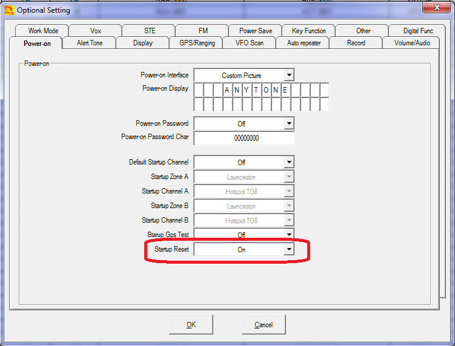

# How do I reset the radio? -or- Why won't the radio reset?

[← All 868-878 mods](index.md)

!!! note "Author: Jason Reilly VK7ZJA (silent key, January 2023)"
    © Jason Reilly 2018–2022. Jason's pages were preserved by Norman Williams on hamradiosouthernrepeaters.co.uk and are reproduced here, with light formatting and spelling edits for readability, so that his work stays available. They will be removed on request from his family. [Original page](https://hamradiosouthernrepeaters.co.uk/images/878Mods/878techmods.html#Reset)

To reset the radio:

1. Turn it off.
2. Hold down the **PTT** button and the button directly beneath it, and keep holding those buttons while turning the radio on.
3. Within two seconds you will see on the display 'Are you sure you want to Initialize radio?' and then Confirm above the green key and Exit above the red key.
4. If you are sure you want to carry out the reset, press the green key and the radio will be reset.

## Why won't the radio reset?

On new firmware version 878 radios, if you do not see this displayed on screen, there is a setting in the CPS that needs to be changed, otherwise holding in the buttons for resetting will have no effect. **Startup Reset** needs to be set to **ON** to enable reset to be carried out.

*Optional Setting → Power-on: Startup Reset = On.*
