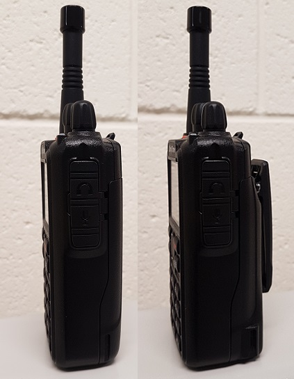

# Differences in battery sizes

[← All 868-878 mods](index.md)

!!! note "Author: Jason Reilly VK7ZJA (silent key, January 2023)"
    © Jason Reilly 2018–2022. Jason's pages were preserved by Norman Williams on hamradiosouthernrepeaters.co.uk and are reproduced here, with light formatting and spelling edits for readability, so that his work stays available. They will be removed on request from his family. [Original page](https://hamradiosouthernrepeaters.co.uk/images/878Mods/878techmods.html#BatterySizes)

The standard battery as delivered with the 878 is a 3100mAh fat battery, while the 6X2 comes with this fat battery and also a lower capacity 2200mAh thin battery. The smaller battery makes the radio both lighter and slimmer to wear on your belt or slipped into a pocket.

Here's a picture visually showing the difference between the two:

