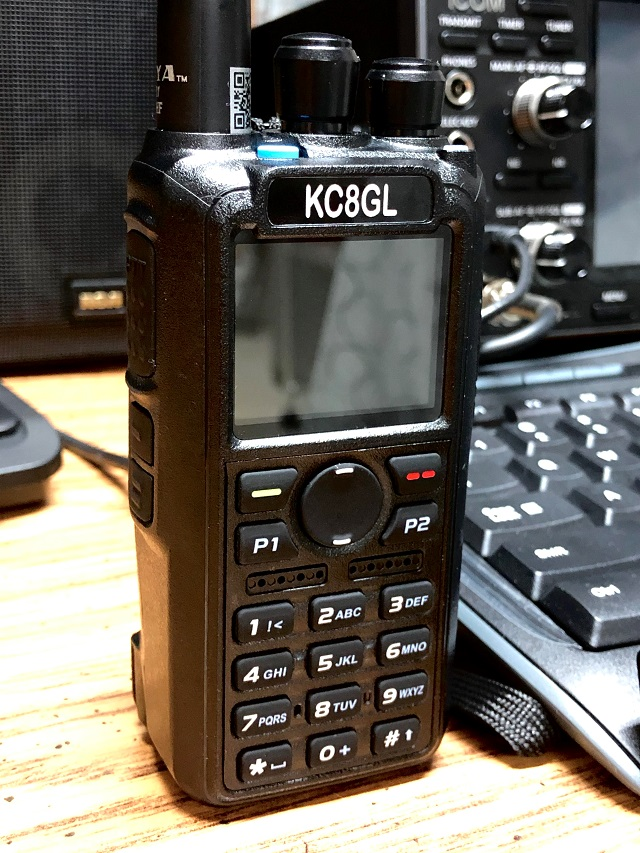

# Custom engraved call sign labels for your radio

[← All 868-878 mods](index.md)

!!! note "Author: Jason Reilly VK7ZJA (silent key, January 2023)"
    © Jason Reilly 2018–2022. Jason's pages were preserved by Norman Williams on hamradiosouthernrepeaters.co.uk and are reproduced here, with light formatting and spelling edits for readability, so that his work stays available. They will be removed on request from his family. [Original page](https://hamradiosouthernrepeaters.co.uk/images/878Mods/878techmods.html#CustomLabels)

Thanks to Greg KC8GL, you can order a custom laser engraved self adhesive label for your radio that perfectly fits the AnyTone 868 / 878 or Btech 6X2 radios, at a very attractive price.

!!! tip
    Greg recommends using a black magic permanent ink marker pen to run a line of ink around the white edge of the labels to help hide the white substrate, touching off that professional look once the label is installed.

Also check out the lovely cherry wood callsign display plaques that Greg does. I highly recommend them! Greg is a fantastic guy, quick to respond and happy to answer any questions you may have. See his website at: <https://sites.google.com/view/kc8gl/>

