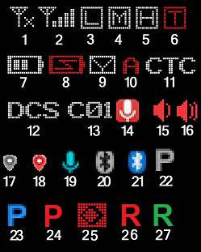

[← All 868-878 mods](index.md)

!!! note "Author: Jason Reilly VK7ZJA (silent key, January 2023)"
    © Jason Reilly 2018–2022. Jason's pages were preserved by Norman Williams on hamradiosouthernrepeaters.co.uk and are reproduced here, unchanged, so that his work stays available. They will be removed on request from his family. [Original page](https://hamradiosouthernrepeaters.co.uk/images/878Mods/878techmods.html#Icons)

**Guide to the icons & what they mean**

These are the most common icons you will see on the display:

1.  Received signal, no signal present
2.  Received signal, full strength
3.  Low RF output power selected
4.  Mid RF output power selected
5.  High RF output power selected
6.  Turbo RF output power selected
7.  Battery level indicator
8.  Battery over discharged, recharge immediately!
9.  SMS message received & not yet read
10. Auto power off timer active - only visible if Bluetooth is off
11. CTCSS / PL-tone / sub-tone active on this channel (analogue only)
12. DCS / DPL-tone active on this channel (analogue only)
13. Colour code number (DMR digital channels only)
14. Recording feature active (only works for DMR digital channels)
15. Digital monitor single slot mode active (only works for DMR digital channels)
16. Digital monitor double slot mode active (only works for DMR digital channels)
17. GPS no position fix yet
18. GPS position acquired
19. VOX turned on
20. Bluetooth turned on, no audio device paired
21. Bluetooth audio device paired OK
22. Bluetooth PTT device not yet paired
23. Bluetooth PTT device paired OK
24. Bluetooth PTT device battery low
25. Encrypted channel (DMR digital channels set with encryption only)
26. Roaming searching
27. Roaming repeater found

------------------------------------------------------------------------
