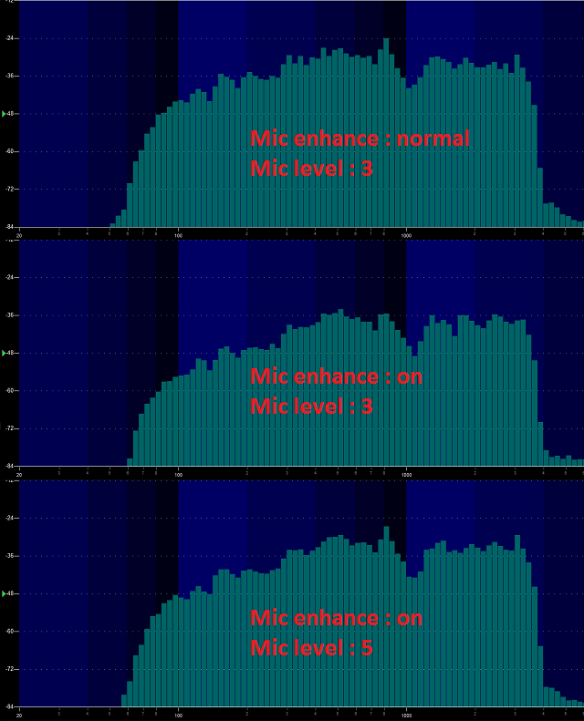

[← All 868-878 mods](index.md)

!!! note "Author: Jason Reilly VK7ZJA (silent key, January 2023)"
    © Jason Reilly 2018–2022. Jason's pages were preserved by Norman Williams on hamradiosouthernrepeaters.co.uk and are reproduced here, unchanged, so that his work stays available. They will be removed on request from his family. [Original page](https://hamradiosouthernrepeaters.co.uk/images/878Mods/878techmods.html#EnhancedMic)

**Hint when using 'enhanced microphone audio'**
So just what does Mic Enhance (Settings \> Radio Set \> Enhance Sound \> Mic Enhance) do exactly? Firstly, lets talk about what it does **not** do. Enhance Sound / Mic Enhance does not have any effect on received audio at all, and it does not have any effect on transmitted analogue FM audio.

What Mic Enhance does is to add in a high pass filter for your voice when transmitting on DMR. This rolls off the low end response of the microphone, so if you have a deep and booming voice, this might make your voice a little more pleasant to listen to on DMR. Enabling Mic Enhance causes DMR transmitted audio to be overall a bit quieter, so to compensate for that, increase your Mic Level up two notches. You could also use Mic Enhance to quieten down your DMR transmitted audio but leave FM transmitted audio level unaffected, if you find that people are telling you that you are too loud on DMR but fine on FM.

*My recommendation is to leave Mic Enhance setting at normal, unless you have a specific need otherwise.*

Shown here is the transmitted audio response plots using a test audio clip transmitted using DMR:

------------------------------------------------------------------------
