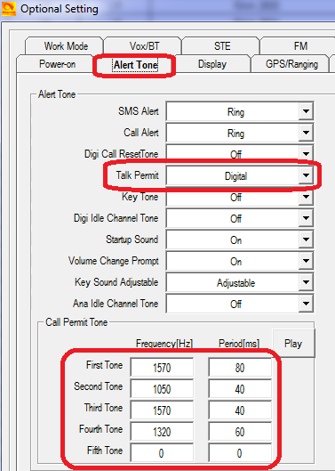

# Make your radio sound like a Motorola and other fun tone sequences to play with

[← All 868-878 mods](index.md)

!!! note "Author: Jason Reilly VK7ZJA (silent key, January 2023)"
    © Jason Reilly 2018–2022. Jason's pages were preserved by Norman Williams on hamradiosouthernrepeaters.co.uk and are reproduced here, with light formatting and spelling edits for readability, so that his work stays available. They will be removed on request from his family. [Original page](https://hamradiosouthernrepeaters.co.uk/images/878Mods/878techmods.html#TPTchirp)

You can set up your radio so the transmit permit tone sounds like that of a Motorola DMR or P25 radio.

## MotoTRBO DMR chirp

Use these settings under **Optional Setting → Alert Tone** to give the distinctive MotoTRBO DMR chirp:

*Optional Setting → Alert Tone: Talk Permit = Digital. Call Permit Tone: First Tone 1570 Hz / 80 ms, Second Tone 1050 Hz / 40 ms, Third Tone 1570 Hz / 40 ms, Fourth Tone 1320 Hz / 60 ms, Fifth Tone 0 Hz / 0 ms.*

It is necessary to have the first tone set to 80mS, as the radio does cut off the first 40mS of the sequence, and the last tone to be set to 60mS. This will make the TPT tone issued by the 878 *identical* to the familiar MotoTRBO TPT sound.

## Motorola trunked system

For a Motorola trunked system transmit permit tone, enter:

| Tone | Frequency | Period |
|---|---|---|
| 1st | 910 Hz | 60mS |
| 2nd | 0 Hz | 20mS |
| 3rd | 910 Hz | 30mS |
| 4th | 0 Hz | 20mS |
| 5th | 910 Hz | 70mS |

At first glance, these figures don't match exactly the Motorola trunked system transmit permit tone, but when you take into consideration the slight delays and tone cut offs of the AnyTone, the actual sound produced by the speaker is *identical.*

## Fun tone sequences

From Steve WA7PTM comes a fun tone sequence to try. You can use this for the Call Tone, Idle Channel Tone or Call Reset Tone, completely your choice.

| Tone | Frequency | Period |
|---|---|---|
| 1st tone | 1175 Hz | 200ms |
| 2nd tone | 1319 Hz | 200ms |
| 3rd tone | 1047 Hz | 200ms |
| 4th tone | 523 Hz | 200ms |
| 5th tone | 784 Hz | 200ms |

Now you'll hear the famous melody from Close Encounters of the Third Kind movie.

Or how about the melody Manah Manah made famous by The Muppets?

| Tone | Frequency | Period |
|---|---|---|
| 1st tone | 1397 Hz | 150ms |
| 2nd tone | 1760 Hz | 150ms |
| 3rd tone | 1976 Hz | 50ms |
| 4th tone | 1568 Hz | 50ms |
| 5th tone | 1318 Hz | 50ms |
