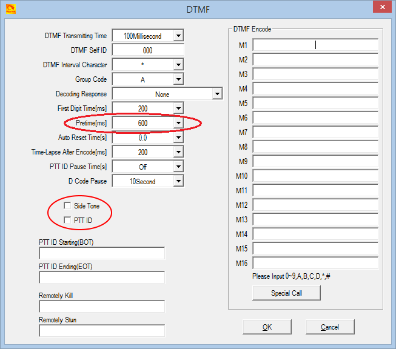

[← All 868-878 mods](index.md)

!!! note "Author: Jason Reilly VK7ZJA (silent key, January 2023)"
    © Jason Reilly 2018–2022. Jason's pages were preserved by Norman Williams on hamradiosouthernrepeaters.co.uk and are reproduced here, unchanged, so that his work stays available. They will be removed on request from his family. [Original page](https://hamradiosouthernrepeaters.co.uk/images/878Mods/878techmods.html#Echolink)

**Using the address book to dial EchoLink nodes**
*Courtesy of Klaus DL5MCC*
EchoLink is a system that allows amateur radio operators to communicate with one another via EchoLink 'nodes' that are connected together by the internet. A regular analog FM radio is used to access each node. To connect to a certain node via a FM-Simplex Link (-L) or -Repeater (-R), you dial the node number just by transmitting the node number you wish to connect to using DTMF-tones. Described here is a method of using the analog address book to store, recall and dial node numbers at the touch of a button.

1.  First, in the CPS, go to Analog \> Analog Address Book and add in each node you might want to be able to quickly recall / dial. The node number goes in the Number column, and the node name / callsign goes under the Name column. This name is what you will see on the radio screen, so it can be given any name that is meaningful to you.

2.  Then, in Analog \> DTMF Setting, set the following:

    

    It is recommended to switch off the side tone, as otherwise you will hear the DTMF tone while transmitting, with full audio level (which could be annoyingly loud).

3.  Next, in Optional Settings \> Other, set your Address Book Is Sent With Its Own Code to off.

4.  The final step is to go in to each channel that is programmed that you will use to connect to your local EchoLink node, and ensure that Optional Signal is set to DTMF.

In use, to connect to an EchoLink node, select the frequency / channel of a nearby FM-Echo-Link Node (-L) or -Repeater (-L). Then press List (red button) and select the entry, you intend to call. With the desired entry highlighted, just press and hold PTT while the sequence of DTMF is transmitted.
Please note, that only DTMF-numbers can be stored in the analog address book. Any other characters (ABCD\*#) required to control a link, must be entered manually by the keypad.

------------------------------------------------------------------------
