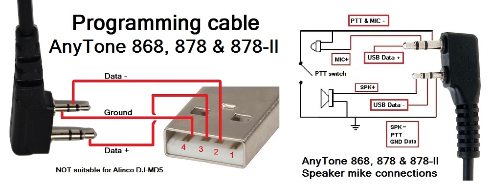
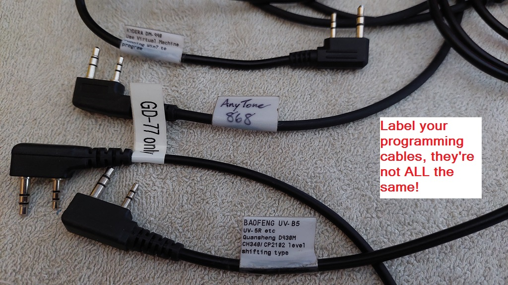

# 868 / 878 / 6X2 programming cable pin out

[← All 868-878 mods](index.md)

!!! note "Author: Jason Reilly VK7ZJA (silent key, January 2023)"
    © Jason Reilly 2018–2022. Jason's pages were preserved by Norman Williams on hamradiosouthernrepeaters.co.uk and are reproduced here, with light formatting and spelling edits for readability, so that his work stays available. They will be removed on request from his family. [Original page](https://hamradiosouthernrepeaters.co.uk/images/878Mods/878techmods.html#ProgCable)

Unlike many other Baofeng programming cables, the 878 cable has no electronics inside, but does need a driver to be installed. You can even make your own spare programming cable if you wanted, using this pin out as a guide. Thanks to Thorsten DC2ZU for correcting my mistake in the original diagram. The Alinco DJ-MD5 programming cable definitely IS different to the below, and I don't have the diagram for that, sorry.

While we are on the subject of programming cables, it is now common to own several different radio models, each with their own unique programming cable. Despite common belief to the contrary, not **ALL** cables are the same! Just because they look the same externally, doesn't mean they are wired the same internally. There are a few other programming cables that can be used as an alternative to the AnyTone 878 programming cable, such as the Radioddity GD-77, TYT MD-380 & UV380, Retevis RT-3 & RT-3S, but these are the ***only*** tested, proven & known to be compatible types so far. In any case, to reduce any confusion later on - possibly leading to grabbing the wrong programming cable and it not working, it might lead you to think that the cable or radio is somehow now faulty (I've even seen one instance where use of the wrong USB cable has caused actual damage to the PC USB port!) - label your programming cables with the model of radio it is for as soon as you get it out of the box when new.

