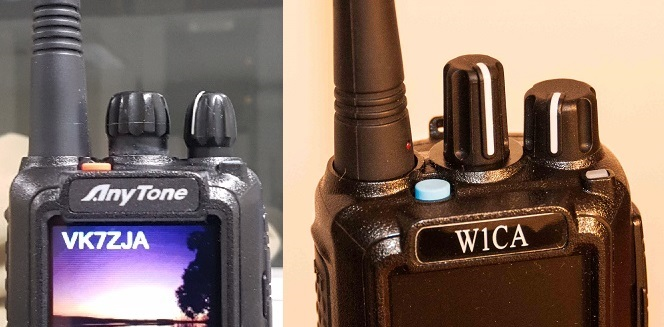
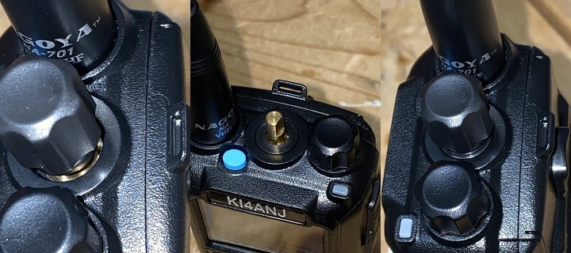

# New knobs for the 878

[← All 868-878 mods](index.md)

!!! note "Author: Jason Reilly VK7ZJA (silent key, January 2023)"
    © Jason Reilly 2018–2022. Jason's pages were preserved by Norman Williams on hamradiosouthernrepeaters.co.uk and are reproduced here, with light formatting and spelling edits for readability, so that his work stays available. They will be removed on request from his family. [Original page](https://hamradiosouthernrepeaters.co.uk/images/878Mods/878techmods.html#NewKnobs)

*Difficulty: Easy*

The knobs as fitted by the AnyTone factory are, in my opinion, awful design. They are difficult and slippery to grip and look a little odd. Some people add a little bit of heat shrink around the existing knobs for a bit of extra grip. You can also replace the knobs with knobs from other radios. The original knobs just pull off, no special tools required.

## Motorola MTX, GP339 and PRO series knobs

I recommend some after market knobs that suit the Motorola MTX, GP339 and some PRO series radios. The smaller knob has to be drilled out a little, while the larger knob needs something to fix it to the tuning shaft. Hot melt glue works well.

## Motorola XPR3000 / XPR7000 knobs

George, W1CA, recommends some Motorola knobs for the XPR3000 or XPR7000 series of radios as replacements. These knobs don't need any drilling, but the flat on the channel shaft needs to be filed to lengthen it slightly to allow the taller knob to fit all the way down the shaft. (Be careful not to scratch your radio when filing the shaft.)

Either set of knobs looks and feels much better in use, and the knobs can be bought on eBay for just a few dollars:

## TYT MD-380 knobs

Another possibility is using TYT MD-380 volume and channel selector knobs, these fit perfectly without any modification, and can be purchased as spares from various suppliers.

!!! tip
    From Allen KI4ANJ comes this hint when using MD-380 knobs: due to the design of the MD-380 channel selector knob, it leaves some of the brass ring nut visible around the base of the knob. This can be improved by fitting a black M6 size nylon washer. It's a very snug fit and needs nothing to hold it in place and fills the gap perfectly.

