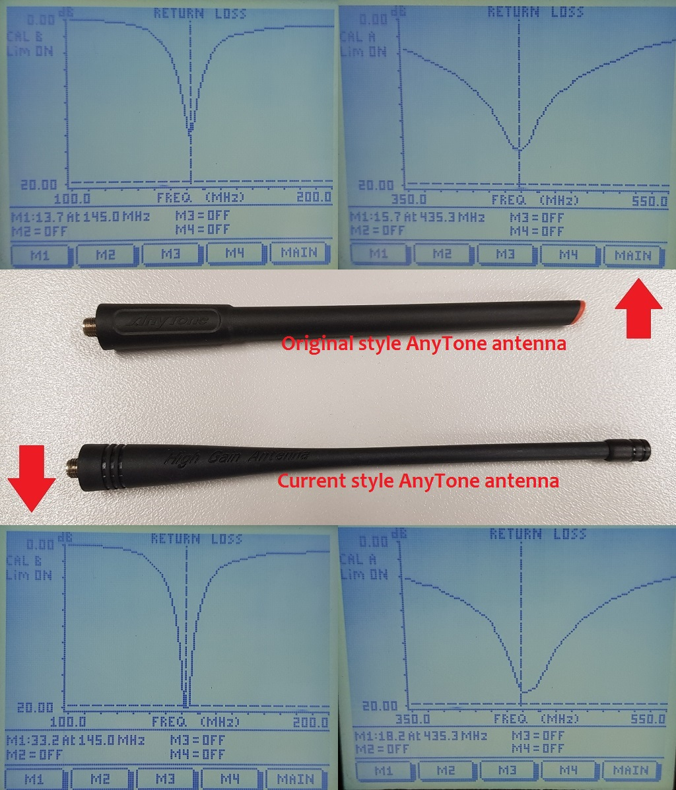

# Antennae for the 868 / 878 / 6X2

[← All 868-878 mods](index.md)

!!! note "Author: Jason Reilly VK7ZJA (silent key, January 2023)"
    © Jason Reilly 2018–2022. Jason's pages were preserved by Norman Williams on hamradiosouthernrepeaters.co.uk and are reproduced here, with light formatting and spelling edits for readability, so that his work stays available. They will be removed on request from his family. [Original page](https://hamradiosouthernrepeaters.co.uk/images/878Mods/878techmods.html#Antennae)

The 'best' antenna to use will depend on many things, considerations such as will you be wearing the radio on your belt, or do you want the shortest antenna possible, or do you need a no compromise performance antenna are all questions to be asked in order to work out the best for your use. The following antennae are what I use, and reasons why:

- *Very Short:* for the shortest possible antenna, they don't get much smaller than a stubby 1.5 inch long antenna commonly found on eBay with the model number PHD-601. Unlike most other antennae of this length, the PHD-601 is genuinely resonant at both VHF & UHF; the vast majority of antennae around this length are resonant on UHF alone. However due the extreme short length, don't expect this antenna to work much better than a dummy load. Strictly for very short range contacts only!
- *Short:* many people ask what is the antenna I use as seen in the photo at the top of [AnyTone 868-878 mods, hints & tips](index.md). That is simply a UHF helical stubby antenna about 2.5 inches long, which you can find very cheaply on eBay. They work very nicely on UHF which is where the majority of my operating takes place, but VHF operation is limited to receive only. This antenna looks quite professional, too.
- *Short no2:* for a genuine dual band short antenna around 3 inches long, the HuaHong HH-S518+ stubby antenna works rather well considering it's short length, but it is completely inflexible so not suitable for wearing on your belt. Just make sure you get the version with a female SMA connection on the antenna.
- *Medium:* believe it or not, the stock standard AnyTone dual band antenna that is supplied with the 878 is very good indeed, but if you need something super flexible, a *genuine* Nagoya NA-666 antenna works just as well, and you'll hardly notice it when worn on your belt.
- *Long:* the Comet SMA-24J or NKTech NK-930S are both especially good for VHF, and they are also both super flexible designs, but at 16 inches long are impractical to wear on your belt.

The stock standard antenna that AnyTone include with the 878 is actually an outstanding antenna. It is, by far, the best antenna that comes included with a radio. Take a look at these sweeps of the AnyTone antenna taken with a professional grade Anritsu SiteMaster S331:

These are superb results: a return loss of 33.2dB on VHF is equivalent to a VSWR of 1 : 1.05 and on UHF where the return loss is 18.2dB, or VSWR of 1 : 1.28, you can be confident that the vast majority of power being sent to the antenna is actually being radiated. These results are even better than a genuine Nagoya NA-666 or Diamond SRH-519! (Though the NA-666 extra two inch advantage offsets it's slightly worse VSWR result)

This is one case where buying an after market antenna isn't necessary - in fact you could be wasting your money on getting an antenna that doesn't work as well. Of course, if you need a shorter antenna, or a super-flexible one, don't let that stop you, but if you think ALL factory supplied antennae are junk - think again. Well done AnyTone!

Whichever antenna you go for, make sure the connection on the antenna is a female SMA. Otherwise, have fun experimenting with different types and see what works best for you.
