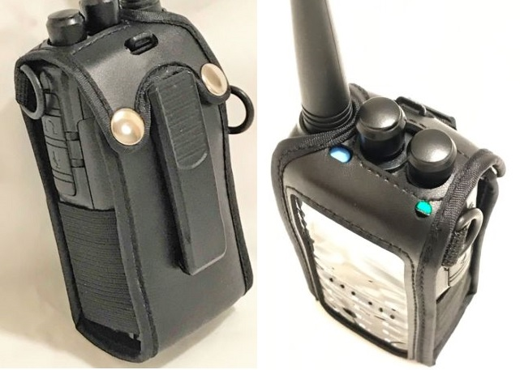

[← All 868-878 mods](index.md)

!!! note "Author: Jason Reilly VK7ZJA (silent key, January 2023)"
    © Jason Reilly 2018–2022. Jason's pages were preserved by Norman Williams on hamradiosouthernrepeaters.co.uk and are reproduced here, unchanged, so that his work stays available. They will be removed on request from his family. [Original page](https://hamradiosouthernrepeaters.co.uk/images/878Mods/878techmods.html#Case)

**Protective carry case for 868 / 878 / 6X2**
PowerWerx have a heavy duty protective carry case for USD \$29.99, which looks very professional. View it here: <https://powerwerx.com/csc-868-anytone-atd868uv-nylon-radio-case>
GigaParts also sold a similar heavy duty carry case, but no longer does so.
There are generic leatherette carry cases from China on eBay, around the USD \$12-15 mark (not including postage) which users report are quite good, and another eBay user jeepbangkok also sells a light duty carry case for around USD \$17 (not including postage) which I have and can also report it is quite good too.

------------------------------------------------------------------------
