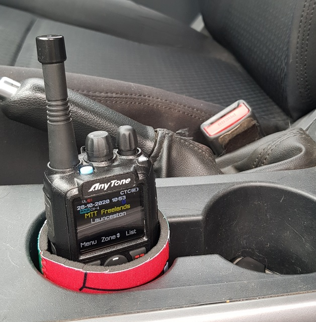

[← All 868-878 mods](index.md)

!!! note "Author: Jason Reilly VK7ZJA (silent key, January 2023)"
    © Jason Reilly 2018–2022. Jason's pages were preserved by Norman Williams on hamradiosouthernrepeaters.co.uk and are reproduced here, unchanged, so that his work stays available. They will be removed on request from his family. [Original page](https://hamradiosouthernrepeaters.co.uk/images/878Mods/878techmods.html#Holder)

**Using a car drink holder for the 868 / 878 / 6X2**
Using a cup or drink holder in your vehicle to hold the radio, but worried that about it getting scratches, scuffs or just loosely ratting around in the cup holder? Here is a very cheap and simple solution to that problem: use a cut down foam or neoprene drink can cooler sleeve. Others have also successfully used clip-on cup holders to hold the radio up higher towards the window sill where the radio will get a better signal.

------------------------------------------------------------------------
