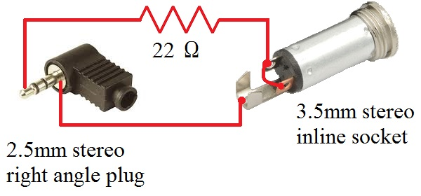
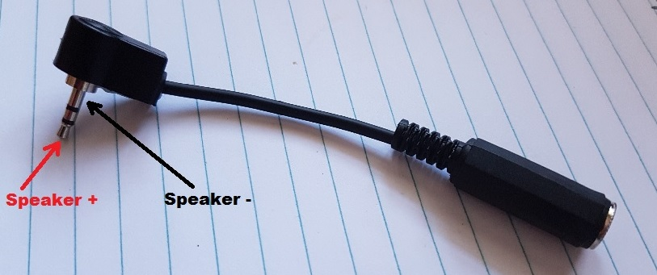

[← All 868-878 mods](index.md)

!!! note "Author: Jason Reilly VK7ZJA (silent key, January 2023)"
    © Jason Reilly 2018–2022. Jason's pages were preserved by Norman Williams on hamradiosouthernrepeaters.co.uk and are reproduced here, unchanged, so that his work stays available. They will be removed on request from his family. [Original page](https://hamradiosouthernrepeaters.co.uk/images/878Mods/878techmods.html#Headphone)

**DIY Headphone adaptor.** Easy
Here is a simple and easy to make adaptor so you can listen to the 878 with normal headphones. You'll need a right angle stereo 2.5mm audio plug, a stereo 3.5mm audio socket, a short length of shielded audio cable and a 22 ohm 1/4 watt resistor. Connect them up following the wiring diagram below, and you're good to go. I also filled the right angle audio plug with hot melt glue to secure the connection and give the connector a bit more solidity.

------------------------------------------------------------------------
