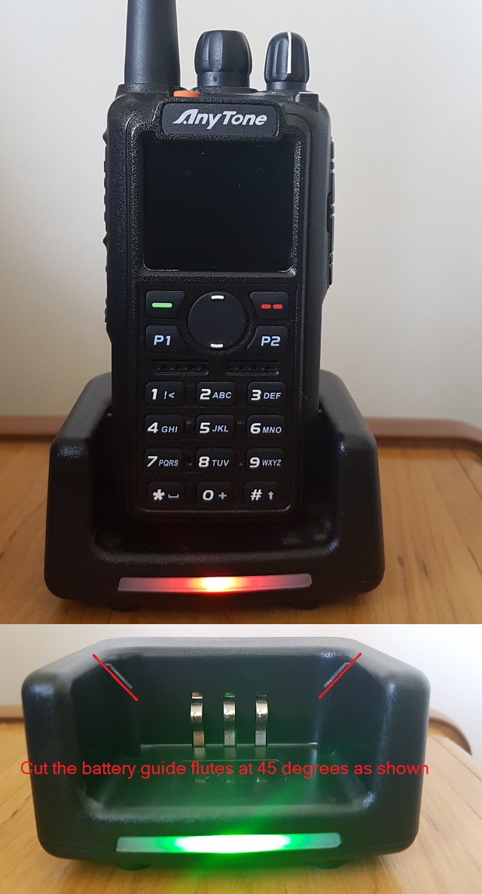

# Modifying the Radioddity GD-77 or TYT MD-390 or Retevis RT3 charger for the 878. Easy

[← All 868-878 mods](index.md)

!!! note "Author: Jason Reilly VK7ZJA (silent key, January 2023)"
    © Jason Reilly 2018–2022. Jason's pages were preserved by Norman Williams on hamradiosouthernrepeaters.co.uk and are reproduced here, with light formatting and spelling edits for readability, so that his work stays available. They will be removed on request from his family. [Original page](https://hamradiosouthernrepeaters.co.uk/images/878Mods/878techmods.html#UseOtherCharger)

By cutting off the battery guide 'flutes' as shown below, the GD-77 / MD-390 or RT3 charger base can be used to charge the AnyTone or Btech radios. The only downside is that these chargers will only charge at a 500mA rate, which means the battery will take twice as long to fully charge as the original charging base would.

