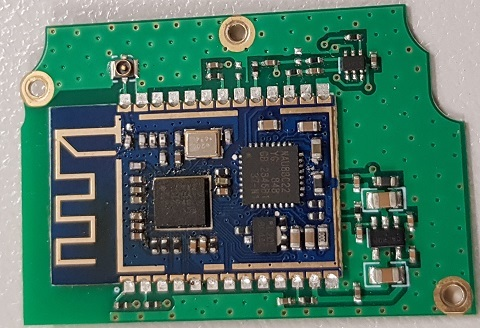

# How to disassemble the radio / fitting the new Bluetooth module

[← All 868-878 mods](index.md)

!!! note "Author: Jason Reilly VK7ZJA (silent key, January 2023)"
    © Jason Reilly 2018–2022. Jason's pages were preserved by Norman Williams on hamradiosouthernrepeaters.co.uk and are reproduced here, with light formatting and spelling edits for readability, so that his work stays available. They will be removed on request from his family. [Original page](https://hamradiosouthernrepeaters.co.uk/images/878Mods/878techmods.html#Disassemble)

*Difficulty: Moderate*

Credit to Duane N6DMR

Here is an excellent video, narrated by Duane N6DMR, on how to disassemble the 868 / 878 / 6X2 radio. It goes on to show how the optional Bluetooth module and it's antenna is fitted, and then reassembly of the radio.

<https://www.youtube.com/watch?v=6ZPMJs6bwbQ>

Some of my own hints to go along with the video:

- If you are planning on getting a Bluetooth module to fit to your AnyTone, you must ensure that it is a second revision 'V2' hardware PCB variant with the little plastic press fit connector on the PCB, and that you have (or can make & fit your own) a little metal shield over the SCT3258 IC, as not all radios have this shield fitted already.
- When doing up the screws, first do them up all just a little bit loosely, then after they're all in place go around and do them up snugly, but not over-tight. This is vital to good RF shielding and overall receiver performance.
- As per the video, re-solder the antenna pin only after you have done the screws up, otherwise the final tightening of the screws and movement of the PCB to snug up to the chassis could place stress on or fracture the soldered antenna pin.
- To ease refitting of the radio chassis into the case, use a little bit of silicon or PTFE lubricant rubbed onto the rubber seal that goes around the chassis edges. This helps the seal slide nicely into the case, rather than it roll out of place and 'bubble' up between the gap, especially around the bottom.

