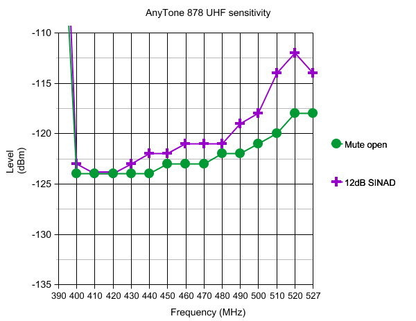

# Sensitivity plots

[← All 868-878 mods](index.md)

!!! note "Author: Jason Reilly VK7ZJA (silent key, January 2023)"
    © Jason Reilly 2018–2022. Jason's pages were preserved by Norman Williams on hamradiosouthernrepeaters.co.uk and are reproduced here, with light formatting and spelling edits for readability, so that his work stays available. They will be removed on request from his family. [Original page](https://hamradiosouthernrepeaters.co.uk/images/878Mods/878techmods.html#Sensitivity)

Refer to the sensitivity plots below:

!!! note
    These measurements were all made in Narrowband FM mode. Wideband FM results are 2dB higher. DMR sensitivity is listed as being -117.4dBm for BER 5% and -110dBm for BER 1%.

## Summary (12dB SINAD in Narrowband FM)

| Band | Sensitivity |
| --- | --- |
| VHF | 0.13uV |
| 220 MHz | 0.32uV |
| UHF | 0.18uV |
