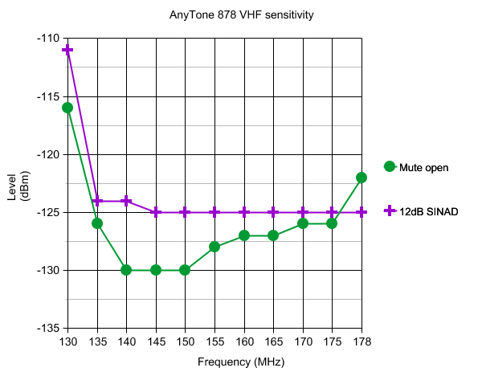
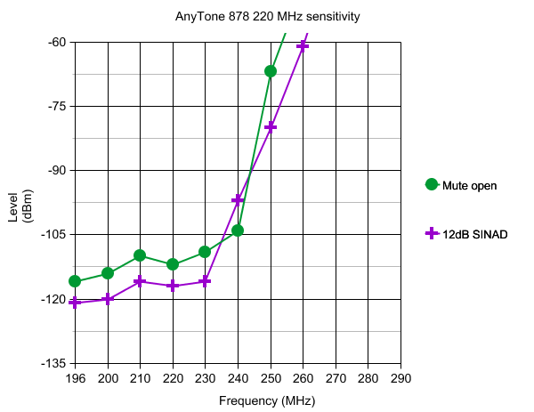

[← All 868-878 mods](index.md)

!!! note "Author: Jason Reilly VK7ZJA (silent key, January 2023)"
    © Jason Reilly 2018–2022. Jason's pages were preserved by Norman Williams on hamradiosouthernrepeaters.co.uk and are reproduced here, unchanged, so that his work stays available. They will be removed on request from his family. [Original page](https://hamradiosouthernrepeaters.co.uk/images/878Mods/878techmods.html#Sensitivity)

Refer to the sensitivity plots below:

**These measurements were all made in Narrowband FM mode. Wideband FM results are 2dB higher. DMR sensitivity is listed as being -117.4dBm for BER 5% and -110dBm for BER 1%**

Summary: 0.13uV VHF // 0.32uV 220 MHz // 0.18uV UHF for 12dB SINAD in Narrowband FM.

------------------------------------------------------------------------
