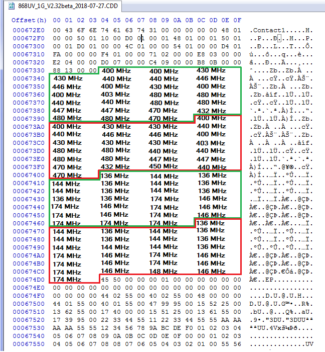

[← All 868-878 mods](index.md)

!!! note "Author: Jason Reilly VK7ZJA (silent key, January 2023)"
    © Jason Reilly 2018–2022. Jason's pages were preserved by Norman Williams on hamradiosouthernrepeaters.co.uk and are reproduced here, unchanged, so that his work stays available. They will be removed on request from his family. [Original page](https://hamradiosouthernrepeaters.co.uk/images/878Mods/878techmods.html#Theory)

**Theory behind the frequency expansion mod.** Advanced
The age of hardware expansion modification is over, 99% of the time these days software is the route to achieving results. When looking to make frequency expansion modifications by software, the first step is to see if the programming software can accept, or be tricked to accept out of band frequencies; if you can't send those frequencies to the radio, then modification becomes a lot more difficult. Thankfully, a lot of programming software only checks for valid frequency entry when entering details by hand inside the software. If you edit a saved configuration file, or import frequencies / channels, often this doesn't go through the software sanity test. The 878 programming software is no exception to this; while out of band frequencies can't be entered by hand, they can be imported just fine.

The next step is to ensure these out of band frequencies are actually being sent to the radio as intended. For capturing USB data as it is being sent to the radio, WireShark is the go-to tool to analyse USB packets and ensure that the frequencies you want are actually being sent. If the radio accepts and uses these out of band frequencies, you are done and dusted.

In the case of the 878, the firmware inside the radio does have a sanity check going on to trap any frequencies that fall outside permitted limits.
Where a radio is doing a sanity check on a programmed channel's frequency, it will compare it against a limit that is programmed in to the radio, perhaps as part of its firmware, or perhaps compared against another memory location. In this case, the 878 has multiple limits stored as part of its firmware. These multiple limits are there to set one of the many options of permitted bands. Things become interesting when trying to find out exactly how the radio represents these limits.

One of the essential tools for snooping inside and modifying software like this is something called a hex-editor.
[If you need a good hex editor, download HxD in your preferred language here (about 860kb)](https://mh-nexus.de/en/downloads.php?product=HxD)

Numbers representing frequencies and frequency limits could be stored in one of many ways, including:

- BCD - binary coded decimal. Example: 146.500 MHz might be seen in a hex editor as 01 04 06 05 00 00. That's quite wasteful on memory, so it could be represented in a 'packed' form and you would see in a hex editor the following sequence: 14 65 00. The Radioddity GD-77 happens to use this method, combined with little endian format as explained below.
- Direct hexadecimal notation. Continuing to use the example of 146.500 MHz, if we convert this to a kHz value of 146500 kHz, that is equal to hexadecimal 23C44, or if we break it up into bytes as seen by a hex editor: 02 3C 44. More commonly though, the frequency is represented as a value in Hz, as 12.5kHz step frequencies couldn't be represented with a whole number value in just kHz. So again using our frequency of 146.500 MHz, that's 146500000 in Hz. Converting that to hex gives 8BB69A0, and broken up into bytes: 08 BB 69 A0.
- Other methods that might be convenient to use: it might be feasible to represent frequencies in a form that is directly used by the frequency synthesis hardware. In PLL schemes, this might be in the form of a 'divider word' that is sent to a programmable divider.
- For radios using the AT1846S 'radio-on-a-chip' they receive data in the form of a hex representation of frequency in kHz x16. Yet again using 146.500 MHz as an example: 146.500 MHz is 146500 kHz, and then multiply by 16 = 2344000 in decimal. Then convert to hex: 23 C4 40. It is possible some radios may store frequencies in a form that can be directly sent to the AT1846S.

It is also worth mentioning that in most systems, a 'little endian' format is used, which simply means to give the lowest significant value byte first. If we have calculated our value as 23 C4 40, then the little endian representation of that is 40 C4 23.
So you can see there could be a variety of methods used to represent frequency values inside software and firmware, and you would have to search for byte patterns for each potential method.
In the case of the 878, none of these methods seem to work, but there is another clue: the .rdt file. After careful examination, you will find that each channel's frequency is stored as a little endian format hex representation of the programmed frequency in Hz divided by 10. Using our example of 146.500 MHz, converting to Hz gives 146500000, and then divide by 10 = 14650000. Now convert to hex: DF 8A 90. And then finally little endian format it: 90 8A DF.
Using this method the 878 stores frequencies in the .rdt 'codeplug' file, we do get some hits if we search for byte patterns of 480 MHz using this method in the firmware .CDD file. Now it's a matter of determining which of those byte groups should be changed. Taking an educated guess, we can assume that the thirteen user selectable band limit frequencies would all be stored together in one area. And so they are!

We can take another educated guess and say that the first lot of bytes in each group indicated correspond to the first user selection in the MODE: 0000x. Now all we need do is to alter those bytes to our new frequency limit. Let's try to go for an upper frequency limit of 527 MHz: 527 MHz = 527000000 Hz, divide by 10 = 52700000, in hex = 03 24 23 60, and finally little endian format = 60 23 24 03. We would replace the first appearance of the representation of 480 MHz (00 6C DC 02) with our new limit of 527 MHz (60 23 24 03).
Sending this modified firmware image to the radio works! You can now tune the VFO above 480 MHz. But now there seems to be another problem: for some reason the tuning stops at 500 MHz exactly (or 520 MHz on the 878). It turns out there is yet another coded limit within the firmware; it assumes the radio will never need to tune above 500 MHz (520 on the 878). We can fix that, too!
Performing another search in the firmware for the representation of 500 MHz (80 F0 FA 02) gives just one hit - this must be it. Change that out for our new limit of 527 MHz (60 23 24 03) and now save that and send to the radio. It works! The radio is now tuning up to 527 MHz.
Incidentally, the 868 also has a lower limit for UHF defined, at 300 MHz. In order for the 868 to tune down to 220 MHz, you have to change this limit as well. Change it out for 210 MHz. Don't try to define a lower UHF frequency limit below 210 MHz as the 868 firmware gets awfully confused and some strange things begin to happen.
The frequency expansion for the 878 is just a little different, because the latest firmware incorporates changes to accommodate a different (Chinese domestic?) version of the radio with 220-250 MHz, the boundary between VHF and UHF has changed from 200 MHz in the 868 to 300 MHz in the 878, starting with firmware v1.07. This means that the bonus expanded frequencies from 190-280 MHz will be part of the VHF band settings. This actually makes the modification just a little easier as we don't have to worry about crossing hard coded band limits.
But how do we know it is actually working, not just displaying a frequency and nothing else? If you have a signal generator, you can test that the 878 is actually receiving this signal. Conveniently, the 878 has a quirk that will tell you if the receiver is 'unlocked' and not working at that frequency: program a button as FM monitor, or turn the squelch level to off. If the radio makes a pulsing or popping noise, the receiver is unlocked and is too far out of band to work. If you hear a constant rush of noise, that indicates the receiver is locked and is working as well as it can do.
Do note that due to the bandpass filtering and front end tracking gain, out of band frequencies between 200 & 400 MHz are not very sensitive, only very strong signals will be heard.
As a final note, when a new version of firmware is released, the addresses at which the changed bytes are written are highly likely to change. You would have to do a fresh search for the byte patterns and replace them appropriately in the new version of firmware.

------------------------------------------------------------------------
