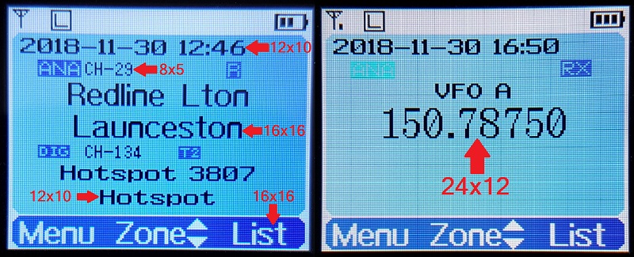
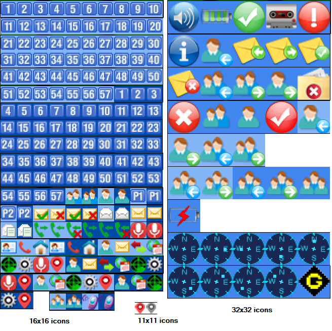

# Changing the display font / modifying some of the icons Advanced

[← All 868-878 mods](index.md)

!!! note "Author: Jason Reilly VK7ZJA (silent key, January 2023)"
    © Jason Reilly 2018–2022. Jason's pages were preserved by Norman Williams on hamradiosouthernrepeaters.co.uk and are reproduced here, with light formatting and spelling edits for readability, so that his work stays available. They will be removed on request from his family. [Original page](https://hamradiosouthernrepeaters.co.uk/images/878Mods/878techmods.html#Fonts)

*(Credit to Colin G4EML & Ronan EI4KN – the 'font master' hihi)*

Would you like to change the display font on your 878, and don't mind getting your hands dirty with a hex editor and a few other tools? Then do I have a deal for you!

There are five different fonts encoded into the 878 firmware .CDD file. The location within the firmware file at which the fonts are encoded will change from version to version. Therefore, the first thing you need to do is identify exactly where the fonts you want to replace are located. To make this job easier, Colin G4EML has created a small executable which allows you to graphically view a file as a bitmapped image.

Download Colin G4EML ImageTest (15kb) software from:

- [Download from this webpage here](../../originals/anytonetechzone/ImageTest.zip)
- [Download via Mega](https://mega.nz/file/WokURZ4b#xjl-6b-4NWrGvwaODjXaCDf0qtn1eAHPpNCkfEiM2FA)
- [Download via Google Drive](https://drive.google.com/file/d/1buYpE91TBzTkrkmEmwkwaNA0hPycITjG/view?usp=sharing)
- [Download via Sabercat host](https://sabercathost.com/myaG/mod_firmware.zip)

## Finding the fonts

Be aware that the bitmapped icons and fonts are vertical raster, not horizontal. It could take a lot of scrolling through the file to identify the font, but the auto step feature makes life a lot easier.

In the 868 v2.33 firmware, there are five font sizes:

| Font (H x W) | Use | Location |
|---|---|---|
| 8x5 | tiny | 0x06D6F7-0x06D908 |
| 12x10 | medium | 0x06D921-0x06E1EB |
| 16x16 | main font | 0x06E20B-0x06EDC8 |
| 24x12 | VFO digits | 0x06EDEF-0x06FB2C |
| 24x16 | a fifth and unused super large font of numbers and upper case letters only | 0x06FB2D-0x07037E |

Other symbols such as the antenna signal meter, battery level meter etc. will be found at 0x07037F-0x070812.

!!! note
    Remember, these addresses / locations are only valid for firmware version 2.33, the exact locations will change a little in other versions.

## Creating a replacement font

Once you find the location of the font you want to play with, make a note of its starting location. Now you'll want to create a font of the same size. A very useful tool to convert fonts from your computer into bitmaps is Rays Font Editor which you can download here:

- [http://www.rayslogic.com/Software/RaysFontEditor/RaysFontEditor_24Aug12.zip (3.0 Mb)](http://www.rayslogic.com/Software/RaysFontEditor/RaysFontEditor_24Aug12.zip)

Make sure you convert the font to the same size as the one you are going to replace. To use Rays Font Editor to produce a bitmap ready for the 878:

1. Install your desired TTF font as a system font on your PC.
2. Select Capture System Font, then select your desired font from the list.
3. Select input size by point, and play around with the value to get each character fully visible. Typically the letters M and W are difficult to fit in smaller pixel widths and get truncated at the sides, and lower case letters g, j, p, q and y can get cut off at the bottom: try smaller point values to get the font small enough to fit or manually tweak the problem letters yourself. As an example, the Courier New TTF font works well if imported at 10 point size.
4. Select Output character size – Change font size and enter height and width to suit the font you are replacing, and click OK.
5. Examine your characters that have been imported to make sure they all fit nicely and are fully legible. You can edit the appearance and shift characters up/down/left/right to make them look nice.
6. Select Font settings, and choose character range starting at 32 and ending at 126, as those are the only characters the 878 needs.
7. Select Export font. You want to select 'custom', format is binary file, scan direction set to start top-left, scan vertical and leave the other settings as they are. Give your font a name and save it.
8. Rename the extension of your font from a .dat to .bin and you have a file that's ready to go into the 878.

## Writing the font to the firmware

Once you have a binary image of your desired font, you might want to use Colin's ImageTest application to examine the fonts and confirm how they'll appear on the radio screen.

Now it is simply a case of using your hex editor to copy this binary data from the file you just created over the top of the font data in the firmware file, at the start address you noted earlier. If using HxD, use paste write, not paste insert when copying your new font binary data into the firmware image. Write the firmware to your 878 and enjoy a new look display.

## Coloured icons

Multi-coloured icons, other than the basic mono-chromatic symbols, are mostly stored in the 868 flash memory locations 0x0015A000 to 0x00200000. The icon update file D868_1G_ICON_V1.11.CDD will write icon data to those memory locations, so it is easiest to edit a copy of this file if you want to customise some of your coloured icons. They are encoded as RGB565 raw bitmap format, and of varying sizes. You could use a raw bitmap viewer to explore the contents of the icon update file. A good website to do this is located at: <http://rawpixels.net/>

For full screen bitmaps such as the start up image, select a width of 128 pixels, height of 160 pixels, select Flip V, select Predefined format of RGB565, and make sure Little Endian is not selected. For other icons you will need to play around with the width and height, but should use the same settings.

This is what all the standard icons in the 868 look like:

A few other coloured icons are encoded into the firmware image at locations 0x0708A8-0x07166F (v2.33 firmware), the main one used here is the 11x11 digital monitor speaker symbol.
