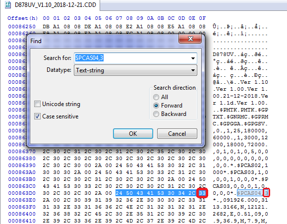
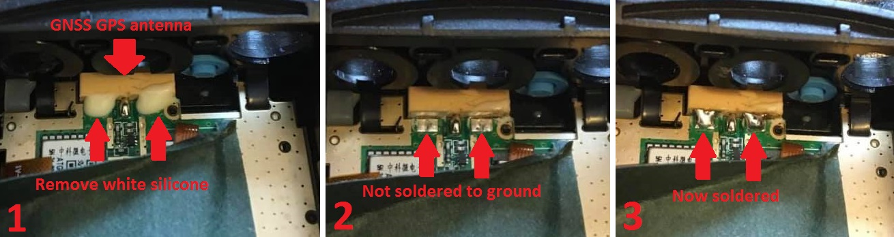

[← All 868-878 mods](index.md)

!!! note "Author: Jason Reilly VK7ZJA (silent key, January 2023)"
    © Jason Reilly 2018–2022. Jason's pages were preserved by Norman Williams on hamradiosouthernrepeaters.co.uk and are reproduced here, unchanged, so that his work stays available. They will be removed on request from his family. [Original page](https://hamradiosouthernrepeaters.co.uk/images/878Mods/878techmods.html#FasterGPS)

**Obtaining faster GPS lock for 868** Moderate
(Credit to github user tkerby)
It is commonly observed that the GPS is slow to lock on the 868. The GPS module as used in 868/878 is a dual GPS & BDS (BeiDou - Chinese equivalent to GPS with worldwide coverage) sensor, and it is configured to check not only L1 frequency for GPS, but also E1, E2, E5a, E5b and E6 frequencies for BDS. That is a lot more work for the module to do and explains why it is a bit slow to get an initial position lock. Fun fact: the module is only good to 1854km/h or Mach 1.5!
This modification is useful for the 868 only; the 878 permits the user to choose GPS only, BDS only or both systems used together. To speed up obtaining a position fix on the 868 you can force it to select just GPS.
The GPS module uses standard NMEA text strings, and the configuration for the GPS module is sent by the MCU from plain text instructions stored in the firmware. If you use a hex editor to search for the NMEA command text \$PCAS04,3 and change that text to \$PCAS04,2 for BDS only or \$PCAS04,1 for GPS only, you will speed up the time to get a position lock quite a bit, from typically 134 seconds to less than 30 seconds when outside. This also translates to slightly improved lock times when GPS signals are weak such as inside a house or inside a vehicle.

While it doesn't appear to be a very common problem, some users have observed that their GPS took a very long time to get a position fix, and that this was due to poor or missing soldering of the GPS antenna in their radio. Repair of poor or missing soldering on a ceramic substrate GPS antenna requires good skills in soldering, as the plating can be burnt off with too much applied heat. If you are not confident in your soldering skills, then you should return the radio to your supplier for a replacement.

------------------------------------------------------------------------
