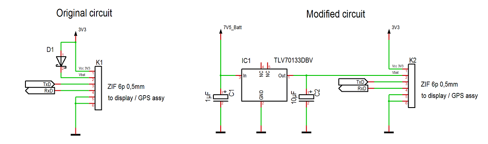
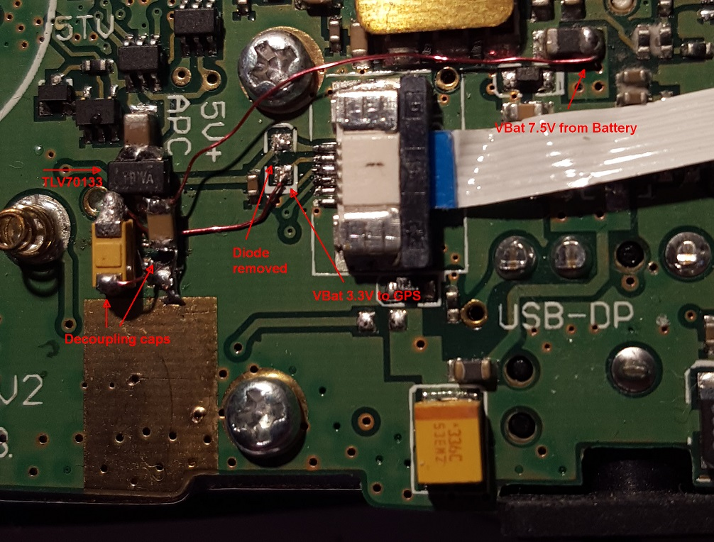

# Much faster GPS lock for the 878, 868 & 6X2

[← All 868-878 mods](index.md)

!!! note "Author: Jason Reilly VK7ZJA (silent key, January 2023)"
    © Jason Reilly 2018–2022. Jason's pages were preserved by Norman Williams on hamradiosouthernrepeaters.co.uk and are reproduced here, with light formatting and spelling edits for readability, so that his work stays available. They will be removed on request from his family. [Original page](https://hamradiosouthernrepeaters.co.uk/images/878Mods/878techmods.html#EvenFasterGPS)

*Difficulty: Advanced*

*(Credit to Bert DD5XL)*

GNSS / GPS systems are very cleverly designed systems. The time to obtain a position fix from first power on can be significantly sped up if the GPS receiver knows roughly what the time is, and knows some ephemeris data which can tell the GPS receiver what satellites it can expect to be able to see given the time of day. Knowing that data from the previous session when the GPS receiver was last used will enable the GPS receiver to obtain a position fix much quicker, and is known as a 'warm start'. In comparison, a 'cold start' is where the GPS receiver has no knowledge of time or ephemeris data and must search for and derive this information from scratch.

A warm start is possible when the GPS receiver can remember this required data, which requires the GPS receiver's internal RAM to be constantly powered so this data is retained for the next time it is used. In the 878, the GPS receiver module isn't constantly powered and so must perform a cold start every time it is turned on. However, Bert DD5XL has investigated this and found that it is possible to modify the power supply to the GPS receiver module to keep the RAM alive and permit a warm start, resulting in a much faster position fix. The modification to backup the GPS receiver module RAM only consumes 15uA which is a tiny amount of power, you would never notice this in normal use.

## Components

You'll need the following components to make the modification:

- TLV70133 surface mount 3.3 volt low drop out regulator
- surface mount tantalum capacitor with a value between 100nF & 1uF for C1
- surface mount ceramic capacitor with a value between 1 & 10uF for C2
- very small enamelled copper wire or very fine kynar insulated wire

## Making the modification

1. A diode close to the FPC ribbon connector first needs to be removed, as per the photo below.
2. Then solder the TLV70133 regulator on to the board, pins 4 & 5 are unused and may be soldered to ground to physically support the device. Attach it to ground side of a surface mount capacitor near the white printed APC text on the PCB.
3. Pin 2 of the TLV70133 needs to be bent downward and soldered directly to ground, some solder resist on the PCB directly below the pin can be carefully scraped off and used as a ground connection.
4. A surface mount capacitor of value between 100nF and 1uF is soldered between TLV70133 pin 3 and ground, and also connect pin 3 using fine insulated wire to the PCB where power is always available from the battery.
5. Another surface mount capacitor of value between 1uF and 10uF is soldered between TLV70133 pin 1 and ground, and also connect pin 1 using fine insulated wire to the PCB land going to the second pin of the FPC ribbon connector, using the PCB land where the diode was removed.

And that is the modification complete. Next time the GPS is used, it will have remembered data it needs to do a warm start and get a position fix much quicker. Of course, if the battery is removed off the radio, then the memory is lost and will result in a cold start the following power on.

