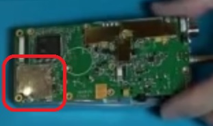
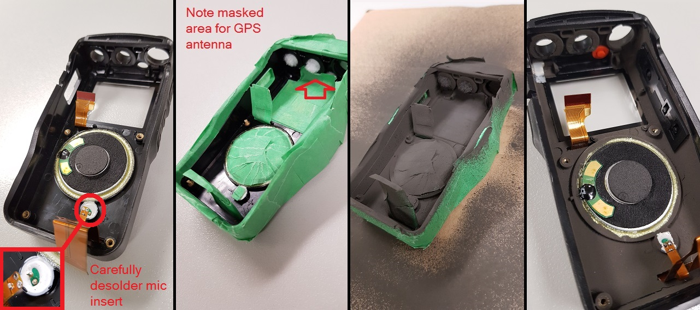
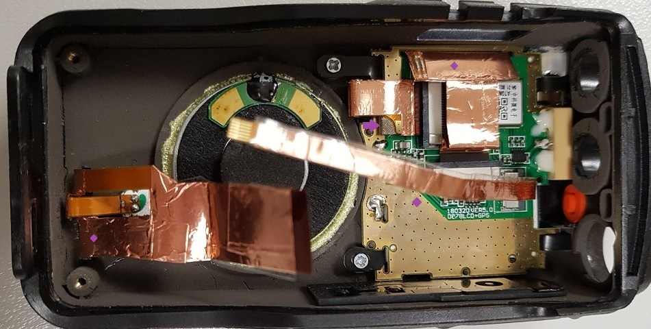

[← All 868-878 mods](index.md)

!!! note "Author: Jason Reilly VK7ZJA (silent key, January 2023)"
    © Jason Reilly 2018–2022. Jason's pages were preserved by Norman Williams on hamradiosouthernrepeaters.co.uk and are reproduced here, unchanged, so that his work stays available. They will be removed on request from his family. [Original page](https://hamradiosouthernrepeaters.co.uk/images/878Mods/878techmods.html#Noise)

**Resolving received noise / perceived poor VHF sensitivity issues** Easy to Advanced
(Credit to Colin G4EML)
Some people have noticed that, especially on VHF, ticking or other noise can affect weak analogue signals. There are a few things you can do to help this:

- *Turn off your clock display and GPS.* It appears as if any display updates or GPS data that is multiplexed on the data lines connecting the display front half of the radio to the main PCB will cause some interference on VHF. The primary culprit for this is the clock flashing colon between the hours and minutes. Updating to firmware version 2.33 or later can help, as this stops the colon / time separator symbol from flashing.
  

- *Noise from display.* The majority of noise appears to come from the LCD itself, and in later revisions of the radio, AnyTone reduced this noise by earthing the metal frame that surrounds the display. You can see this indicated by two small grey arrows in the picture of the display / GPS PCB a little bit further down. If your display doesn't have this, then thoroughly scrape the paint from the two metal tabs poking through the bottom of the display PCB and solder them to the ground plane as pictured. Use a 60-100 watt soldering iron to rapidly heat the components and solder quickly. Use of a smaller iron will take longer to heat components up which allows time for the heat to spread further, and that isn't ideal.
  

- *Chassis to PCB shielding:* A good connection between the PCB earth and the chassis will ensure the best RF shielding possible. Critical for this good connection, you should ensure that all screws are done up snugly, but not so tight that they will strip the threads.
  

- *New metal shield over the SCT3258 IC:* Appearing in the 878 radio is a small sheet metal shield fitted over the SCT3258 IC, as seen in this screen grab from the Bluetooth module fitting YouTube video mentioned earlier. This shield isn't fitted to all radios, and it isn't known if this on it's own helps with RF shielding. But if you do fit the Bluetooth module, ensuring this shield is in place is vital to ensure the Bluetooth RF transmissions don't interfere with the operation of the SCT3258, and to provide a physical mounting point for the Bluetooth antenna. I made my own shield out of tin plate. The shield only needs to sit about 1.5mm above the PCB, which allows just enough clearance for components, and a layer of electrical insulating tape on the underside of the shield. Allow a generous clearance around the screw holes at the bottom corner of the radio.

  

- *Nickel shielding spray paint. (Only for the really keen & fastidious radio operator: very extensive disassembly!)* While AnyTone have done a reasonable job of shielding sensitive parts of the circuitry with brass shields and the cast aluminium chassis, you can amp up the shielding by use of nickel shielding spray. If you look inside some cellular mobile phones or portable two way radios, you will sometimes see a coating of paint on the inside of any plastic parts. This paint could be black, brown, pink, grey or silver, and they all have a similar job: they're conductive and add a thin layer of RF shielding to the electronics inside. Electrolube's NSCP400H nickel spray paint is sold by Element14 (Farnell) is made exactly for this job.
  You might be able to find alternative products from other suppliers but do not use any of the carbon based conductive / EMI / RFI shielding paints, they are simply not good enough. Even with fancy sounding names like 'nano-impregnated' they can't compare to nickel, copper or silver based shielding paints. The carbon based paints are usually distinguishable by their very dark grey, almost black colour, so avoid any paint like that.
  You'll need to follow these general steps:

  1.  Completely disassemble the front half of the radio. You need a bare plastic shell with the LCD display, orange / blue top button and side PTT buttons removed and the plastic 'light pipe' for the top mounted TX/RX LED removed as well. The speaker and keyboard can remain in place.
  2.  There will be two ribbon cables coming out of the back of the keypad, don't try to remove these, leave as is for the moment.
  3.  Part of the bottom ribbon cable connects to the electret microphone insert. Desolder the ribbon cable from the insert.
  4.  Use masking tape to cover every surface that you don't want the nickel spray paint to go. That not only includes ALL the visible exterior parts, but also many interior areas as well. This job of masking every surface you don't want covered by the paint is fiddly and tedious in the extreme, but is necessary because the spray paint will go everywhere, trust me!
  5.  Cut out a circle of paper to fit over the speaker and use masking tape to neatly hold it over the back of the speaker. Use a small square of making tape to cover the back of the electret microphone insert.
  6.  Also cut out a rectangle of cardboard to the same size as the LCD clear display window lens. It is best not to use masking tape directly on the display lens or anything with printing, cover those with some paper or cardboard and hold in place with masking tape over the top.
  7.  Block up any openings such as the top & side button openings with cotton wool - I use craft work decorative soft balls for this and it works well.
  8.  You will also need to leave the area around the GPS antenna clear of any coating, so mask up that area on the inside of the case as well, just behind and above the AnyTone label.
  9.  Mask up the two ribbon cables coming out of the back of the keypad, and cover the little conductive contacts with paper so the masking tape doesn't leave any residue on these.
  10. Use some toothpicks to block up the four screw holes in the chassis, and cut them off so only a little bit pokes out of the screw hole.
  11. Finally, also mask up around a slight raised lip on the inside edge of the casing, where the rubber seal seats in the casing. The rubber seal is a very tight fit and you don't want to make that any tighter from a coating of nickel shielding paint, see the photos to see how this is done.
  12. Nickel spray paint is known to be rather hazardous. You will want to do this job outside, and on a calm wind free day. Wear goggles, dust mask, long sleeve shirt and rubber gloves.
  13. Place the masked up shell onto a piece of scrap cardboard and use good spray painting techniques to apply a thin coat of nickel spray on the inside of the shell. The spray will look uneven as you apply it, and don't let that tempt you into applying more paint in those areas. Too much paint will attack the plastic and cause the coating to crack once dried.
  14. Let the coat of nickel paint dry, about 24 hours.
  15. If need be, apply one more thin coat of nickel paint to cover any areas that were missed or uneven, and let dry for another 24 hours.
  16. Slowly remove any masking tape, cardboard protective bits and cotton wool stuffing, and pull out the toothpicks from the screw holes. You should have your same bare radio shell but with a nice grey coating of nickel spray paint on the inside.
  17. Reassemble the radio. Don't forget to wipe over the LCD screen and inside of the display lens with a good quality lint-free optical cleaning cloth before refitting the display board. Combining this nickel spray paint shielding with copper foil tape over the ribbon cables (details just below) provides the most benefit and greatest noise reduction.

  

  Don't coat the rectangular rubber piece that fits over the side speaker/mic connectors, these must be left 'floating' from ground. This nickel coating will give an extra 10dB worth of shielding to the back side of the main PCB, which results in a 'cleaner' receiver, especially in an area of moderate RF fields: weaker signals are less distorted and less disturbed by nearby transmitters in comparison to a radio without this treatment. The most noticeable improvement, however, is the receiver picks up far less 'birdies' (internally generated signals)
  *Note for those planning to, or already have, Bluetooth fitted*: the extra shielding offered by the nickel screening spray paint will have a detrimental effect on the Bluetooth signal getting in and out of your radio. Some signal will still leak out, but Bluetooth range will be decreased (by how much remains to be seen).
  

- *Shielding the small flat flexible ribbon cable* with some adhesive copper tape helps a little bit, according to Colin G4EML, especially if you have the older white style flat flexible ribbon cable. It is also essential that you insulate the copper shielding to prevent any shorts circuits, clear plastic sticky tape is fine. If you have a brown cable with no tracks visible on the back side as indicated by the single grey arrow in the picture of the display / GPS PCB a little bit further down, your cable is already upgraded and won't benefit much from any adding any extra shielding to the cable.

  

- *Adding more RF gaskets* In the picture above, see the little silver-grey sponge like thing indicated by the small purple arrow? That is called a 'RF gasket' and is used to ensure a positive earth connection between two surfaces. Here, AnyTone have fitted one to earth the shielded back side of that ribbon cable to the PCB ground plane. If you've taken the time to shield the ribbon cables with copper tape as per the point above, then you can add more RF gaskets in to earth them too, rather than leave them 'floating' from earth. (They won't really be entirely floating as they will get a little bit of capacitive coupling to earth, but this trick will ensure they are definitely very well earthed) This takes a little bit of planning, as you don't want to insulate the copper tape in the area where it is going to be making contact with the RF gasket, and nor do you want the RF gasket to short out anything nearby when it is compressed down and spreads out. I added four new RF gaskets to the radio:
  1.  Main ribbon near the microphone insert, adding the RF gasket just where it exits the slot in the front case. This relies on the front case being treated with the nickel shielding spray paint first.
  2.  Longer & wider ribbon for the display, again adding a little RF gasket just where it exits the slot of the display PCB.
  3.  Skinny little ribbon, adding a RF gasket on to the PCB near where the earth plane on the PCB is at a diagonal angle close to the white 'D878LCD+GPS' printing. Ensure the ribbon cable is insulated it's entire length except for the small area where it makes contact with the RF gasket here, you don't want it to short out the components just above the white printing on the display PCB, or on the main PCB. Afterward, the thicker green insulating pad is used to help hold the skinny ribbon cable in place so that it lays over the top of this RF gasket.
  4.  Last RF gasket goes on the RF shield of the main PCB close to the PTT side PCB, so it makes contact with the display LCD when they come together once the radio is reassembled. Some radios may have this RF gasket fitted by the factory already; mine did not.

  The position of the first three RF gaskets are indicated on the above picture by little purple diamonds, the gaskets go underneath the ribbon cables, just the same as the gasket under the ribbon cable with the purple arrow.

------------------------------------------------------------------------
