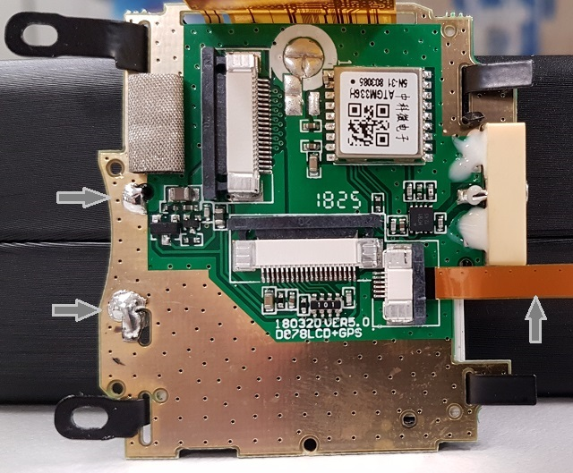
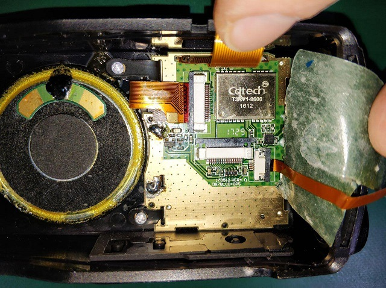
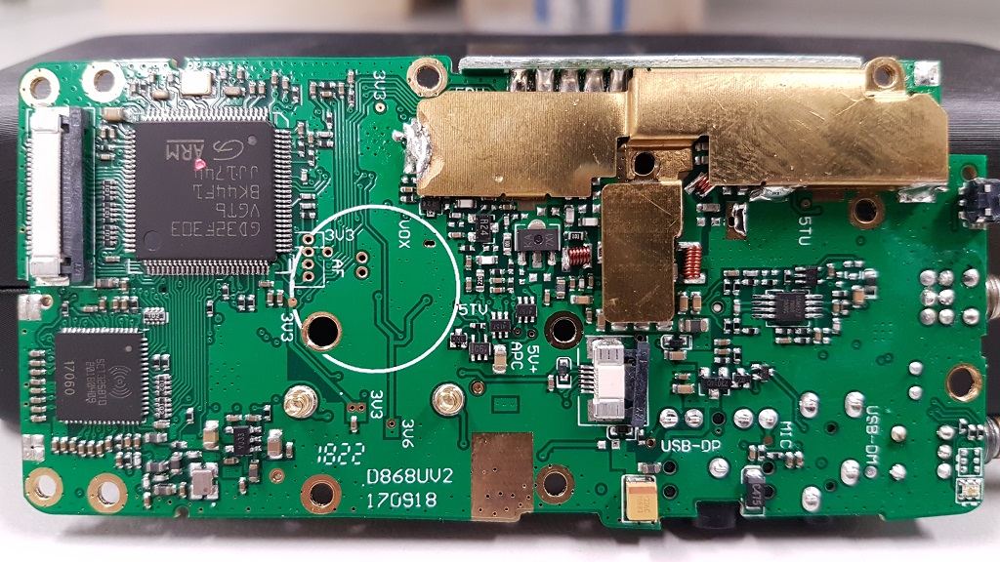
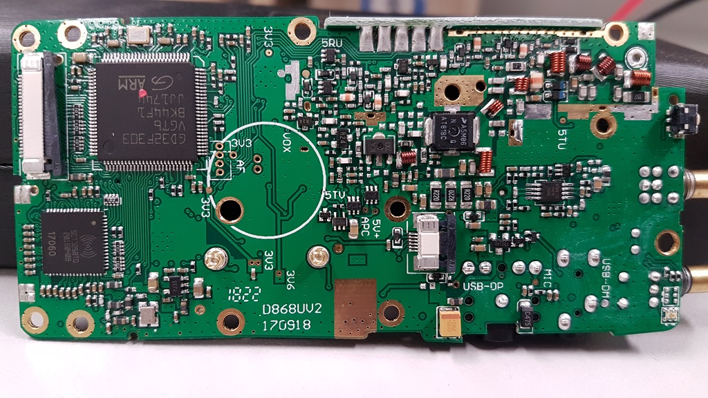
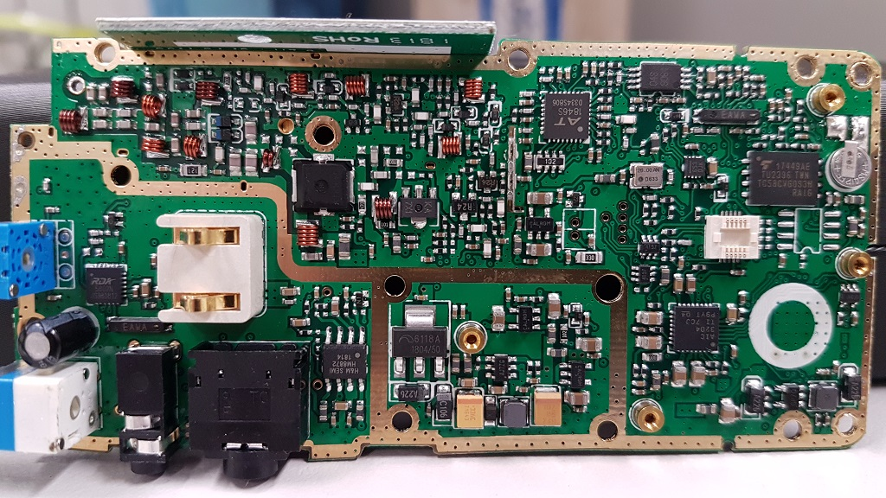
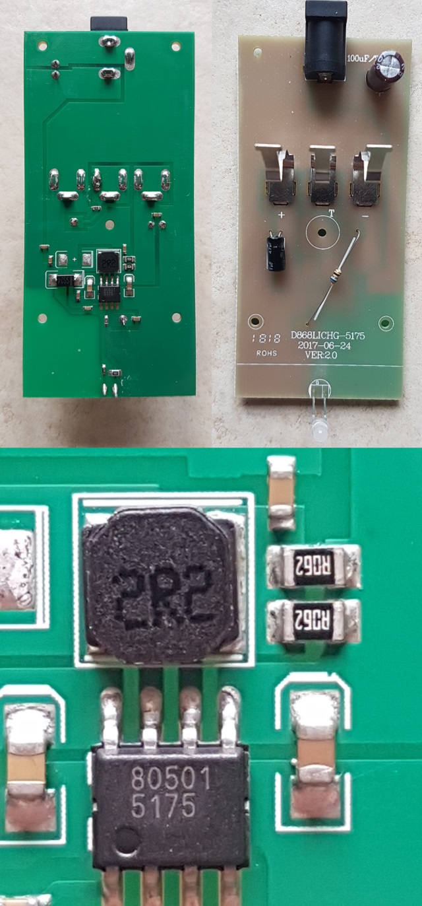

[← All 868-878 mods](index.md)

!!! note "Author: Jason Reilly VK7ZJA (silent key, January 2023)"
    © Jason Reilly 2018–2022. Jason's pages were preserved by Norman Williams on hamradiosouthernrepeaters.co.uk and are reproduced here, unchanged, so that his work stays available. They will be removed on request from his family. [Original page](https://hamradiosouthernrepeaters.co.uk/images/878Mods/878techmods.html#Inside)

**A look inside the 878**
All these photos are of a second revision 'V2' PCB which is common to the current 868 and 878 PCBs:

The back side of the GPS & LCD screen board. Ribbon cables removed for clarity. Note the mini GPS antenna to the right - it sits underneath the AnyTone badge above the display. The GPS module ATGM336H is capable of tracking GPS & BDS (BeiDou) positioning systems.

Thanks to Sergey UA3ARF, an alternate version of the GPS & LCD screen board has been identified, this one uses a Cdtech T3RV1-9600 module which is GPS only.

The 878 main board back side, with brass RF shield fitted

The 878 main board back side, with brass RF shield removed this time

The 878 main board front side

You can download high resolution pictures (7 Mb) of the above from here:

- 
- [Download via Mega](https://mega.nz/file/3kdXyKDK#SHNO1e3RkSM68mpO3wwk_GFNj-tcz8qGkChsJ8K-nw8)
- [Download via Google Drive](https://drive.google.com/file/d/1vz11mjm9g6T1bI3PVGQGpZLyWpPsimH8/view?usp=sharing)
- [Download via Sabercat host](https://sabercathost.com/e859/868mainboard_front_and_back_full.zip)

The 878 battery charger:

The heart of the charger is a CHK0501 lithium ion charger IC. AnyTone appear to have very recently (early 2020, charger PCB version 4) redesigned the charger base circuitry, and while it still uses the CHK0501 charger IC, it is hoped that these changes may make the charger more reliable. It's too early to say at this stage, time will tell.

------------------------------------------------------------------------
