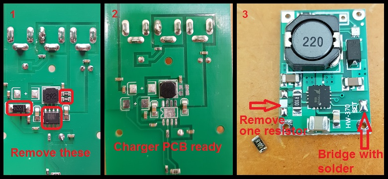
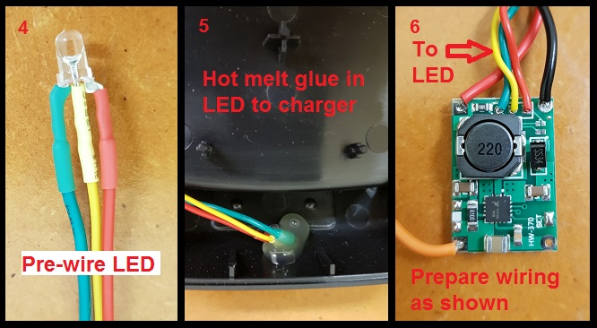
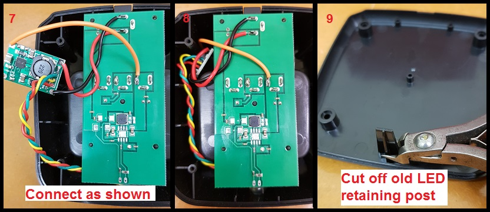
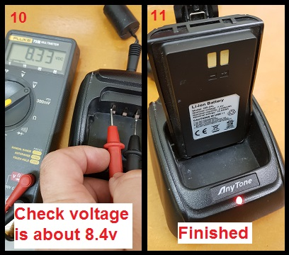

# Repairing a faulty charger base: Moderate

[← All 868-878 mods](index.md)

!!! note "Author: Jason Reilly VK7ZJA (silent key, January 2023)"
    © Jason Reilly 2018–2022. Jason's pages were preserved by Norman Williams on hamradiosouthernrepeaters.co.uk and are reproduced here, with light formatting and spelling edits for readability, so that his work stays available. They will be removed on request from his family. [Original page](https://hamradiosouthernrepeaters.co.uk/images/878Mods/878techmods.html#ChargerFix)

In normal use the AnyTone charger base, model QBC-45L, has been subject to a higher than desirable failure rate. Sometimes the failure has been spectacular with audible pops and melting of the plastic casing, or sometimes as simple as the LED alternately flashing red-green and not charging the battery.

!!! note
    AnyTone appear to have very recently (early 2020, charger PCB version 4) redesigned the charger base circuitry, and while it still uses the CHK0501 charger IC, it does appear to have improved the reliability of the charger hardware.

This can be fixed by replacing the charging circuitry with a TP5100 li-ion battery charging module that can be bought very cheaply on eBay for as little as one dollar! The TP5100 has proven itself to be flexible, easy to use and most importantly reliable.

## You will need

- A TP5100 li-ion battery charging module.
- A *common anode* bi-colour LED. Be careful here, as most bi-colour LEDs are common *cathode*, the TP5100 is designed to work with a common *anode* LED. The original LED from the AnyTone charger can't be re-used.
- Some short lengths of flexible hook up wire.

## Steps 1 to 3: prepare the PCBs

Begin by removing four components off the faulty AnyTone charger PCB as shown in step 1 & 2.

- If you don't have any SMD rework tools, an easy way to do this is to use a pair of fine, sharp pointed cutters to snip through the eight legs of the surface mount IC, then desolder the legs from the PCB lands so there is no contact made between the dead IC and the PCB lands.
- Optionally, you could then use a pair of needle nose pliers to carefully twist the IC body off the PCB.
- Also make use of the same sharp pointed cutters to chomp through the diode and desolder the remains of it.
- The resistors are best removed by adding some quite substantial blobs of solder to both ends of each resistor, then 'laying' your soldering iron tip across the resistor and solder blobs so that both ends are heated at the same time, then quickly move the resistor off its PCB lands.
- The TP5100 PCB also needs some changes: solder bridge the SET lands, and remove one of the current limiting resistors as shown in step 3.

## Steps 4 to 6: LED and wiring

Pre-wire your common anode LED as per step 4, then use some hot melt glue to fix the LED in to the charger base where the old LED would have gone. Prepare some wiring on the new TP5100 PCB as shown in step 6.

## Step 7: connect and fit

Connect the wires from the new TP5100 charger module onto the points shown on the AnyTone charger PCB as per step 7. Optionally, you can also remove the small surface mount LED off the TP5100 PCB as you won't see it inside the case. Then tuck the TP5100 module down one side of the charger. Cut off the old LED retaining post on the bottom half of the AnyTone charger case.

## Reassemble and test

Reassemble the AnyTone charger and use a multimeter to confirm the output voltage is around 8.3 to 8.4 volts (it will pulse up and down – this is the charger in its trickle charge mode and is normal) and is of the correct polarity. You are done!

You will find that in the newest versions of the TP5100 li-ion charger module, with no battery inserted to the charger, the charging indicator LED will be green with an occasional brief flicker of red. That is normal. The TP5100 module can handle input voltages up to 15 volts, so connecting it to your shack 13.8 volt power supply is no problem at all for it.
