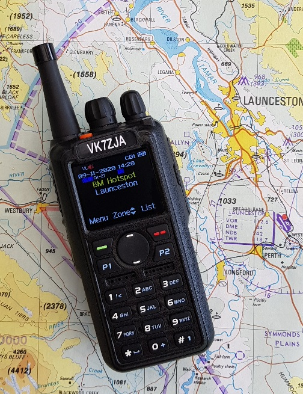

# AnyTone 868-878 mods, hints & tips

!!! note "Author: Jason Reilly VK7ZJA (silent key, January 2023)"
    © Jason Reilly 2018–2022. Jason's pages were preserved by Norman Williams on hamradiosouthernrepeaters.co.uk and are reproduced here, unchanged, so that his work stays available. They will be removed on request from his family. [Original page](https://hamradiosouthernrepeaters.co.uk/images/878Mods/878techmods.html)

This is a back up of Jason's work (VK7ZJA), who passed away in January 2023.
The page will not be updated and some links might not work.

**Modifications, hints, tips and technical information for the
AnyTone AT-D878UV
AnyTone AT-D878UV-II
AnyTone AT-D868UV
and
BTech DMR-6X2\**

**(Some relevance to Alinco DJ-MD5 & Radioddity GD-AT10G too)**

**dual band DMR digital handheld radio**

------------------------------------------------------------------------

 

**Version 20.0 --- 20 October 2022**

**Updates made since the previous version are shown in this purple colour**

------------------------------------------------------------------------

**This information is primarily intended for amateur 'ham' radio operators who wish to maintain and adjust their AT-D878UV, AT-D878UV-II, AT-D868UV or DMR-6X2. Any regulatory authority approval (e.g. FCC certification) may become invalid by the use of this information. Users should always ensure that they and their radios are operating in accordance with their licence conditions. Many of these mods may also invalidate any manufacturer warranty you may have. In any case, the user alone accepts all responsibility and risk from the use of this information and tools provided here.**

------------------------------------------------------------------------

**General warnings to all users:\**

**Codeplug version, CPS programming software version and firmware version present in the radio must all match in version number. If not, very strange things happen. You must [REBUILD](81-prevent.md) your codeplug every time a new CPS or firmware version is installed. This keeps the underlying data sent to the radio consistent in version.**

**For the same reason above, I would caution anyone from sharing and using other people's codeplugs. While it might be convenient, you can't be guaranteed what version the shared codeplug was built under, and therefore whether it would work properly under the firmware version installed in your radio. You just can't tell, the CPS won't tell you unless it is a very early version codeplug. Save yourself a lot of headaches and [REBUILD](81-prevent.md) the codeplug before writing it to your radio.**

Be very careful not to accidentally hit the PTT (Push to Talk) button while you have the USB cable plugged in to the radio, or while it is sitting in the charger. Doing so can cause RF to be picked up by the USB cable or charger, and cause damage to the hardware - both radio and charger. This has happened to some unfortunate 878 owners previously.

Don't have the USB cable inserted when you have any channel that may autonomously transmit, such as APRS, roaming or lone worker feature is active (credit to Jerry Kuhn)

Keep the radio 1 foot away from your cellular / mobile phone, cordless phone and Wi-Fi devices at ALL times.

Use caution if writing non standard data to the radio in some of the advanced modifications listed below. It is possible to cause the radio to cease functioning correctly if instructions are not carried out with care.

------------------------------------------------------------------------

**Page index:**

- [Introduction
  ](01-introduction.md)
  
- [**Band Error and five ways you can fix it**
  ](02-band-error.md)
  
- [**Help! I can't change zones any more!**
  ](03-zone-hide.md)
  
- [Are the AnyTone AT-D878UV and Btech DMR-6X2 really the same radio?
  ](04-same.md)
  
- [What are the differences between the AnyTone AT-D868UV, AT-D878UV and AT-D878UV-II?
  ](05-differences.md)
  
- [So can you upgrade an AT-D868UV or Btech DMR-6X2 to an AT-D878UV?
  ](06-878upgrade.md)
  
- [Can you upgrade an 878 to an 878-II?
  ](07-878-iiupgrade.md)
  
- [Similarities between Alinco DJ-MD5, Radioddity GD-AT10G and AnyTone 878?
  ](08-md5similarities.md)
  
- [Comparison of the AnyTone 868, 878, Btech 6X2 and Alinco DJ-MD5
  ](09-comparison.md)
  
- [Hint when using the programming software / CPS
  ](10-cpshint.md)
  
- [Virus detected! Is the CPS software really safe to use?
  ](11-cpsvirus.md)
  
- [Hints & tips for upgrading firmware
  ](12-fwupgrade.md)
  
- [Trouble getting the drivers to install or work properly on Win 7 or 10
  ](13-driver-trouble.md)
  
- [Strange error messages and what you can do to fix them ---](14-error-messages.md) [Band Error has it's own section, click here](02-band-error.md)
- [A website with lots of great hints & tips for the AnyTone DMR radio family
  ](15-webhints.md)
  
- [Looking for a guide on how to setup APRS? This website shows you how
  ](16-aprssetup.md)
  
- [Hint for being able to recall and dial Private Call IDs
  ](17-private-idrecall-hint.md)
  
- [How to reply on an active channel found while scanning
  ](18-talkback-hint.md)
  
- [Hint when using the radio menus
  ](19-radio-menu-hint.md)
  
- [How do I reset the radio? -or- Why won't the radio reset?
  ](20-reset.md)
  
- [Compatibility of encryption
  ](21-encryption.md)
  
- [Cross compatibility of accessories Updated: more compatible programming cables discovered
  ](22-compatibility.md)
  
- [Need a spare battery for your AnyTone AT-D868UV, AT-D878UV or BTech DMR-6X2?
  ](23-spare-battery.md)
  
- [Battery meter & how it relates to actual battery life remaining
  ](24-battery-meter.md)
  
- [Tips for extending the life of your battery
  ](25-battery-tips.md)
  
- [Differences in battery sizes
  ](26-battery-sizes.md)
  
- [Custom engraved call sign labels for your radio.
  ](27-custom-labels.md)
  
- [A DIY 3D printed custom desk stand
  ](28-stand.md)
  
- [Custom background display files
  ](29-backgrounds.md)
  
- [Guide to the icons & what they mean (updated)
  ](30-icons.md)
  
- [Alternate GPS icons to download (878 only)
  ](31-gpsicons.md)
  
- [Hint when using 'enhanced microphone audio'
  ](32-enhanced-mic.md)
  
- [Make your radio sound like a Motorola and other fun tone sequences to play with (updated)
  ](33-tptchirp.md)
  
- [Using the address book to dial EchoLink nodes
  ](34-echolink.md)
  
- [868 / 878 / 6X2 programming cable pin out Updated: label your programming cable!
  ](35-prog-cable.md)
  
- [Known button held during power up sequences
  ](36-power-up-sequences.md)
  
- [Selecting operational bands
  ](37-selecting-bands.md)
  
- [New knobs for the 878
  ](38-new-knobs.md)
  
- [Antennae for the 868 / 878 / 6X2
  ](39-antennae.md)
  
- [Screen scratch protection
  ](40-screen-protect.md)
  
- [Protective carry case options for 868 / 878 / 6X2
  ](41-case.md)
  
- [Using a car drink holder for the 868 / 878 / 6X2
  ](42-holder.md)
  
- [DIY Headphone adaptor
  ](43-headphone.md)
  
- [Hint when using a Bluetooth earpiece
  ](44-earpiece.md)
  
- [How to control playback of recordings using PC software
  ](45-record.md)
  
- [Modifying the Radioddity GD-77 or TYT MD-390 or Retevis RT3 charger for the 878
  ](46-use-other-charger.md)
  
- [How to disassemble the radio / fitting the new Bluetooth module
  ](47-disassemble.md)
  
- [Improving top mounted LED visibility
  ](48-led.md)
  
- [Expanding RX frequencies New: modified AnyTone 878 firmware version 1.27, modified 878-II firmware version 2.05, modified 868 firmware version 2.40, modified Alinco DJ-MD5 firmware version 1.13e and Alinco DJ-MD5X firmware version 1.11 now available to download
  ](49-expand-rx.md)
  
- [AnyTone 868 or 878 or Btech 6X2 on VHF air band?
  ](50-airband.md)
  
- [What about 220 MHz, could the 868 / 878 be used on the 1.25 metre band?
  ](51-220mhz.md)
  
- [Sensitivity plots
  ](52-sensitivity.md)
  
- [I heard VHF was deaf on the 878. Is that true?
  ](53-vhfdeaf.md)
  
- [Can the 878 be used as a scanner?
  ](54-scanner.md)
  
- [My receive keeps cutting in and out on FM, can that be fixed? (updated)
  ](55-popping.md)
  
- [Introduction to hex editing
  ](56-hex-intro.md)
  
- [Theory behind the frequency expansion mod
  ](57-theory.md)
  
- [Expanding FM band frequencies 76 to 121 MHz
  ](58-fmband.md)
  
- [Changing the display font / modifying some of the icons
  ](59-fonts.md)
  
- [Modify a speaker microphone to keep out DMR pulsed RF feedback
  ](60-microphone.md)
  
- [Swapping Btech DMR-6X2 firmware into an AnyTone AT-D878UV
  ](61-swap-fw.md)
  
- [Obtaining faster GPS lock for the 868
  ](62-faster-gps.md)
  
- [Much faster GPS lock for the 878, 868 & 6X2
  ](63-even-faster-gps.md)
  
- [Enabling full test / self adjustment mode
  ](64-full-test-mode.md)
  
- [AnyTone Options software download New: AT Options version 8 now available, supporting 868, 878, 878-II, 578 of all flavours and Alinco DJ-MD5, DJ-MD5X, DR-MD500 & DR-MD520
  ](65-atoptions.md)
  
- [Resetting your power on password (updated)
  ](66-lost-password.md)
  
- [Programming password lock
  ](67-password.md)
  
- [Resolving received noise / perceived poor VHF sensitivity issues (improved shielding)
  ](68-noise.md)
  
- [FCC Part 90 approval information
  ](69-fcc.md)
  
- [A look inside the 878
  ](70-inside.md)
  
- [Repairing a faulty charger base
  ](71-charger-fix.md)
  
- [Bugs on the 868 & 878
  ](72-bugs.md)
  
- [Hardware faults with the 868 / 878 / 6X2
  ](73-hwfault.md)
  
- [General technical information
  ](74-gen-tech.md)
  
- [Flash memory structure in the 868 / 6X2 / 878
  ](75-flash-mem.md)
  
- [Flash Utility software
  ](76-flash-utility.md)
  
- [Backing up or restoring vital alignment & configuration data of your radio
  ](77-backup.md)
  
- [Writing your own .CDD files
  ](78-cdd.md)
  
- [Fix a frozen or stuck during boot up 868 / 878 / 6X2 / DJ-MD5 / DJ-MD5X
  ](79-frozen.md)
  
- [Preventing your radio from freezing or locking up & also cures many problems
  ](81-prevent.md)
  
- [French text help file for 878 (updated for v1.26)
  ](82-other-help-languages.md)
  
- [Updating the SCT3258 baseband / DMR codec firmware Updated: includes latest version V2.01.07BF
  ](83-baseband.md)
  
- [Future developments & ideas
  ](84-future.md)
  

------------------------------------------------------------------------

## Sections

- [Introduction](01-introduction.md)
- [Band Error and five ways you can fix it](02-band-error.md)
- [Help! I can not change zones any more!](03-zone-hide.md)
- [Are the AnyTone AT-D878UV and Btech DMR-6X2 really the same radio?](04-same.md)
- [What are the differences between the AnyTone AT-D868UV, AT-D878UV & AT-D878UV-II?](05-differences.md)
- [So can you upgrade an AT-D868UV or Btech DMR-6X2 to an AT-D878UV? Advanced](06-878upgrade.md)
- [Can you upgrade an 878 to an 878-II SUPER Advanced](07-878-iiupgrade.md)
- [Similarities between Alinco DJ-MD5, Radioddity GD-AT10G and AnyTone 878?](08-md5similarities.md)
- [Comparison of the AnyTone 868, 878, Btech 6X2 and Alinco DJ-MD5](09-comparison.md)
- [Hint when using the programming software / CPS](10-cpshint.md)
- [Virus detected! Is the CPS programming software really safe to use?](11-cpsvirus.md)
- [Hints & tips for upgrading firmware](12-fwupgrade.md)
- [Trouble getting the drivers to install or work properly on Win 7 or 10](13-driver-trouble.md)
- [Strange error messages](14-error-messages.md)
- [A website with lots of great hints & tips for the AnyTone DMR radio family](15-webhints.md)
- [Looking for a guide on how to setup APRS? This website shows you how](16-aprssetup.md)
- [Hint for being able to recall and dial Private Call IDs](17-private-idrecall-hint.md)
- [How to reply on an active channel found while scanning](18-talkback-hint.md)
- [Hint when using the radio menus](19-radio-menu-hint.md)
- [How do I reset the radio? -or- Why won't the radio reset?](20-reset.md)
- [Compatibility of encryption](21-encryption.md)
- [Cross compatibility of accessories for the AT-D878UV](22-compatibility.md)
- [Need a spare battery for your AnyTone AT-D868UV, AT-D878UV or BTech DMR-6X2?](23-spare-battery.md)
- [Battery meter & how it relates to actual battery life remaining](24-battery-meter.md)
- [Tips for extending battery life](25-battery-tips.md)
- [Differences in battery sizes](26-battery-sizes.md)
- [Custom engraved call sign labels for your radio](27-custom-labels.md)
- [3D printed desk stand](28-stand.md)
- [Custom background display files for your AT-D878UV](29-backgrounds.md)
- [Guide to the icons & what they mean](30-icons.md)
- [Alternate GPS icons to download (878 only)](31-gpsicons.md)
- [Hint when using 'enhanced microphone audio'](32-enhanced-mic.md)
- [Make your radio sound like a Motorola and other fun tone sequences to play with](33-tptchirp.md)
- [Using the address book to dial EchoLink nodes](34-echolink.md)
- [868 / 878 / 6X2 programming cable pin out](35-prog-cable.md)
- [Known button held during power up sequences](36-power-up-sequences.md)
- [Selecting operational bands](37-selecting-bands.md)
- [New knobs for the 878. Easy](38-new-knobs.md)
- [Antennae for the 868 / 878 / 6X2](39-antennae.md)
- [Screen scratch protection. Easy](40-screen-protect.md)
- [Protective carry case for 868 / 878 / 6X2](41-case.md)
- [Using a car drink holder for the 868 / 878 / 6X2](42-holder.md)
- [DIY Headphone adaptor. Easy](43-headphone.md)
- [Hint when using a Bluetooth earpiece](44-earpiece.md)
- [How to control playback of recordings using PC software. Easy](45-record.md)
- [Modifying the Radioddity GD-77 or TYT MD-390 or Retevis RT3 charger for the 878. Easy](46-use-other-charger.md)
- [How to disassemble the radio / fitting the new Bluetooth module Moderate](47-disassemble.md)
- [Improving top mounted LED visibility Moderate](48-led.md)
- [Expanding RX frequencies Easy](49-expand-rx.md)
- [AnyTone 868 or 878 or Btech 6X2 or DJ-MD5 on VHF air band? You'll notice that this mod wil](50-airband.md)
- [What about 220 MHz, could the 868 / 878 / 6X2 / DJ-MD5 / DJ-MD5X be used on the 1.25 metre](51-220mhz.md)
- [Refer to the sensitivity plots below](52-sensitivity.md)
- [I heard VHF was deaf on the 878. Is that true?](53-vhfdeaf.md)
- [Can the 878 be used as a scanner?](54-scanner.md)
- [My receive keeps cutting in and out on FM, can that be fixed?](55-popping.md)
- [Introduction to hex editing. Moderate](56-hex-intro.md)
- [Theory behind the frequency expansion mod. Advanced](57-theory.md)
- [Expanding FM band frequencies 76 to 121 MHz Easy](58-fmband.md)
- [Changing the display font / modifying some of the icons Advanced](59-fonts.md)
- [Modify a speaker microphone to keep out DMR pulsed RF feedback. Moderate](60-microphone.md)
- [Swapping Btech DMR-6X2 firmware into an AnyTone AT-D878UV Moderate](61-swap-fw.md)
- [Obtaining faster GPS lock for 868 Moderate](62-faster-gps.md)
- [Much faster GPS lock for the 878, 868 & 6X2 Advanced](63-even-faster-gps.md)
- [Enabling full test / self adjustment mode Advanced](64-full-test-mode.md)
- [Colin G4EML has created an application called AT Options, which will allow you to enable t](65-atoptions.md)
- [Resetting your power on password Easy](66-lost-password.md)
- [Programming password lock Easy](67-password.md)
- [Resolving received noise / perceived poor VHF sensitivity issues Easy to Advanced](68-noise.md)
- [FCC Part 90 approval information](69-fcc.md)
- [A look inside the 878](70-inside.md)
- [Repairing a faulty charger base: Moderate](71-charger-fix.md)
- [Bugs with the AT-D868UV / AT-D878UV](72-bugs.md)
- [Hardware faults with the 868 / 878 / 6X2](73-hwfault.md)
- [General technical information](74-gen-tech.md)
- [Flash memory structure in the 868 / 6X2 / 878](75-flash-mem.md)
- [Flash Utility software: Courtesy of Colin G4EML comes this small utility program that can ](76-flash-utility.md)
- [Backing up or restoring vital alignment & configuration data of your 878 / 868 / 6X2 (unte](77-backup.md)
- [Writing your own .CDD files Advanced](78-cdd.md)
- [Fix a frozen or stuck during boot up 868 / 878 / 6X2 / DJ-MD5X Moderate](79-frozen.md)
- [Full defroster](80-full-defrost.md)
- [Preventing your radio from freezing or locking up and how to cure many problems](81-prevent.md)
- [French text help file for 878](82-other-help-languages.md)
- [Updating the SCT3258 baseband / DMR codec firmware](83-baseband.md)
- [Future developments & ideas](84-future.md)
