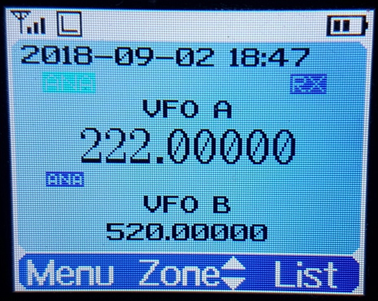
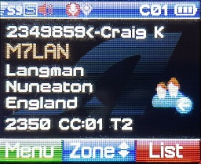

# Expanding RX frequencies

!!! info "Source"
    Originally published by Norman Williams on hamradiosouthernrepeaters.co.uk. [Source](https://hamradiosouthernrepeaters.co.uk/20-expanding-rx-frequencies.html) Hub item 12b, 56, 58.

This is a back-up and edited version of Jason's work (VK7ZJA), who passed away in January 2023.

**Difficulty:** Easy · *Suitable for 878 / 878-II / 578*

As delivered by the factory, the 868 covers 136-174 MHz and 400-480 MHz and the 878 covers up to 520 MHz. There are countries around the world that make use of the radio spectrum above 480 MHz for two way radio, and this modification will allow you to hear those transmissions. TX is intentionally inhibited in these expanded areas.

!!! note
    The modification only opens up the radio hardware; some tricks are still necessary to program out of band frequencies with the software.

At the heart of the 878 is an AT1846S ’radio-on-a-chip’ that is designed to work from 134-174 MHz, 400-520 MHz and \*200-260 MHz. In practice, the chip will cover even more than that, as you will soon see.

## Carrying out the modification

To carry out this modification do the following:

1. Download the **frequency expanded modified firmware package**, which contains firmware packages for all models 878 / 878-II / 578, from: [Download](https://my.hidrive.com/share/pct1kt-nc2) *and Modded firmware by Joachim, DL6EK*
2. Unzip the package, and look for your model radio in the folders.
3. Make sure you have saved your codeplug (rdt) configuration file.
4. Using the regular firmware updating software & process, send this frequency expanded firmware to the radio.
5. If necessary, update your codeplug / rdt configuration file to be compatible with the version of firmware you have downloaded. If you want to reuse your saved codeplug rdt configuration file, you may need to modify one byte with a hex editor as detailed below in italics.
6. Enjoy actual extra receive frequency coverage of around 120-527 MHz (with a gap between 290-370 MHz on the 878; the 578s start at 110 MHz).
7. The "mod + font" version comes with the RX Extension and a better readable fontset.

Your mileage may vary of course, due to individual radio & component manufacturing tolerances. You can use the VFO and add memory channels to use these new expanded receive frequency ranges.

Sometimes, you can’t enter frequencies via keypad direct entry that start with a 2, 3 or 5 (e.g. any frequency in the 200, 300 or 500 MHz range); the only way to get to them is via lots of knob twisting in VFO mode or use the up/down buttons to tune in 1 MHz steps.

## Entering out of band frequencies in the CPS

To enter out of band frequencies in the CPS programming software, you will need to use the export-edit-import method:

1. Program some dummy channels with valid but easy to recognise frequencies, for example 456 MHz.
2. Use the export feature (**Tool → Export → Channel →** give it a name **→ Export**) and save your exported channels.
3. Open the exported channels file with a text editor - look for your dummy channels you had previously entered, and edit the frequencies as you require, and save the file.
4. Back in the CPS software, use the import feature (**Tool → Import → Channel →** find your edited csv file **→ Import**) to bring the channels with out of band edited frequencies into the radio.

## But how do we know it is actually working?

How do we know it is actually working, not just displaying a frequency and nothing else? Conveniently, the 878 has a quirk that will tell you if the receiver is ’unlocked’ and not working at that frequency: program a button as FM monitor, or turn the squelch level to off.

- If the radio makes a pulsing or popping noise, the receiver is unlocked and is too far out of band to work.
- If you hear a constant rush of noise, that indicates the receiver is locked and is working as well as it can do.

If you have a signal generator, you can test that the 878 is actually receiving this signal, or you can use an off air signal to confirm reception is working.

*Transmit remains standard according to each MODE.* Typically, the receiver locks and actually works around 130-178 MHz, 195-290 MHz (with a gap between 200-210 MHz on 868 / 6X2) and 390-527 MHz, though note that frequencies between 210-400 MHz vary in sensitivity quite a bit.

## Alternate font

Also included with the frequency expanded firmware package is an alternate font which can be a bit easier to see than the original. Here is an example of what the new alternate font looks like if you are interested.

## AnyTone 878 on VHF air band?

You’ll notice that this mod will permit coverage of some of the VHF air band. So how well does the radio receive here? Not perfectly, since this is strictly an FM & DMR receiver and air band signals are AM. But if you select narrow bandwidth FM and tune off frequency by 2.5 kHz, stronger AM air band signals can be resolved, with some distortion. Take a look at this YouTube video for an example:

<https://youtu.be/_F1i_tmPepU>

## \*200-260 MHz

!!! warning
    Unless you have a 578 Tri Band radio that offers 220, you CAN NOT TX on 220. [Read this post](868-878/51-220mhz.md).

## See also

- [Expanding RX frequencies (AT-D868UV/878UV mods)](868-878/49-expand-rx.md)
- [Expanding RX frequencies (AT-D578UV mods)](578/31-expand-rx.md)
