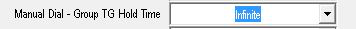

# Anytone FreeDMR

!!! info "Source"
    Originally published by Norman Williams on hamradiosouthernrepeaters.co.uk. [Original PDF](../originals/images/Anytone/Anytone_FreeDMR.pdf) · [Source](https://hamradiosouthernrepeaters.co.uk/images/Anytone/Anytone_FreeDMR.pdf) Hub item 147.

Two ways to use an Anytone Radio on FreeDMR without adding Talk Groups as Channels.

## 1. Manual Dial Talk Groups Direct.

**CPS → Optional Settings → Digital Fun**

Set your hang time to 30mins in this section.

*Manual Dial - Group TG Hold Time = 30min.*

**Now via the Radio -**

**Go to ANY channel for your HotSpot or Local Repeater on the FreeDMR Network.
This can be Slot 1 or Slot 2.**

Long Press **0** key – Display will show **Private ID**
Press **#** key – Display will show **Talk Group ID**

**Type in the Talk Group you want to use – 2350**
PTT for 3 sec.

You are now on Talk Group 2350

The radio will stay on that Talk Group for 30 mins from your last PTT.
After 30mins it will default back to the Talk Group of the Chanel you started with.

You can link to any Talk Group as described above.

\*\* You could set the hang time to Infinite. But I would not recommend this. \*\*

*Manual Dial - Group TG Hold Time = Infinite.*

**OR this way**

## 2. Dail-a-TG on FreeDMR

<http://www.freedmr.uk/index.php/linking-to-talk-groups-via-tg9/>

**CPS → Optional Settings → Digital Fun**

Set your hang time to 3sec in this section.

*Manual Dial - Private TG Hold Time = 3s.*

**CPS make a channel.**

Add 9 in Contact/Talk group as **GROUP CALL.**

Make a Channel up for Talk Group 9 on Slot 2 and then add to a Zone you wish to use it in.
This is the only Talk group you will need for a QSO on Dial-a-TG.

**Now via the Radio -**

**Go to channel TG9 on Slot 2 for your HotSpot or Local Repeater on FreeDMR Network.**

Long Press **0** key – Display will show **Private ID**

**Type in the Talk Group you want to use – 2350**
PTT for 3 sec.

The repeater/hotspot will respond with a voice announcement “Linked to 2350.“
“Voice announcements come back on 5000.”

Then via Talk Group 9 you can QSO on that Talk Group.
You can link to any Talk Group as described above.

## 4000 Unlink

FreeDMR you can move to a new Talk Group without doing a 4000.
PTT for up to 3 seconds on the new Talk Group you wish to use.
Now you can TX and RX in that Talk Group.

**Via TG9 Slot 2 Enhanced Talk Groups Dial-a-TG.**

Manual Dial **4000 Private Call** transmit for up to 3 sec.
The repeater / hotspot will respond with a voice announcement “Not Linked”.
**You can move to a new Talk Group without doing a 4000. Just call the next Talk Group and PTT for up to 3 sec.**
Would be recommended to make a 4000 unlink channel. Add 4000 as a Private call to the radio. Set TG9 in the RX Group. Now when you get a GAP in RX you can PTT and unlink.

<http://www.freedmr.uk>
