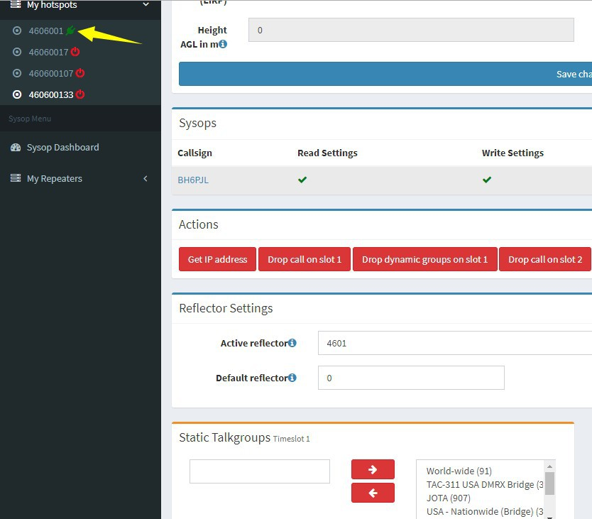
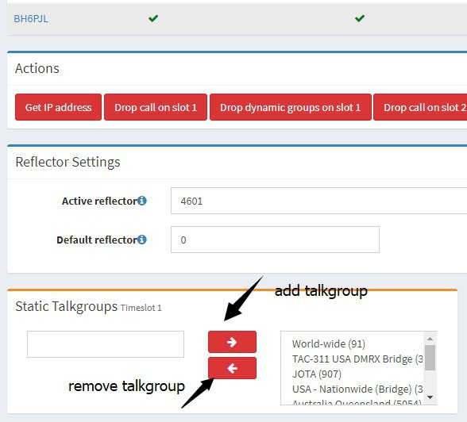
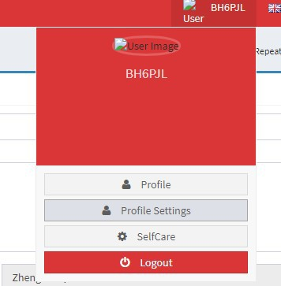
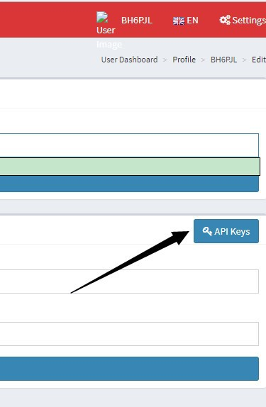
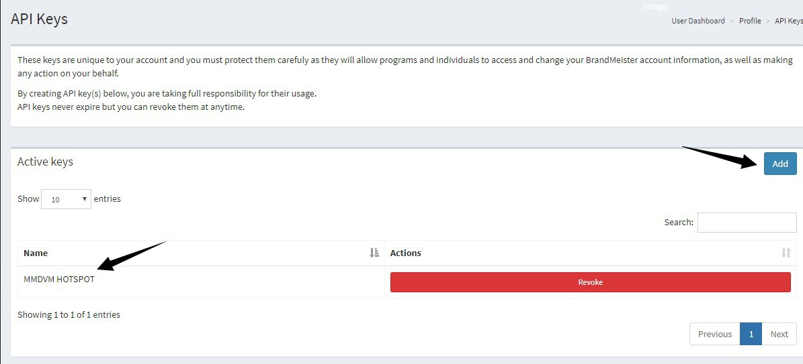
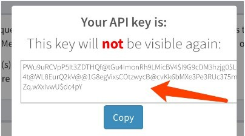
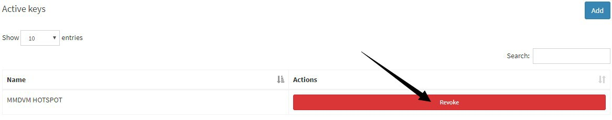
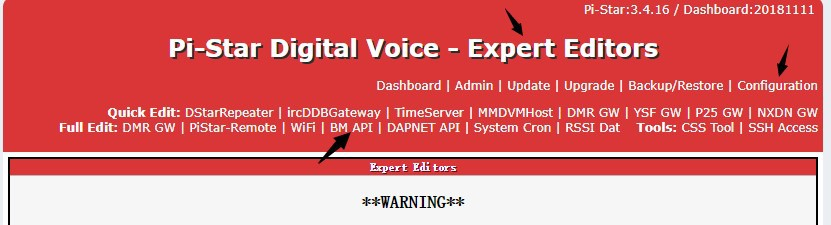
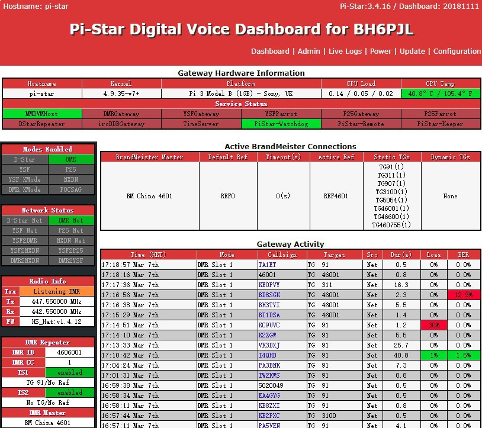

# Dynamic and Static Talkgroups on Brandmeister v2

!!! info "Source"
    Originally published by Norman Williams on hamradiosouthernrepeaters.co.uk. [Original PDF](../originals/images/PDF/Dynamic_Talkgroup_and_Static_Talkgroup_on_Brandmeister.pdf) · [Source](https://hamradiosouthernrepeaters.co.uk/images/PDF/Dynamic_Talkgroup_and_Static_Talkgroup_on_Brandmeister.pdf) Hub item E.

## Talk group types

The talk group on Brandmeister is divided into the following three types:

### Repeaters and Duplex Hotspot

1. **Dynamic Talkgroup:** Dynamic group must press PTT into, dynamic group is also known as temporary group, you can enter multiple dynamic groups at the same time, and the last dynamic group which you continuous listening can keep 15 minutes until exit automatically.
2. **Static Talkgroup:** Do not need press PTT, open your hot spot can listen to the group, you can set one to more static groups.
3. **Automatic static group:** When there is no static group, the last dynamic group used is set to automatic static group until the PTT is switched to another talkgroup, and when the talkgroup is switched, the previous automatic static talkgroup becomes a dynamic group and retains 15 minutes, and the last group becomes an automatic static group, and its effect is equivalent to a static group (but only one).

### Simplex Hotspots

Same as above, but does not drop the talkgroup at 15mins.

## Unlinking with 4000

When moving from a Reflector or Talkgroup to another, you should do a 4000 unlink.

| Call 4000 as | Disconnects |
|---|---|
| Private Call | ONLY Reflectors (Hytera and Moto Repeaters) |
| Group Call | Reflectors and Talk Groups (Hotspots and Repeaters Slot 1) |

4000 will not disconnect Static Talk Groups.

## Managing Brandmeister talk groups

There are two ways to manage Brandmeister talk groups.

### Manage the talk groups on Brandmeister website

Sign up and sign in to <https://brandmeister.network> and find your hotspot on the left, as shown in the figure:

*Actions: Get IP address, Drop call on slot 1, Drop dynamic groups on slot 1, Drop call on slot 2. Reflector Settings: Active reflector = 4601, Default reflector = 0.*

On the right side of this page find the static talkgroups, here can be add groups and remove groups.

Click drop dynamic groups can clear all dynamic groups, which is equivalent to a group call 4000 on the radio.

### Manage BM Talk groups on the Pi-star

This is new feature which added to pi-star v3.4.11. At the same time, Brandmeister also release the API keys interface, Pi-star use this interface to achieve direct management of the talk group function, so no longer need to log in Brandmeister website. It is very convenient to use.

#### 1. Generate API Key

1. Login your Brandmeister, click "profile settings" on the top right corner.

    

2. Click the "API keys" in the setting page.

    

3. Click the Add button and enter any name.

    

4. Copy the key out after it build succeeds.

    !!! warning
        Note that the page is displayed only one time, and if there is no copy, you have to regenerate the key.

    

If the key is accidentally leaked, you want to delete (void) the key, you can click the Revoke button.

#### 2. Key configuration in Pi-star

Go to **Configuration → Expert → BM API keys**, fill in the key you just copied and save it.

Then you can view and manage the talk groups informations in the pi-star Admin page.

*Active BrandMeister Connections: BM China 4601, Active Ref REF4601, Static TGs TG91, TG311, TG907, TG3100, TG5054, TG46001, TG46600, TG460755; Dynamic TGs = None.*

## See also

- [Linking to Gateway Dynamic Talk Groups V10](linking-to-gateway-dynamic-talk-groups.md)
